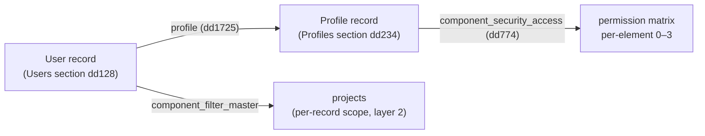

# Users, profiles and permissions

## Introduction

Access control in Dédalo answers two separate questions for every request:
*"who are you?"* (**authentication**) and *"what may you do?"*
(**authorization**). The two are handled by two different classes and this guide
ties them together into the everyday administration workflow: how to create a
user, how a profile turns into a per-element permission map, and how those
permissions are computed and enforced on every read and save.

This is a **workflow** page. The exact mechanics live in the reference docs and
are not repeated here at length — read them alongside this guide:

- [security](../core/system/security.md) — the authorization core (resolves and enforces the 0–3 levels).
- [login](../core/system/login.md) — authentication: credentials, session, the users section.
- [component_security_access](../core/components/component_security_access.md) — the stored per-profile permission matrix.
- [API gate](../core/system/api.md) — where the login check, CSRF and permission gates run at the request boundary.

The mechanics below live in `src/core/security/permissions.ts` (the matrix +
`getPermissions`), `src/core/security/auth.ts` (login, Argon2id via
`Bun.password`) and `src/core/security/session_store.ts` (session
issuance/rotation).

!!! note "The Dédalo way: no bespoke tables"
    There is no `users` table and no `permissions` table. Users are ordinary
    records in the **Users** section, profiles are ordinary records in the
    **Profiles** section, and a profile's permission map is an ordinary
    component datum. Everything is versioned in Time Machine, importable and
    propagable like any other data.

## The four permission levels

A permission is a single integer; a higher level always includes the lower ones.

| value | level | meaning |
| --- | --- | --- |
| `0` | no access | the element is not returned and may not be read |
| `1` | read only | read, but every write is refused |
| `2` | read / write | read and save |
| `3` | admin | full control (structure edits, debug) |

The absence of a stored row means level `0`. Rows whose value is `0` are **never
persisted** — the editor builds a full tree for the UI but strips every
`value <= 0` on save, so "no access" is simply the absence of a grant.

See [Components — Permissions](../core/components/index.md#permissions) for the
levels from a component's point of view.

## Where users and profiles live

| concept | section | tipo | notes |
| --- | --- | --- | --- |
| User | **Users** | `dd128` (`DEDALO_SECTION_USERS_TIPO`) | login name, password, active flag, profile, projects |
| Profile | **Profiles** | `dd234` | carries the `component_security_access` matrix (`dd774`) |

A user record links to a profile through its profile
component (`dd1725`), and to one or more projects through its
`component_filter_master` (`dd170`). The profile, in turn, owns the **permissions
matrix** (`component_security_access`, tipo `dd774`). When the user logs in, that
matrix is flattened into the fast lookup table that gates the rest of the
session — on the TS server this is `getPermissionsTable()` in
`src/core/security/permissions.ts`, cached per `user_id` in a module `Map`
(see the cache warning below).



The super-user **root** (`section_id = -1`) is outside this model: it is always a
global admin, bypasses the profile/projects checks, and cannot be managed from
the web interface (see [root user](index.md#root-user) and
[changing the root password](#changing-the-root-password)).

### Two roles above the profile

Two flags promote a user beyond their profile's grants. They are stored on the
user record and read back from the session for the current user:

- **Global admin** (`dd244`) — bypasses
  the per-record project scope and unlocks the admin-only surfaces (the
  Maintenance area, Time Machine reads, structural operations). It does **not**
  bypass the per-element permission matrix: an admin-flagged user still resolves
  each element through their profile's grants — only the superuser `root`
  resolves level `3` everywhere. Give an admin's profile the grants you expect
  them to have. This is the "general admin" account described
  in the [management index](index.md#general-admin). It is the `isGlobalAdmin`
  flag on the request's `Principal`, resolved by `resolvePrincipal()` in
  `src/core/security/permissions.ts`.
- **Developer** (`dd515`) — grants access to
  development/structure surfaces; the `isDeveloper` flag on the same
  `Principal`.

Both, plus a profile that grants the maintenance area, are required to use the
[Maintenance panel](index.md#maintenance-panel).

## Workflow: create a profile

1. Go to the **Profiles** section (under System administration).
2. Create a new record and name it (e.g. *Cataloguer*, *Read-only reviewer*).
3. Open the **Permissions** component (`component_security_access`). It renders
   the whole ontology as an expandable tree — areas → sections → elements — with
   four radio buttons per node for the levels 0–3.
4. Set the level on each node you want to grant. Areas and sections **derive**
   their level from their children (a parent shows a level only when all its
   children share it), so you normally set leaf elements (components, buttons)
   and let the parents follow. Selecting a value propagates up the parent chain.
5. Save. Only non-zero rows are written; absent rows mean no access.

See [component_security_access](../core/components/component_security_access.md)
for the tree shape, the structural exclusions (the Admin area and its children
are never shown for permissioning), and the per-profile data format.

The `component_security_access` descriptor
(`src/core/components/component_security_access/descriptor.ts`) serves the
dd774 datum for both the editor and read/authorization purposes
(`getPermissionsTable()` in `permissions.ts`, plus the datalist resolver in
`src/core/resolve/security_access_datalist.ts`). The tree editor itself —
steps 3–4 above — lives in `client/dedalo/core/component_security_access/`.

## Workflow: create a user

1. Go to the **Users** section.
2. Create a new record and fill the login name (`dd132`) and password (`dd133`;
   min length 8 — see the gap noted below).
3. Set **Active account** (`dd131`) to *Yes* — an inactive account is refused at
   login.
4. Assign a **profile**. A user with no profile is
   refused at login (*User without profile*).
5. Assign at least one **project** (`component_filter_master`). A user with no
   project is refused at login (*User without projects*) and, at runtime, sees
   only the records inside their projects (layer-2 scope, below).
6. Optionally promote to global admin and/or developer (above).

!!! warning "Gap: password hashing on save is not implemented"
    The `component_password` descriptor
    (`src/core/components/component_password/descriptor.ts`) is currently a
    plain string column with no save-time hashing hook — the server can only
    **verify** an existing `$argon2id$…` hash at login
    (`src/core/security/auth.ts`); it cannot **create** one through the
    ordinary Users-section save path yet. Until this is implemented, create or
    reset a user's password by setting the hash directly in SQL, the way
    [changing the root password](#changing-the-root-password) describes for
    root — the same `matrix_users` row, the same `dd133` component, keyed by
    that user's `section_id`.

!!! note "Who can create whom"
    Per the [management index](index.md), root creates the first general admin;
    general admins can then create other admins, developers and ordinary users
    and assign their profiles/projects — but an account cannot edit its own
    admin/developer configuration.

## How permissions are computed and enforced

All authorization is resolved and enforced **server-side**, never trusting the
client. There are two independent tiers:

1. **Type / schema permission (layer 1).** *"What may this profile do with this
   section or component type?"* — resolved from the flattened permission table.
   A single function reproduces the whole decision order —
   `getPermissions(principal, parentTipo, tipo)` in
   `src/core/security/permissions.ts` — including the Time-Machine admin-only
   clamp, the superuser/tools-register/temp-preset shortcuts, the maintenance
   area block, and the public list/dd/notes read fallback. Resolves to `0` when
   not logged in.
2. **Per-record / project scope (layer 2).** *"Is this specific record inside the
   user's project scope?"* — `getUserProjects(userId)` (same file) resolves the
   user's `dd170` project locators, and `src/core/search/sql_assembler.ts`
   folds them into the generated `WHERE` clause every list/search applies.

The level is resolved in one place but **checked at several chokepoints**: each
dispatch entry point calls `getPermissions`/`getUserProjects` inline at its own
gate.

- **Read** — `src/core/api/dispatch.ts` resolves a read permission (level ≥ 1)
  per action before serving it. Inside the section read
  (`src/core/section/read.ts`), each element the user holds level `0` on is
  dropped from the response entirely (context and data — its value never leaves
  the server), and every served element's context carries its **real** level.
  The client renders from that stamp: `1` draws the component read-only, `≥ 2`
  editable — so a user without a write grant never gets an editable field that
  would only fail at save time.
- **Create / save** — the save paths in `dispatch.ts` and
  `src/core/relations/save.ts` refuse when `getPermissions(...) < 2`.
- **API gates** — tool actions gate inline in `src/core/tools/security.ts`
  (project-scope check) and `dispatch.ts` (section-permission check). A failed
  gate returns the same uniform `{result:false, errors:[...]}` shape from an
  early `return` — there is no separate exception type.

The full enforcement diagram and method list are in
[security](../core/system/security.md#how-permissions-are-enforced).

!!! warning "Invalidate the cache after editing permissions"
    The permission table is cached in a single per-`user_id` module `Map`
    (`permissionsTableCache` in `permissions.ts`) — after editing a profile's
    permissions, the next request must see the new matrix. Call
    `clearPermissionsCache(userId)` (or with no argument, to clear every user)
    after a profile's dd774 data or a user's profile assignment changes; the
    companion `clearUserProjectsCache()` does the same for layer-2 project
    grants. The server is request-scoped via `AsyncLocalStorage` (see
    `engineering/REWRITE_SPEC.md`), so there is no cross-request identity bleed to
    worry about — but these two caches are long-lived across requests by
    design and still need explicit invalidation.

### The no-login allowlist

Authentication is enforced at the [API gate](../core/system/api.md) for every
action **except** a small allowlist of bootstrap and machine-to-machine
actions that must run before a session exists. That list is
`NO_LOGIN_ACTIONS` in `src/core/api/dispatch.ts`: `login`, `get_environment`,
`start`, `get_login_context`, and the ontology-/code-master reachability and manifest
actions (`get_server_ready_status`, `get_ontology_update_info`,
`get_code_update_info`) — the last three fail closed unless this install is
configured as an ontology or code server (see [Updates](updates/index.md)).

`change_lang` is deliberately **not** in the allowlist, so it requires a
logged-in session; see [Request-scoped langs](../core/system/login.md) for
why. Everything else requires a valid session
(`context.session !== null`); the action name is compared as a strict string
against the allowlist, looked up by exact key in a `Record`.

## Worked example: a read-only profile for one section

Goal: a profile that can **read** the *Archaeological objects* section (say
`rsc197`) and its fields, but cannot edit anything, and has no access to the rest.

1. **Create the profile.** Profiles section → new record → name it
   *Objects reader*.
2. **Open Permissions** (`component_security_access`) and expand the tree to the
   *Archaeological objects* section.
3. **Set the section to level `1` (read only).** Set the section node — and its
   description fields — to `1`. Because parents derive from children, set the
   leaf components to `1` and the section node follows. Leave everything outside
   that section untouched (absent = `0` = no access).
4. *(Optional)* grant `1` on linked **Thesaurus** sections so the reader can see
   the controlled terms referenced by the records, but not edit the vocabulary.
5. **Do not grant the `button_new`** of the section — without write (`2`) on the
   section the create/save path in `src/core/api/dispatch.ts` refuses new
   records anyway, and the thesaurus tree's own button-level check is
   `getPermissionsElement(sectionTipo, 'button_new', principal)` in
   `src/core/ts_object/ts_object.ts`.
6. **Save.** Only the non-zero rows persist, e.g.:

    ```json
    [
        {"id": 1, "tipo": "rsc197", "section_tipo": "rsc197", "value": 1},
        {"id": 2, "tipo": "rsc85",  "section_tipo": "rsc197", "value": 1}
    ]
    ```

7. **Assign the profile** to a user (Users section → user → profile = *Objects
   reader*), with a project so layer-2 scope is satisfied.
8. **Verify.** Log in as that user: the *Archaeological objects* records render
   read-only (the served context stamps level `1`, so the client draws values
   without inputs or tool buttons), any write is refused server-side (`< 2`),
   and other sections and ungranted components do not appear at all (`0` —
   dropped from the response, values included). The user only sees records
   inside their assigned projects.

!!! note "Programmatic grant (dev)"
    To grant a profile read+write over a list of sections *and all their
    children* in code — e.g. when generating hierarchies — call
    `setSectionPermissions()` (`src/core/security/section_permissions.ts`).
    Default level `2`, `0` accepted; it merges into the existing matrix (an
    existing `(tipo, section_tipo)` pair is updated in place, never duplicated)
    and invalidates the permissions table.

    The grant lands on the user's **profile** record (`dd234`), resolved through
    their profile-select (`dd1725`) — never on the user record. A user with no
    profile assigned cannot be granted anything: the call returns `ok:false`
    with an error rather than throwing, and callers decide whether that is
    fatal (hierarchy provisioning treats it as non-fatal).

    This is what makes a freshly provisioned hierarchy visible to the user who
    created it — see [install new hierarchies](install_new_hierarchies.md).

## Changing the root password

The Dédalo root user is the most powerful administrative account, granting complete and unrestricted access to all system data and functions. Reserve this account exclusively for critical operations like installation, system updates, maintenance procedures, and diagnostic debugging.

The root user password is established during the initial installation process and is generally intended to remain permanent. There are specific scenarios, however, that may necessitate a password change, for example, during server migration or when administrative duties are reassigned to a new administrator.

### Procedure

Ordinary users do not need this procedure: an administrator sets a new password by editing the user record in the Users section (the write engine hashes it with Argon2id on save — `src/core/section/record/save_component.ts` via `src/core/security/password_hash.ts`), and users can recover a forgotten password themselves from the login screen — see [Password recovery](password_recovery.md).

The root user is different. For security reasons it is not accessible via the Dédalo web interface, it is excluded from the self-service recovery flow, and changing its password is not exposed through the maintenance panel. Resetting root's password is therefore a manual database task, requiring:

1. Server access using the GNU/Linux account created for the Dédalo installation.
2. Privileged access to the Dédalo PostgreSQL database.

#### Steps

1. **Compute a fresh Argon2id hash**, using the same algorithm the server verifies against (`Bun.password`, no external tooling needed):

    ```ts
    console.log(await Bun.password.hash('my-new-root-password'));
    // => $argon2id$v=19$m=65536,t=2,p=1$...
    ```

2. **Write the hash into `matrix_users`.** The password component is `dd133`; root is `section_id = -1`. This overwrites the first stored item's value with the freshly computed hash (see `src/core/security/auth.ts` `findUserByUsername`, which reads `string->'dd133'->0->'value'`):

    ```sql
    UPDATE matrix_users
    SET string = jsonb_set(string, '{dd133,0,value}', '"$argon2id$v=19$m=65536,t=2,p=1$..."'::jsonb)
    WHERE section_tipo = 'dd128' AND section_id = -1;
    ```

3. **Log in as root** with the new password to confirm the change took effect.

!!! warning "Secure environment required"
    Before beginning this operation, ensure your Dédalo installation is not
    publicly accessible while you carry it out, to prevent unauthorized access
    during the password change.

## Related

- [security](../core/system/security.md) — authorization core, the 0–3 levels, the enforcement gates and caching.
- [login](../core/system/login.md) — authentication, the session `auth` block, the users section as credential store.
- [component_security_access](../core/components/component_security_access.md) — the stored per-profile permission matrix and its editor.
- [API gate](../core/system/api.md) — the request-boundary gates (login, CSRF, permission).
- [Management index](index.md) — root vs general admin, the maintenance panel, the access policy in prose.
- [Installing new hierarchies](install_new_hierarchies.md) — setting permissions on freshly created sections.
