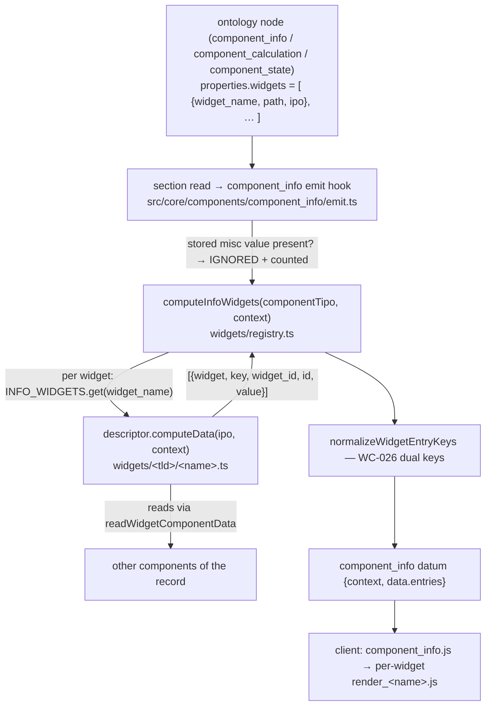

# component_info

> The **IPO** (Import–Process–Output) component: a read-only field that hosts
> one or more **widgets** which *import* data from other components, *process*
> it, and *output* the result. It computes; it does not store user input.

> See also: [widgets](../ui/widgets.md) (the framework reference) ·
> [Add a widget](../../development/extending/add_a_widget.md) (the how-to) ·
> [component_info cookbook](component_info_cookbook.md) (recipes) ·
> [Components](index.md) · [Architecture overview](../architecture_overview.md)

## Why it exists

Many catalogue screens need a synthesised, read-only panel that summarises or
links to information living **elsewhere** in the record: a strip of media-icon
shortcuts into the transcription / indexation / translation tools, a
completion-state percentage across the project languages, the descriptor
roll-up of an oral-history record, an aggregated weight/diameter statistic over
a coin archive, a computed sum of date spans. `component_info` is the building
block for all of these. It reads other components, runs each configured
widget's **IPO** formula, and presents the result — the cataloguer never edits
it directly.

!!! note "Typology — an *info* literal component"
    `component_info` is a **literal** component (`is_literal: true`) whose value
    is **computed from widgets** rather than typed by a cataloguer. It is one of
    the two *info* models (`component_inverse` is the other). Two more ontology
    models — `component_calculation` and `component_state` — **alias to
    `component_info` at runtime** (their descriptors set
    `alias: 'component_info'`), so everything on this page applies to them too.
    As the [components index](index.md#info-components) puts it: *"Info
    components need other components to calculate their own data, but the result
    is saved as direct data, so the component reads and saves like any other
    literal component."*

**When to use it**

- A dashboard-style panel that aggregates data already stored in other
  components of the section (an oral-history record's *Information* block).
- Computed read-outs that are derived, not entered: archive state, digitization
  percentage, a roll-up of descriptors across linked tapes.
- Contextual tool shortcuts (indexation / transcription / translation) computed
  against the current media.

**When *not* to use it**

- Free text the cataloguer types → [component_input_text](component_input_text.md) /
  [component_text_area](component_text_area.md).
- A pointer to another record → a relation component such as
  [component_portal](component_portal.md) / [component_select](component_select.md).
- A "who points at me" reverse listing with no per-widget computation →
  [component_inverse](component_inverse.md).
- A static numeric field → [component_number](component_number.md).

## How the pieces fit



On a section read the info **emit hook**
(`src/core/components/component_info/emit.ts`) is reached for every
`component_info` instance. The value is **always** the **live compute** through
`computeInfoWidgets()` (`widgets/registry.ts`), which reads the node's
`properties.widgets` and, for each non-async widget, looks its `widget_name` up
in the registry and runs the descriptor's `computeData()`. A stored `misc`
value is never served (see [The derived-value rule](#the-derived-value-rule)).
The entries pass through `normalizeWidgetEntryKeys` (the WC-026 dual-key fix — see
[The wire contract](#the-wire-contract)). The client (`component_info.js`) then
hands each widget its slice of `data.entries` and dynamically imports its
render module.

!!! info "Where the code lives (the TS/Bun home)"
    The whole framework is under
    `src/core/components/component_info/widgets/` — `widget_common.ts` (the
    `InfoWidgetDescriptor` contract + shared IPO helpers), `registry.ts` (the
    ONE dispatch home: `INFO_WIDGETS` map + `computeInfoWidgets`), one module
    per widget under `<tld>/<name>.ts`, `calculation/functions.ts` (the static
    process-fn registry) and `grid.ts` (dd_grid builders). The TS server
    dispatches by **name** through a static registry and never loads code from
    an ontology-authored path — the dynamic-include threat class does not exist
    here by construction. The developer checklist lives in
    `src/core/components/component_info/widgets/README.md`; the framework
    invariants are gated by `test/unit/info_widget_registry_tripwire.test.ts`.

## The wire contract

The datum is the standard `{context, data}` shape. The client's
`component_info.js` `get_widgets()` reads **`context.properties.widgets`** and
**`data.entries`**, so both are load-bearing.

### context.properties.widgets — a HARD client requirement

The client iterates `context.properties.widgets` to know which widget modules
to import; a **missing or non-array** `widgets` throws a `TypeError` in the
browser and the whole field fails to render. The TS structure-context carries it
straight from the ontology node's `properties`. Each entry is:

```json
{
    "widget_name": "media_icons",
    "path"       : "/oh/media_icons",
    "widget_info": "Create a simple list of media element icons …",
    "ipo": [ /* one or more Input–Process–Output blocks */ ]
}
```

- **`widget_name`** — the dispatch key. The registry (`widgets/registry.ts`)
  switches on it; the client imports `core/widgets<path>/js/<widget_name>.js`.
  An ontology `widget_name` with no registry entry throws
  `WidgetNotRegisteredError` on the server — widgets never silently render
  empty (the never-narrow law).
- **`path`** — the client import path (leading slash), also the folder under
  `core/widgets`. The server never uses it to load code; the registry tripwire
  only **verifies** each descriptor's `path` resolves to a real client module.
- **`ipo`** — the Input–Process–Output config (see
  [The IPO config](../ui/widgets.md#ipo--input--process--output)).

### data.entries — the widget outputs (WC-026)

`data.entries` is a **flat array** of the widgets' output items, concatenated in
declaration order. Each item is widget-specific but uniform in its head:

```jsonc
[
  // a descriptors item — a top-level scalar output, dualised by WC-026:
  { "widget": "descriptors", "key": 0, "id": "indexation", "widget_id": "indexation", "value": 90, "locator": { … } },
  // a media_icons item — a ROW object keyed by column id; each column value is a
  // CELL object, so the outer `id` key is NOT dualised (nested shapes pass through):
  { "widget": "media_icons",
    "id":            { "widget": "media_icons", "widget_id": "id",    "value": 42, "locator": { … } },
    "tc":            { "widget": "media_icons", "widget_id": "tc",    "value": "00:12:34.000", "locator": { … } },
    "transcription": { "widget": "media_icons", "widget_id": "transcription", "tool_context": { … }, "locator": { … } } }
]
```

!!! warning "WC-026 — every item carries BOTH `id` and `widget_id`"
    This is the motivating bug of the rebuild ("widgets are not working"). The
    byte-identical **client** widget renders match entries on **`widget_id`**
    (`render_get_archive_weights.js`, `render_calculation.js`, …), while the
    **grid/export** builders match on **`id`**. Historically each widget emitted
    only *one* of the two keys: live weights/state emitted `widget_id` (fine for
    the client, missing for grid/export); live calculation emitted `id` (fine
    for grid/export, missing for the client); and **all stored misc values were
    `id`-keyed only**. The result: stored archives (measured across 17,087
    numisdata records) and live calculations both rendered client-side as
    **blank**, because neither carried the `widget_id` the client matches on.

    The TS server satisfies the client's contract by emitting **both** keys at
    the emit boundary via `normalizeWidgetEntryKeys`
    (`widgets/widget_common.ts`). Only top-level string keys are dualised —
    `media_icons` row objects (whose `id` key holds a *cell* object), nested
    shapes (`state`'s `value.widget_id`) and the `tags` widget's leading raw
    text items (no `widget` tag) pass through verbatim. This is wire contract
    WC-026.

### `state` — `detail`, `total`, and the `items` divisor

The `state` widget emits two item types per column (`situation` = the `dd174`
vocabulary, `state` = `dd501`), for each `output` id of the IPO block:

```jsonc
[
  // one detail item per SOURCE RECORD (or per language, on a translatable leaf)
  { "widget": "state", "key": 0, "widget_id": "indexation", "lang": "lg-nolan",
    "value": 50, "locator": { "section_tipo": "dd501", "section_id": 2 },
    "column": "state", "type": "detail" },
  // one total item per column: the average over every source record
  { "widget": "state", "key": 0, "widget_id": "indexation", "lang": "lg-nolan",
    "value": 25, "column": "state", "type": "total", "items": 2 }
]
```

The total is `sum / n / items` — `n` is the project-language count for a
translatable leaf (else 1), and **`items` is the number of source records the
IPO input resolved to**. On a record with two linked resources where only one
carries a value, a single `detail` of 50% therefore yields a `total` of 25%.

!!! warning "`items` is the only way to see a source record that saved nothing"
    A source record with no value emits **no `detail` item at all** — it
    contributes 0 to the average and then vanishes from the payload. Without the
    divisor a consumer cannot tell 50%-of-one from 25%-of-two, and any breakdown
    it renders will contradict the total sitting next to it (which is exactly
    what the edit render did until 2026-08-03). The client pads its breakdown
    panel to `items` rows, so the missing record appears as its own explicit
    `0%` row.

    `items` is **TS-only** — wire contract
    `WC-2026-08-03-state-widget-total-source-count`. It is additive: every other
    key keeps its value and its position, so a consumer that ignores it is
    unaffected. Live instances: **rsc19**, **oh28** (both `component_state`).

### The derived-value rule

A `component_info` value is **derived**: what its widgets compute for this
record, for this principal, at read time. The emit hook therefore **always**
serves the live compute and **never** a stored `misc` array — whatever shape it
has (v5 residue, a modern entry array, a Time Machine restore of an observer
row). An ignored stored value is counted on `/api/v1/counters`
(`component_info_stored_value_ignored`; the v5 blob additionally under
`component_info_legacy_stored_value`), and the column is never rewritten.

Why not "stored wins, live as fallback": nothing
authors a `component_info` value — no client widget saves, and the server-side
observer writes only history — so a stored array could only ever freeze a
per-principal computation at somebody's stale snapshot, which a Time Machine
restore of an observer-written row did, permanently. Ledgered in
`WC-2026-09-03-info-stored-value-never-served`.

### Edit-mode datalist

In **edit** mode the emit hook additionally attaches a `datalist` to the data
item (`decorateItem`), the concatenation of every widget's `computeDataList`
output. Only the `state` widget implements it today; its client render
(`render_edit_state.js`) resolves option labels from `self.datalist` and
**TypeErrors to blank without it**. The datalist is attached only in edit mode
and only when non-empty.

## The `get_widget_data` API action

Async widgets — and any widget the client chooses to build lazily — fetch their
data through the `dd_component_info` API class, whose single allowed action is
`get_widget_data` (`API_ACTIONS = ['get_widget_data']`,
`src/core/api/handlers/dd_component_info.ts`). The byte-identical client issues
it from the shared `widget_common.js` `build(autoload=true)` path.

**Request** (RQO):

```json
{
  "dd_api" : "dd_component_info",
  "action" : "get_widget_data",
  "source" : { "tipo": "dd1633", "section_tipo": "dd64", "section_id": 42, "mode": "edit" },
  "options": { "widget_name": "user_activity" }
}
```

**Response** — success is the widget's raw item array in `result`; failures ride
as HTTP 200 with the exact error-envelope bytes preserved verbatim:

```jsonc
// success
{ "result": [ { "widget": "user_activity", "key": 0, "widget_id": "totals", "value": { … } } ],
  "msg": "OK. Request done successfully", "errors": [] }

// unknown widget_name
{ "result": false, "msg": [" Empty widget_obj for widget user_activity"], "errors": [] }

// a widgets-less tipo
{ "result": false, "msg": [" Empty defined widgets for dd_component_info : <label> [<tipo>] "], "errors": [] }
```

!!! note "AUTHZ-01"
    A widget computes **over a record**, so the handler gates the record with
    `principalCanAccessRecord(section_tipo, section_id, principal)` **before any
    compute** — a logged-in user cannot trigger a compute over coordinates they
    cannot access. A forbidden record returns `{result:false, msg:[' Forbidden
    record'], errors:['forbidden']}`.
    This channel is the **only** delivery path for async widgets — it computes
    them (the read-time aggregate skips them).

## The widget census

All **11** widgets of the census are ported. TLD folders keep a consistent
naming discipline across the descriptor modules
(`src/core/components/component_info/widgets/<tld>/<name>.ts`) and the
byte-identical client (`client/dedalo/core/widgets/<tld>/<name>/js/`).

| widget | TLD | descriptor `path` | purpose | facets |
|---|---|---|---|---|
| `calculation` | — | `/calculation` | Generic IPO calculator: read `current`-scope components, run a static process fn (`summarize` / `to_euros` / `calculate_period`), emit `output` items. | emits `id` (not `widget_id`) |
| `state` | — | `/state` | Per-record completion **state** %: follow each IPO path to a select/check_box pointing at the `dd174`/`dd501` vocabulary, emit per-column `detail` + `total` items. | **`computeDataList`** (edit datalist) |
| `user_activity` | `dd` | `/dd/user_activity` | The user's WHOLE activity history: their saved stats span, plus the raw log for the tail after the last saved day. | **`isAsync`** — delivered only via `get_widget_data` |
| `get_archive_states` | `dmm` | `/dmm/get_archive_states` | Aggregate radio_button state values (`answer`/`closed`, affirmative/negative counts + %) over linked records; 14 keyed outputs. | shape-gated (no instance declares it) |
| `sum_dates` | `mdcat` | `/mdcat/sum_dates` | Sum date_in/date_out spans into a `DateInterval`-shaped total, with estimate/bridge handling. | **`computeDataParsed`** (grid/export humanizer) |
| `get_archive_weights` | `numisdata` | `/numisdata/get_archive_weights` | Weight/diameter mean/max/min/count over the coins linked via the source portal. | — |
| `get_coins_by_period` | `numisdata` | `/numisdata/get_coins_by_period` | Count/group coins by chronological period (thesaurus-driven). | — |
| `descriptors` | `oh` | `/oh/descriptors` | Oral-history indexation count + merged descriptor **term grid** for a record. | edit-only (`list` mode → `[]`) |
| `media_icons` | `oh` | `/oh/media_icons` | One row per linked media record: id + tc value columns + one tool-launch column per declared tool. | row objects; user-scoped tools |
| `tags` | `oh` | `/oh/tags` | Transcription tag statistics over the current record's transcription text. | leads with raw text items (a legacy quirk) |
| `test_info` | `test` | `/test/test_info` | Minimal reference widget used by tests/samples; emits both `id` and `widget_id` natively. | reference stub |

!!! note "Coverage state lives in the internal ledger, not here (S2-45)"
    Which widgets are byte-parity gated vs shape-gated, and the open reconcile
    rows, are tracked in the project's internal coverage ledger, not in this
    page. This page describes behaviour; the ledger tracks state.

## IPO — the widget config

The widget's behaviour is **data**, not code: the `ipo` array read from the
ontology. Each block has up to three parts — `input` (what to read), `process`
(optional transform, only `calculation` uses it), `output` (`{id, …}` maps, one
item per `id`). Full field reference: [widgets → IPO](../ui/widgets.md#ipo--input--process--output).

Two input shapes appear in the real ontology:

- **object input** with `type` + `source` + `paths` (`media_icons`,
  `descriptors`, `state`, `calculation`) — `source` names the origin
  component(s) with `current` sentinels for this record; `paths` walk to the
  leaf component;
- **array input** of typed entries scanned by `type` (`get_archive_weights`,
  `get_coins_by_period`, `sum_dates`, `get_archive_states`) — e.g. `{type:
  'source'}`, `{type: 'used'}`, `{type: 'data_diamenter'}`.

Verified `get_archive_weights` block from **numisdata595** (note the persistent
ontology typo `data_diamenter` — it is a wire contract, kept verbatim):

```json
{
  "widget_name": "get_archive_weights",
  "path": "/numisdata/get_archive_weights",
  "ipo": [
    {
      "input": [
        { "type": "source",         "section_tipo": "numisdata3", "component_tipo": "numisdata77"  },
        { "type": "used",           "section_tipo": "numisdata4", "component_tipo": "numisdata57"  },
        { "type": "duplicated",     "section_tipo": "numisdata4", "component_tipo": "numisdata157" },
        { "type": "data_weights",   "section_tipo": "numisdata4", "component_tipo": "numisdata133" },
        { "type": "data_diamenter", "section_tipo": "numisdata4", "component_tipo": "numisdata135" }
      ],
      "output": [
        { "id": "media_weight", "value": "float" }, { "id": "max_weight", "value": "float" },
        { "id": "min_weight", "value": "float" },   { "id": "total_elements_weights", "value": "float" },
        { "id": "media_diameter", "value": "float" }, { "id": "max_diameter", "value": "float" },
        { "id": "min_diameter", "value": "float" },   { "id": "total_elements_diameter", "value": "float" }
      ]
    }
  ]
}
```

More real examples to read: **oh87** (media_icons + descriptors over the oh25
portal), **rsc19** (state over eight `self` select paths, `component_state`
alias), **test212** (test_info over test52), and the copied client samples under
`client/dedalo/core/component_info/samples/`.

## Observers

One ontology key wires the edge: **`observe`**, declared on the info component
itself — `{component_tipo, server:{filter|config|perform}, client:{event,perform}}`.
An entry carrying a `server` object is the whole registration. The watched
component is not asked and declares nothing.

!!! warning "`observers` on the watched component is legacy"
    A second, mirror declaration on the **observed** node
    (`[{section_tipo, component_tipo}]`) used to be required, and a
    half-declared edge was silently dead. It no longer is. The forward array
    survives only for scoping an `"all"` wildcard and for targeting a component
    reused across sections — neither of which applies to an ordinary info
    widget. Full rules: [Server-side observers](../system/observers.md).

When the watched component saves, the engine looks up its watchers in an
ontology-wide subscription registry and, for each info-model observer,
recomputes the widgets after the save commits. Two server `filter` shapes are
covered (oracle-verified on scratch twins 2026-07-10):

| shape | example | targets | what lands |
|---|---|---|---|
| **`filter:{SQO}`** | numisdata595 ← numisdata57 (observed lives on **another** section) | fill every clause's `q` with the saved record's locator (+ `from_component_tipo` from the clause's last path step) and search the **host section** for the referencing records | ONE `matrix_time_machine` row per target (lg-nolan, raw computed shape); live misc **untouched**; no response item (cross-section) |
| **`filter:false`** | rsc19 ← rsc156 (same-record observer) | the saved record itself | TM row **plus** the recomputed item merged into the **save response** (`observers_data`), so the actively-edited record's panel refreshes |

Real shapes: the info component numisdata595 (in section numisdata3) carries an
`observe` entry for numisdata57 (a `component_radio_button` in section
numisdata4) whose `server.filter` `$and` clause has a path through the
numisdata77 portal — that entry alone is the wiring, and numisdata3 is the host
section it searches. rsc19 (`component_state`) carries eight `observe` entries
with `server:{filter:false}`. How the host section is chosen when the observer's
own section and the filter path disagree is in
[Server-side observers](../system/observers.md#host-section-resolution).

!!! note "One TM row, never the live misc column"
    Per target the engine writes exactly one `matrix_time_machine` row per save
    and — deliberate — does **not** write the live misc column: the served
    value is derived at read time, so the TM row is history only and restoring
    it is inert for what is served (see
    [The derived-value rule](#the-derived-value-rule)). Gated in
    `test/parity/info_observer_differential.test.ts` and
    `test/unit/write_obligations_native.test.ts`.

## Render views & modes (client)

The client was copied as-is. Views come from `context.view` (default `default`)
and dispatch through the per-mode render files (`render_edit_component_info.js`,
`render_list_component_info.js`); the `component_info` prototype maps `tm` → the
list renderer and `search` → the edit renderer.

| View | edit | list / tm | Notes |
| --- | :---: | :---: | --- |
| `default` | yes | yes | Full wrapper: `label`, `buttons` (edit + write perms only), `content_data` with one `content_value` per widget. Each shows a "Loading widget.." placeholder, then builds and fades in the widget node. |
| `line` | yes | — | Same as default with `label: null` (compact inline). |
| `print` | yes | — | Falls through to `default` but forces `permissions = 1` (read-only). |
| `mini` | yes | yes | Minimal `wrapper_mini`; joins `data.entries` with `context.fields_separator` as a plain string (autocomplete / datalist contexts). |

DOM (edit / default): `wrapper_component component_info <tipo> <mode>` → `label`,
`buttons_container`, `content_data` → one `content_value widget_item_<name>` per
widget → the widget's own `wrapper_widget` node. `content_data` uses
`display: contents` so widgets participate directly in the parent grid.

## Import / export

**Import.** `component_info` owns no user-entered data and defines no import
handling — there is nothing to import; the value is recomputed each load. See
[importing data](../../using/importing_data.md).

**Export / grid.** The intended contract is **one atom per widget IPO `output`
entry**, built by walking each output `id`. The current grid/export consumer
for widgets is partial — the shared dd_grid cell tree is built by
`widgets/grid.ts` (`buildPortalGridValue`, consumed by `descriptors`), and
`sum_dates` ships a `computeDataParsed` humanizer as its grid/export face; the
full one-column-per-`output` consumer is not universally wired. Check the code
before relying on an exact column layout. See [exporting data](../../using/exporting_data.md).

## Honest notes on known limitations

These notes document known limitations and historical context behind some of
the engine's deliberate divergences:

- **`calculation` `summarize` does not sum non-empty input yet** — it emits
  `[]` when any input is non-empty (a known limitation, not a real sum yet);
  with all inputs empty it emits `total 0`. Pinned in
  `test/parity/info_widget_differential.test.ts` and the code comment in
  `widgets/calculation/functions.ts`.
- **`user_activity` reports the WHOLE history, not a fixed window.** Earlier
  tooling never fully exercised the saved-stats read, its `who` dimension never
  worked, and the window was hardcoded to the last 365 days — on a decade-old
  account that meant a widget titled "Total actions" reporting 21 of 284,743
  events. The span now comes from the user's own saved stats rows
  (`WC-2026-08-12-user-activity-full-history`); `who` stays dead, faithfully.
- **An insert save used to double-fire before the cutover** — so historical,
  frozen data can contain two identical observer TM rows where the current
  engine writes one; the observer differential compares TM **counts deduped**
  for this reason.

## Related

- [widgets](../ui/widgets.md) — the framework reference (registry, descriptor
  contract, IPO field reference, async widgets, SEC-052 static fn registry).
- [Add a widget](../../development/extending/add_a_widget.md) — the step-by-step
  how-to.
- [component_info cookbook](component_info_cookbook.md) — practical recipes
  (declare, extend, async, datalist, observers, test, debug).
- [component_inverse](component_inverse.md) — the other *info* model.
