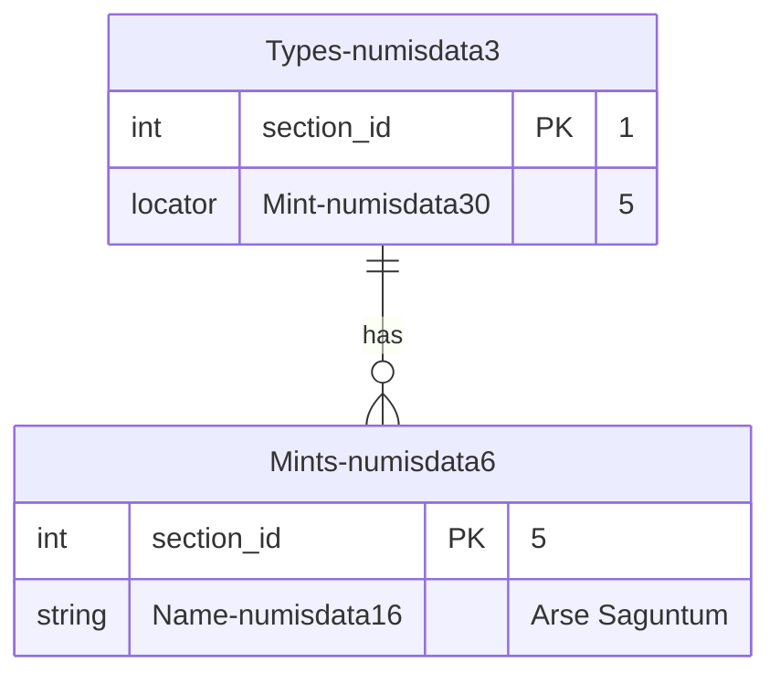

# Importing data

> See also: [Exporting data](exporting_data.md) · [Locator](locator.md) · [Component dataframe](components/component_dataframe.md) · [Glossary](glossary.md)

How to prepare and import data into Dédalo from CSV files, covering the v7 data format, per-component formats, and the locator-based relation model.

## Introduction

Importing data is an important part of Dédalo projects. Dédalo is a highly structured data system; it manages literal data and relationships between data. Data normalization is at the core of the application. Dédalo mainly uses lists, thesauri, resources and other related sections to define its data.

The Dédalo data model has an abstraction layer that uses the ontology definitions to create components (as fields) and sections (as tables).

??? note "About plain text / non-normalized data"

    Lots of catalogues in museums have a previous cataloging system, sometimes created themselves in commercial applications such as FileMaker, Access, etc., and sometimes this data has no structure and is saved as plain text without normalization. This situation creates a lot of data inconsistencies that can lead to situations that are very difficult to resolve. Dédalo can import plain text without any structuring, but it is not recommended. If you want to import this kind of data, we recommend running a cleaning process before importing it into Dédalo.

## Format

Dédalo uses the [standard CSV](https://datatracker.ietf.org/doc/html/rfc4180) to import data, and [UTF-8](http://www.unicode.org/versions/latest/) is the encoding to give it.

A file that is **not** UTF-8 is not read as if it were. Dédalo either converts it or refuses it, and it always says which:

- a file that carries a byte order mark (UTF-8 or UTF-16) is read in the encoding the mark declares;
- a file that is not valid UTF-8 is converted from **windows-1252** (what a European spreadsheet writes when it saves in the system code page), and the conversion is reported as a **notice** — on the file list, in the preflight and in the import report. A notice is not an error: the file imported, and the notice tells you what was done to it;
- a file that cannot be converted honestly is **refused, and nothing is imported**: one that contains NUL bytes (a binary file, or UTF-16 saved without its mark) and one that already carries replacement characters (`�`), which means its original encoding was lost before it reached Dédalo.

!!! warning

    A converted file is imported from a *guess about which encoding it is*, and the guess is only a good one for Western European text. Read the notice, check the imported values, and re-export the file as UTF-8 to remove the guess. Exporting in UTF-8 in the first place is the only way to be sure an accent arrives as the character it left as.

!!! note "A file whose shape cannot be trusted is refused whole"

    Two more refusals belong to the same rule, and neither is about encoding: a row whose number of columns disagrees with the header (every value after the mismatch would be imported into the wrong component), and a quoted value that is opened and never closed (the rest of the file is swallowed into that one cell). Both name the row, nothing is imported, and the fix is in the file.

??? note "Byte Order Mark (BOM)"

    BOM is accepted in some cases, but in general and according to the Unicode standard, the [BOM for UTF-8](http://www.unicode.org/versions/Unicode15.0.0/ch02.pdf) files is not recommended:

    ***2.6 Encoding Schemes***

    *... Use of a BOM is neither required nor recommended for UTF-8, but may be encountered in contexts where UTF-8 data is converted from other encoding forms that use a BOM or where the BOM is used as a UTF-8 signature. See the “Byte Order Mark” subsection in Section 23.8, Specials, for more information...*

    Dédalo's own CSV and TSV **downloads** do carry one, for exactly the signature use the standard describes: without it a spreadsheet opens the file in the system code page and saves it back in that code page, which is the badly encoded file the import door then has to convert. On import the mark is read and removed — it never reaches a record.

By default Dédalo uses a stringified JSON encoding in UTF-8 with double-quote `""` escape marks for the data.

Example of [locator](locator.md):

```json
[{
    "type":"dd151",
    "section_id":2,
    "section_tipo":"rsc723"
}]
```

Will need to be encoded in CSV format as:

> "\[{""type"":""dd151"",""section_id"":2,""section_tipo"":""rsc723""}]"

But you can use plain text to import flat data.

Example of text:

```text
My plain text without double quotes
```

It will need to be encoded in CSV format as:

> My plain text without double quotes

Example of text with double quotes inside:

```text
my plain text with "double quotes"
```

It will need to be encoded in CSV format as:

> "my plain text with ""double quotes"""

## File nomenclature (optional)

It is highly recommended to use only [ASCII](https://itscj.ipsj.or.jp/ir/006.pdf) characters in the name of import files, so try to use names without spaces, accents or any special character.

### Adding the section to the filename

Filenames can be used to detect the section automatically on import; you can specify it in this way:

> my_name_to_identify_data-section_tipo.csv

Example, a file with interviews data to import into the Interviews section [oh1](https://dedalo.dev/ontology/oh1):

> interviews_2015-oh1.csv

But you can indicate the destination section in the import CSV tool.

## Using editors

You can use an editor to create the CSV import files. If you want to use a spreadsheet editor such as LibreOffice [Calc](https://www.libreoffice.org/discover/calc/), remember that you will need to export the CSV with UTF-8 encoding.

## Using a spreadsheet

Dédalo data can be represented as a spreadsheet with columns and rows. The columns represent the components (fields), and the rows represent the records.

Every CSV import file represents a single section. If you need to import multiple sections, you will need a separate CSV file for each one. To import into the "Types" section [numisdata3](https://dedalo.dev/ontology/numisdata3), the CSV file must be named using its section_tipo as follows:

> my_import_types-numisdata3.csv

Every column represents a component (field) and every row represents a record; the data is the cell that crosses the column and the row.

| column A | column B | column X |
| -------- | -------- | -------- |
| data1A   | data1B   | data1X   |
| data1B   | data2B   | data2X   |

### Defining the target component in the column name

Every column in the first row of the file, the head, contains the ontology tipo of the target component of the section to be imported. At least one column must be set as the section_id to identify the column with the unique id; by convention it is the first one, but this is not mandatory.

To import the component `Key` [numisdata81](https://dedalo.dev/ontology/numisdata81) and the component `Number` [numisdata27](https://dedalo.dev/ontology/numisdata27) as fields of the `Types` section [numisdata3](https://dedalo.dev/ontology/numisdata3), you will need to create a CSV as:

| section_id | numisdata81 | numisdata27 |
| --- | --- | --- |
| 1 | \[{"value":"key1"}] | \[{"value":"062"}] |
| 2 | \[{"value":"key2"}] | \[{"value":"685a"}] |

!!! note "Columns with names instead of the ontology tipo"

    You can use "human" names in the columns, but the import tool will not match them to the component and you will need to set it manually before import.

    The previous CSV could be named in this way:

    | id  | Key | Number |
    | --- | --- | ------ |
    | 1 | \[{"value":"key1"}] | \[{"value":"062"}]  |
    | 2 | \[{"value":"key2"}] | \[{"value":"685a"}]  |

    But it will not match and you will need to set the component tipo inside the import tool.

!!! warning "The header must match the mapped column exactly"

    During the import, every CSV header is compared with its mapped column name and they must match **exactly**, including suffixes as `tch56_dmy` (date format) or `tch191_rsc723` (relation target). Columns whose header does not match are **silently skipped** — no data is imported for them and no error is reported. Review the column mapping in the import tool before launching the import.

You can know the ontology tipo of the component picking one component and Dédalo will show it inside the info part of the inspector:


Besides, Dédalo shows the component data format and you can copy it, as `[{"value":"062"}]`.

Also you can check the ontology [here](https://dedalo.dev/ontology).

## Data formats

### The v7 data format

Dédalo v7 stores component data as **arrays of objects**. Every object in the array is one value of the component, and the property that holds the data depends on the component type:

| Component type | v7 format | Data property |
| --- | --- | --- |
| `component_input_text` | `[{"value":"Hello"}]` | `value` |
| `component_text_area` / `component_html_text` | `[{"value":"<p>Hello</p>"}]` | `value` |
| `component_email` | `[{"value":"a@b.com"}]` | `value` |
| `component_number` | `[{"value":5.87}]` | `value` |
| `component_json` | `[{"value":{"any":"JSON"}}]` | `value` |
| `component_date` | `[{"start":{"year":2023,"month":10,"day":26}}]` | `start` / `end` |
| `component_iri` | `[{"iri":"https://dedalo.dev"}]` | `iri` |
| `component_geolocation` | `[{"lat":39.4625,"lon":-0.3762,"zoom":16,"alt":0}]` | `lat` / `lon` |
| Relation components (select, portals, etc.) | `[{"section_id":2,"section_tipo":"rsc723"}]` | `section_id` / `section_tipo` |

The **v7 format is the canonical import format**: what you see in the component inspector and in raw exports is what you import.

!!! note "id and lang properties"

    Stored data also carries `id` and `lang` properties, as `[{"value":"Hello","lang":"lg-eng","id":1}]`. Both are **auto-assigned by the import process** when omitted. The `lang` property can be set explicitly to import multiple languages at once (see [Multiple languages](#multiple-languages)); the `id` property should be omitted, except for `component_iri` where it pairs the value with its label dataframe.

??? note "v6 legacy format (accepted)"

    Dédalo v6 stored plain value arrays as `["Hello"]` or `[104,-75.35]`. This input is still accepted and automatically normalized to the v7 format on save, so old v6 CSV files import without changes.

Besides the JSON formats, every component accepts simple **flat string** alternatives (a plain text, a number, a date as `2023/10/26`, a list of ids as `1,4,6`...) described in each component section below. Flat strings are the easiest way to write a CSV by hand.

### The dedalo_data wrapper

Data exported with the tool export in `dedalo_raw` format is wrapped with the `dedalo_data` property:

```json
{"dedalo_data":[{"value":"Hello","lang":"lg-eng","id":1}]}
```

The wrapper identifies externally that the content is Dédalo format data and not any other generic value. The import process detects and unwraps it transparently, then conforms the value like any typed input — it is **not** a verbatim round trip of the stored row (`component_text_area` markup and `component_geolocation` item ids change; empty cells become explicit clears; locators are checked for shape only). For a lossless copy of a section set use the archive door (see [The archive door](exporting_data.md#the-archive-door)). Un-wrapped v7/v6 values remain fully accepted; the wrapper is only mandatory to disambiguate `component_json` data (see [JSON](#json)).

!!! note "What is not wrapped"

    Two cases are exported **without** the wrapper, and both import as intended: the `section_id` column (a plain int, used as the record key on import) and components without data (empty cells). The wrapper is detected only when `dedalo_data` is the **only** property of the cell object — a JSON value that merely contains a `dedalo_data` property among others is treated as a normal value.

### Dataframe columns

A [dataframe](components/component_dataframe.md) is a component of its own, with its own stored data, so it travels in **its own column**, headed by the dataframe component's tipo — never inside the column of the component it frames:

| `rsc217` | `dd560` |
|---|---|
| `{"dedalo_data":[{"value":"Hello","lang":"lg-eng","id":1}]}` | `{"dedalo_data":[{"type":"dd490","section_tipo":"dd1706","section_id":3,"id_key":1,"from_component_tipo":"dd560","main_component_tipo":"rsc217"}]}` |

A raw export writes the dataframe column right after the component it belongs to, and writes it for every record of the export — empty where a record has no frames.

In *Append* mode the pairing is re-established against the final ids: a frame is paired with the item its main value became after the append — or with the existing item, when that value was already present and skipped. Frames already stored are not added twice, and the dataframe's `data_limit` still applies.

What links the two columns is the data, not their position: each frame locator's `id_key` pairs it with the item carrying the same `id` in the main component (this is why explicit item ids round-trip). Import the dataframe column like any other component column and the pairing is restored; import it alone and only the frames are written, leaving the framed component untouched.

??? note "Legacy envelope (accepted)"

    Files exported before Dédalo 7 (2026-08-09) carry the frames folded into the framed component's own cell, as `{"dedalo_data":{"data":[...],"dataframe":[...]}}` — with `dato` instead of `data` in v6-era files. Both spellings still import, frames included; neither is ever written any more. An envelope carrying only `dataframe` writes just the frames and leaves the component data untouched.

### Empty cells

!!! warning "An empty cell clears the existing data (replace mode)"

    In the default *Replace* mode an empty CSV cell is imported as `null` and **clears the existing data** of that component for that record (and for the current data language when the component is translatable). If you don't want to touch a component in some records, don't include its column in the CSV file, split the import into several files, or set the column to *Append* mode, where an empty cell changes nothing.

### Replace or append

Each mapped column is imported in one of two modes, chosen per column in the import tool (see [Adding instead of replacing](../tools/using_import_dedalo_csv.md#adding-instead-of-replacing)):

- **Replace** (the default) — the cell becomes the component's data, as described throughout this page. An empty cell clears it.
- **Append** — the cell's values are **added** after the stored ones; nothing already stored is changed. A value already present is skipped and reported as a warning, so re-importing the same file adds nothing. An empty cell, or an empty language group such as `{"lg-spa":[]}`, changes nothing, and an empty value inside a cell is never added as a blank entry. A cell with several languages on a component that is not translatable adds all its values to the component's one language-neutral set.

The cell formats are the same in both modes: a cell is conformed exactly as this page describes, and only what happens to the stored data differs. Append is available for the list-shaped components — text, email, number, date, URI, related data and dataframes — plus geolocation (a [new layer](#geolocation)) and formatted text (a [new paragraph](#formatted-text)). It is refused, before anything is written, for media, single-choice components (select, radio button, language, publication, model), single-document components (JSON, password, permissions, record filters), computed components (info, inverse, external, children, index), the `section_id` column and the record's creation and modification stamps.

### Undoing an import

Every import runs as one bulk process and can be reverted as a whole from the [Time machine](../tools/using_time_machine.md#reverting-a-batch-run), in either mode. Each change the import makes records the value it replaced, so the revert puts back exactly what each record held before — also for components that had no earlier history — and leaves alone, and reports, any value edited after the import. There is no option to import without this record.

---

### Text

Component: `component_input_text`.

Canonical v7 input, array of objects with `value`:

```json
[{"value":"my import data"},{"value":"Other data"}]
```

#### Multiple languages

For translatable components you can import multiple languages at once in two equivalent ways:

1. **Flat v7 array** (the stored v7 format, as produced by the raw export): every item carries its own `lang` property:

    ```json
    [
        {"value":"mi dato para importar","lang":"lg-spa"},
        {"value":"my import data","lang":"lg-eng"}
    ]
    ```

2. **Lang keyed object**: one property per language, each holding its items:

    ```json
    {
        "lg-spa" : [{"value":"mi dato para importar"}, {"value":"Otro dato"}],
        "lg-eng" : [{"value":"my import data"}, {"value":"Other data to import"}]
    }
    ```

Encoded in CSV format as:

```text
section_id;rsc86
1;"{""lg-spa"":[{""value"":""mi dato para importar""},{""value"":""Otro dato""}]}"
```

In both cases every language present in the import value replaces that language data, and the languages not present are preserved. Items without `lang` are saved into the Dédalo data lang defined by the user in menu.

#### Alternative formats to import text

1. Plain text (the simplest)

    section_id | oh14
    --- | ---
    1 | new data to import

    The import process assumes the Dédalo data lang defined by the user in the menu and imports the value as the single value in the array. If previous data exists in that lang, it is replaced with a new array holding the import value.

2. An array of string values (v6 format)

    section_id | oh14
    --- | ---
    1 | \["mi dato para importar","Otro dato"]

    The import process assumes the Dédalo data lang defined by the user in the menu and saves into this lang, or, if the component is non-translatable, uses `lg-nolan`. Each string is automatically wrapped into a v7 object with a `value` property.

3. Multi-language object with plain strings

    ```json
    {"lg-eng":"My value","lg-spa":"Mi valor"}
    ```

    Each lang value is normalized to the v7 format and saved into its own language.

---

### Formatted text

Components: `component_text_area` and `component_html_text`.

Dédalo uses standard HTML format to import formatted text. As Dédalo uses CKEditor as its text editor, the accepted HTML tags are the same as [CKEditor](https://ckeditor.com/docs/ckeditor5/latest/features/basic-styles.html#available-text-styles):

1. `text_area` accepts:

    ```html
    <p></p> // a Paragraph
    <strong></strong> // Bold text
    <i></i> // Italic text
    <u></u> // Underscore text
    ```

2. `html_text` accepts:

    ```html
    <p></p> // a Paragraph
    <strong></strong> // Bold text
    <i></i> // italic text
    <u></u> // underscore text
    <s></s> // Strikethrough text
    <Code></Code> // programming code
    <sub></sub> // Subscript text
    <sup></sup> // Superscript text
    ```

!!! note "Import behavior for text_area vs html_text"

    Both components use the same import format and data structure. The difference is only in which HTML tags are preserved after import. `text_area` will strip unsupported tags (like `<s>`, `<code>`, `<sub>`, `<sup>`), while `html_text` preserves them.

Besides, import format text support some compatible elements and CSS styles:

```html
<b>             <* style="font-weight: bold"> // (or numeric values that are greater or equal 600)
<em>            <* style="font-style: italic">
                <* style="text-decoration: underline">
<del><strike>   <* style="text-decoration: line-through">
                <* style="word-wrap: break-word">
                <* style="vertical-align: sub">
                <* style="vertical-align: super">
```

!!! note
    These elements and styles are changed to supported elements during the import process.

Canonical v7 input:

```json
[{"value":"<p>El meu text per <strong>importar</strong></p>"},{"value":"<p>Altra dada</p>"}]
```

Multi-language input, as flat v7 array (per-item `lang`, the raw export format) or as lang keyed object — see [Multiple languages](#multiple-languages):

```json
[
    {"value":"<p>Les meves dades per <strong>importar</strong></p>","lang":"lg-cat"},
    {"value":"<p>My data to <strong>import</strong></p>","lang":"lg-eng"}
]
```

```json
{
    "lg-cat" : [{"value":"<p>Les meves dades per <strong>importar</strong></p><p>&nbsp;</p><p>Amb 2 paragraphs</p>"}],
    "lg-eng" : [{"value":"<p>My data to <strong>import</strong></p><p>&nbsp;</p><p>With 2 paragraphs</p>"}]
}
```

Encoded in CSV format as:

```text
section_id;numisdata18
1;"{""lg-cat"": [{""value"":""<p>El meu text per <strong>importar</strong></p>""},{""value"":""<p>Altra dada</p>""}]}"
```

#### Alternative formats to import formatted text

1. Formatted text (flat string, the simplest)

    section_id | numisdata18
    --- | ---
    1 | `<p>Nou text per <strong>importar</strong></p>`

2. Plain text (without HTML)

    section_id | numisdata18
    --- | ---
    1 | new data to import

    The text will be wrapped automatically into `<p></p>` paragraphs, and line returns become new paragraphs.

3. An array of string values (v6 format)

    section_id | oh14
    --- | ---
    1 | `["<p>El meu text per <strong>importar</strong></p>","<p>Altra dada</p>"]`

In the flat string cases the import process assumes the Dédalo data lang defined by the user in the menu and imports the value as the single value in the array, replacing previous data of that lang.

!!! note "Append mode: a new paragraph"

    In *Append* mode the cell is added at the end of the stored text of its language, as a new paragraph: `Altra dada` is stored as `<p>Altra dada</p>` after the existing paragraphs, and a paragraph identical to one already present is skipped. A cell that carries any indexation tag (below) is **rejected** in append mode: tags are tied to the index entries that point at them, and an addition cannot keep that pairing. Import tagged text in *Replace* mode.

#### Indexation tags

Dédalo uses non-standard HTML tags to define `indexation` `tags`, `tc`, `person`, `language`, `notes` and `references`.

The main format of these tags follows these rules:

1. The tag is enclosed by `[]`
2. the elements are separated by the `-` character
3. the first element is `tag_name` with the standard name of the tag
4. the second element is the `state` of the tag with n|r|d options, n=normal, r=to review, d=deleted.
5. unique id of the tag, int.
6. data::data enclosing the locator in the case that this tag has a link to any data.
7. locator is a stringified version with the double quotes `"` replaced with simple quotes `'`

```text
[tag_name-state-id-label-data:locator:data]
```

##### index

The index tag defines a fragment inside formatted text. The index tag has an in and out format; the fragment sits in the middle of these tags.

###### indexIn

Mark the initial position of the indexation fragment.

Example:

> \[index-n-1-my tag label-data::data]

###### indexOut

Mark the out position of the indexation fragment.

Example:

> \[index-n-1-my tag label-data::data]

##### tc

The tc tag is used to point to a specific audiovisual timecode at the beginning of paragraphs; it is used to create a time relation between the text and its audiovisual time.

The tc tag has its own format: the tc is enclosed by `TC_` and `_TC` marks.

```text
[TC_hh:mm:ss.ms_TC]
```
Example:

> \[TC_00:01:25.627_TC]

##### lang

The lang tag is used to mark the change from the previous language. Example, an interview in Catalan in which the interviewee begins to speak in French.

> \[lang-a-1-spa-data:['lg-spa']:data]

!!! note "`section_id` inside a tag is quoted on purpose"
    A record address is an integer everywhere in the engine's API. The locator
    embedded in an inline tag is the one exception you will see below: it is
    serialized **into the text string itself**, and its byte form is fixed
    contract for the consumers that parse it, so it keeps the quoted
    `'section_id':'2'` shape.

##### svg

The svg tag is used to add a graphic within the text. The tag uses a locator to point to the svg section. Example to add an Iberian symbol inside a legend text.

Example:

> \[svg-n-1--data:{'section_tipo':'sccmk1','section_id':'2','component_tipo':'hierarchy95'}:data]

##### geo

The geo tag is used to add some features as, polygons, points, or marks.

Example:

> \[geo-n-10-10-data::data]

##### page

The page tag is used to mark a page break inside text.

Example:

> \[page-n-3]

##### person

The person tag is used to mark a person who begins to talk. The tag uses a locator to point to the People under study [rsc197](https://dedalo.dev/ontology/rsc197) section.

> \[person-a-1-Pedpi-data:{'section_tipo':'rsc197','section_id':'1','component_tipo':'oh24'}:data]

##### note

The note tag is used to add an annotation in text. The annotation uses a locator to point to the Annotations [rsc326](https://dedalo.dev/ontology/rsc326) section. The state of the note can be a | b, a=private, b=public.

Example:

> \[note-a-1-1-data:{'section_tipo':'rsc326','section_id':1}:data]

##### reference

The reference tag is used to link to any other section. It uses the locator to point at any other section. The reference works like an HTML `<a href><a>` element. References have an in and out tag to indicate the beginning and end of the reference.

###### referenceIn

> \[reference-n-1-reference 1-data:\[{'section_tipo':'fr1','section_id':'1','type':'dd151'}]:data]

###### referenceOut

> \[/reference-n-1-reference 1-data:\[{'section_tipo':'fr1','section_id':'1','type':'dd151'}]:data]

---

### Numbers

Component: `component_number`. The component does not use languages.

Canonical v7 input:

```json
[{"value":104},{"value":-75.35}]
```

Encoded in CSV format as:

```text
section_id;numisdata133
1;"[{""value"":104},{""value"":-75.35}]"
```

#### Alternative formats to import numbers

1. Plain number (the simplest)

    | section_id  | numisdata133 |
    | ----------- | ------------ |
    | 1           | 33.85        |

    The import process assumes this data is the full data; if previous data exists, it is replaced with a new array holding the import value.

    The decimal separator (`.` or `,`) can be selected in the import tool for every number column.

2. An array of numbers (v6 format)

    | section_id  | numisdata133 |
    | ----------- | ------------ |
    | 1           | \[104,-75.35] |

---

### Email

Component: `component_email`. The component does not use languages.

Canonical v7 input:

```json
[{"value":"user@example.com"},{"value":"admin@example.com"}]
```

Encoded in CSV format as:

```text
section_id;tch442
1;"[{""value"":""user@example.com""},{""value"":""admin@example.com""}]"
```

#### Alternative formats to import emails

1. Plain email string (the simplest)

    | section_id  | tch442 |
    | ----------- | ------ |
    | 1           | user@example.com |

2. Multiple emails with the ` | ` separator

    | section_id  | tch442 |
    | ----------- | ------ |
    | 1           | user@example.com \| admin@example.com |

    will be parsed as:

    ```json
    [{"value":"user@example.com"},{"value":"admin@example.com"}]
    ```

    !!! note "Fixed separator"

        The ` | ` separator (space, pipe, space) is fixed and not configurable. An address containing a literal ` | ` cannot be imported as flat string: use the JSON array format instead.

3. An array of strings (v6 format)

    | section_id  | tch442 |
    | ----------- | ------ |
    | 1           | \["user@example.com","admin@example.com"] |

---

### Dates

Component: `component_date`. The component does not use languages. The main format to import is the array of objects with `start` and optional `end` dd_date values.

Canonical v7 input:

```json
[{
   "start" : {
        "year": 1238,
        "month": 10,
        "day": 9
    }
}]
```

Encoded in CSV format as:

```text
section_id;tch56
1;"[{""start"":{""year"":1238,""month"":10,""day"":9}}]"
```

#### Alternative formats to import dates

1. A punctual date in flat string :

    ```text
    -205/05
    ```

    Example:

    | section_id | tch56   |
    | ---------- | ------- |
    | 1          | -205/05 |

    It's allowed to use different [formats](#using-other-date-formats) indicating it in the name of the header as tch56_dmy.

    section_id   | tch56_dmy
    ------------ | :--------------:
    1            | 05/-205

    It's allowed to use different separator between [values of elements](#using-other-separators).

    ```text
    -205-05
    15-11--50
    15.11.-50
    ```

2. A range of dates in flat string:

    ```text
    2023/10/26<>2023/10/27
    ```

    The '<>' separator indicates the range, with the start date on the left and the end date on the right.

    ```json
    [{
        "start" : {
            "year": 2023,
            "month": 10,
            "day": 26
        },
        "end" : {
            "year": 2023,
            "month": 10,
            "day": 27
        }
    }]
    ```

    You can leave spaces between dates and the separator.

    ```text
    -150 <>      238
    ```

    is a valid range date, but the separator must always keep the same format; a space between the marks is not allowed:

    ```text
    -150< >238
    ```

    is not a valid range.

    It's allowed to use different [formats](#using-other-date-formats) indicating it in the name of the header as tch56_dmy.

    | section_id | tch56_mdy |
    | ---------- | --------- |
    | 1          | 10/26/2023<>10/27/2023 |

     It's allowed to use different separator between [values of elements](#using-other-separators).

    ```text
    10-26-2023<>10-27-2023
    10.26.2023<>10.27.2023
    ```

3. Multi value date in flat string

    ```text
    2023/10/26|1853/02/18
    ```

    The '|' separator indicates multiple values. The values are not start <> end dates; both are start dates, and the second one is the start date of the second value.

    The previous string date will be parsed as:

    ```json
    [
        {
            "start" : {
                "year": 2023,
                "month": 10,
                "day": 26
            }
        },
        {
            "start" : {
                "year": 1853,
                "month": 02,
                "day": 18
            }
        }
    ]
    ```

    You can leave spaces between dates and the separator.

    ```text
    -150 |          -25
    ```

    It's allowed to use different [formats](#using-other-date-formats) indicating it in the name of the header as tch56_dmy.

    | section_id | tch56_mdy |
    | ---------- | --------- |
    | 1          | 10/26/2023\|02/18/1853 |

    It's allowed to use different separator between [values of elements](#using-other-separators).

    ```text
    10-26-2023|02-18-1853
    10.26.2023|02.18.1853
    ```

4. Combination of multi value and range

    ```text
    2023/10/26<>2023/10/27|1853/02/18
    ```

    To define multiple values with ranges you can use a combination of the '|' to indicate the multi value and the '<>' to indicate the range.

        The previous string date will be parsed as two date values, with the range of the first value having start and end dates:

    ```json
    [
        {
            "start" : {
                "year": 2023,
                "month": 10,
                "day": 26
            },
            "end" : {
                "year": 2023,
                "month": 10,
                "day": 27
            }
        },
        {
            "start" : {
                "year": 1853,
                "month": 02,
                "day": 18
            }
        }
    ]
    ```

    You can leave part of the range blank:

    ```text
    2023/10/26|<>1853/02/18
    ```

    ```json
    [
        {
            "start" : {
                "year": 2023,
                "month": 10,
                "day": 26
            }
        },
        {
            "end" : {
                "year": 1853,
                "month": 02,
                "day": 18
            }
        }
    ]
    ```

    You can leave spaces between dates and the separators.

    ```text
    2023/10/26 |   <>  1853/02/18
    ```

    It's allowed to use different [formats](#using-other-date-formats) indicating it in the name of the header as tch56_dmy.

    | section_id   | tch56_mdy |
    | ------------ | --------- |
    | 1            | 10/26/2023\|<>02/18/1853 |

    It's allowed to use different separator between [values of elements](#using-other-separators).

    ```text
    10-26-2023\|<>02-18-1853
    10.26.2023\|<>02.18.1853
    ```

##### Using other date formats

By default the string date formats use \[-]y/m/d, but you can import the date in other formats by indicating the format in the column header as a second parameter after the tipo, using the `_` character between them.

| section_id | tch56_dmy |
| ---------- | --------- |
| 1          | 05/-205   |

You can use these formats

| Format | Description |
| --- | --- |
| ymd | year/month/day as 2023/10/26 |
| mdy | month/day/year as 10/26/2023 |
| dmy | day/month/year as 26/10/2023 |

##### Using other separators

The default separator between day, month and year is `/`, but you can use `-` and `.`

```text
20-10-1945
2023-10-26|<>1853-02-18
-200<>50-11|-150-10
11-12--200|28-10-5
```

```text
20.10.1945
2023.10.26|<>1853.02.18
-200<>50.11|-150.10
11.12.-200|28.10.5
```

---

### Related data

#### Understanding relationships between data

Dédalo uses a data relation model based on [locators](locator.md); sections are connected to each other with locators. Any related data is connected by locators: a list shown in a select is connected by locators, an image inside a section is connected by locators. Dédalo uses locators everywhere.

Locators are an extensible connection between data and can point to a full section, a component inside a section, or a part of the components inside a section. Besides, locators can create links to external data.

When you want to import data with relations, you will use locators.

Basic locator has only two properties:

- section_tipo
- section_id

`section_tipo` is the ontology tipo of the target section, `section_id` is the unique id of the target section.

!!! note "`section_id` is an integer"

    A CSV cell is text, but a record address is an **integer** (negatives valid). On import every locator's `section_id` is classified against its target section:

    - an integer, or text convertible to one (`2`, `"2"`) → stored as the integer;
    - a remote id of an [external service](system/external_services.md) section (`"001338683"`, `"Q42"`) → stored **verbatim**, it is not an address;
    - anything else — a synthetic token, a zero-padded or out-of-range number on a normal section — is a **conform error**: the cell is rejected and reported, and the record keeps its previous value.

    Law: `engineering/wire_contract/WC-2026-08-10-section-id-int-canonical.md`.

Also the locator has a `type`, that defines the relation type and `from_component_tipo` that defines the origin component (the field that point to target section, the portal).

Data linked as:



It says that Type 1 has a link with Mint 5.
The field Mint [numisdata30](https://dedalo.dev/ontology/numisdata30) in the section Types [numisdata3](https://dedalo.dev/ontology/numisdata3) has a link to id 5 of the section Mints [numisdata6](https://dedalo.dev/ontology/numisdata6)

In Dédalo format it will be: the record's row in the section's matrix table carries the locator inside its `relation` column (a typed JSONB column keyed by component tipo — see the [matrix storage model](sqo.md#about-the-sql-examples-in-this-page)), not inside the component's own value:

```json
{
    "section_id": 1,
    "section_tipo": "numisdata3",
    "relation":
    {
        "numisdata30":
        [
            {
                "section_id":5,
                "section_tipo":"numisdata6",
                "from_component_tipo": "numisdata30"
            }
        ]
    }
}
```

And it could be represented in CSV spreadsheet columns in this way:

> types-numisdata3.csv

| section_id    | numisdata30 |
| ------------  | ----------- |
| 1             | \[{"section_id":5,"section_tipo":"numisdata6","from_component_tipo": "numisdata30"}] |

#### Importing

By default the import model uses the JSON format of its data, an array of [locators](locator.md).

```json
[{"type":"dd151","section_id":2,"section_tipo":"rsc723","from_component_tipo":"tch191"}]
```

Because the Dédalo import process uses a plain CSV file, the JSON data must be stringified in the following way:

The table to import

| section_id    | tch191 |
| ------------  | :----: |
| 1             | \[{"type":"dd151","section_id":2,"section_tipo":"rsc723","from_component_tipo":"tch191"}] |

Will need to be encoded in CSV format as:

```text
section_id;tch191
1;"[{""type"":""dd151"", ""section_id"":2, ""section_tipo"":""rsc723"", ""from_component_tipo"":""tch191""}]"
```

You can remove the `type` and `from_component_tipo` properties because the column head specifies the value of `from_component_tipo` and the component knows its own `type`. So you can define the previous locator to import in this way:

```json
[{"section_id":2,"section_tipo":"rsc723"}]
```

##### Alternative formats to import related data

1. A comma separate int (as destination section_id):

    ```text
    1,4,6
    ```

    To import this data, you must specify, in the column head of the component, the section_tipo using the `_` character between them:

    `component_tipo + '_' + section_tipo`

    Example:

     **tch191_rsc723**

    In this case the import process assumes that all int values are section_id, the section_tipo comes from the second tipo in the column head, from_component_tipo comes from the first tipo in the column head, and type is calculated by asking the component on the server.

    Example:

    | section_id | tch191_rsc723 |
    | --- | --- |
    | 1   | 1,4,6 |

    will be parsed as:

    ```json
    [
        {"type":"dd151","section_id":1,"section_tipo":"rsc723","from_component_tipo":"tch191"},
        {"type":"dd151","section_id":4,"section_tipo":"rsc723","from_component_tipo":"tch191"},
        {"type":"dd151","section_id":6,"section_tipo":"rsc723","from_component_tipo":"tch191"}
    ]
    ```

    When the component points to multiple sections, this import method does not preserve other sections' values in its data. Previous data pointing to sections other than the one indicated in the head is removed.

    1. Importing unique values

        You can import a single int as section_tipo

        Example:

        | section_id | tch191_rsc723 |
        | --- | --- |
        | 1 | 6 |

    2. Removing section_tipo reference in head.

        You can remove the section_tipo in the head of the column when the component points to only 1 section.

        Example:

        | section_id | tch191 |
        | --- | --- |
        | 1 | 1,4,6 |

        !!! warning "Components using with multiple sections"
            This possibility is only available when the component points to 1 section. Multiple sections cannot be imported in this way.

        In this case the import process asks the component on the server for the section_tipo to be used; if the component has multiple sections it fails to import, to avoid errors and inconsistencies.

---

### Languages (select_lang)

Component: `component_select_lang`. It is a relation component pointing to the Dédalo languages section, used to specify the language of a content (e.g. the language of a text or an audiovisual).

Canonical v7 input, array of locators:

```json
[{"section_tipo":"lg1","section_id":17344}]
```

#### Alternative formats to import languages

1. A lang code in flat string (the simplest)

    | section_id | rsc36 |
    | --- | --- |
    | 1 | lg-spa |

2. Multiple lang codes separated by comma

    | section_id | rsc36 |
    | --- | --- |
    | 1 | lg-spa, lg-eng |

3. A JSON array of lang codes

    | section_id | rsc36 |
    | --- | --- |
    | 1 | \["lg-spa","lg-eng"] |

Every code is resolved to its locator in the languages section. An unresolvable code (e.g. `lg-zzz`) produces a failed row and the value is ignored.

Lang codes must be **lowercase** alphanumeric with the `lg-` prefix (`lg-spa`, `lg-eng`, `lg-vlca`); uppercase variants as `LG-SPA` are not recognized as lang codes.

!!! note "Languages not configured in the project"

    A valid lang code that is **not part of the project configured languages** (DEDALO_PROJECTS_DEFAULT_LANGS) is imported anyway, and the import report shows a **warning**: the value is saved but it will not be accessible until the project languages include it.

---

### Geolocation

Component: `component_geolocation`. The component does not use languages. The data is an array with one item defining the map center (`lat`, `lon`), the map state (`zoom`, `alt`) and, optionally, the drawn shapes as GeoJSON layers (`lib_data`).

Canonical v7 input:

```json
[{
    "lat"  : 39.4625,
    "lon"  : -0.3762,
    "zoom" : 16,
    "alt"  : 0
}]
```

With drawn shapes:

```json
[{
    "lat"  : 39.4625,
    "lon"  : -0.3762,
    "zoom" : 16,
    "alt"  : 0,
    "lib_data" : [{
        "layer_id"   : 1,
        "layer_data" : {
            "type"     : "FeatureCollection",
            "features" : [{
                "type"       : "Feature",
                "properties" : {"layer_id":1},
                "geometry"   : {"type":"Point","coordinates":[-0.3762,39.4625]}
            }]
        }
    }]
}]
```

#### Alternative formats to import geolocation

1. Coordinates in flat string (the simplest), as `lat, lon[, zoom[, alt]]` with dot decimals:

    | section_id | tch102 |
    | --- | --- |
    | 1 | 39.4625, -0.3762 |
    | 2 | 39.4625, -0.3762, 15 |

    !!! note "Coordinate order"

        The flat string order is **latitude first** (human convention, as map applications show). Note that GeoJSON `coordinates` use the opposite `[lon, lat]` order.

2. A bare GeoJSON FeatureCollection:

    ```json
    {"type":"FeatureCollection","features":[{"type":"Feature","properties":{},"geometry":{"type":"Point","coordinates":[-0.3762,39.4625]}}]}
    ```

    The map center is taken from the first `Point` feature and the full collection is stored as the layer 1 shapes.

Latitude must be in range \[-90, 90] and longitude in \[-180, 180]; `zoom` defaults to 16 and `alt` to 0 when omitted.

An item may also carry the map's `sources` and `legend` beside `lib_data` (see [Map sources and legend](data_model/geolocation.md#map-sources-and-legend)). They are checked on import like on any save, so a bad source address is reported with its position and the cell is left alone; an item with no coordinate and only `sources` and/or `legend` is a valid value. Source numbers are issued by the server, so a hand-written file leaves them out: a source that equals one the record already stores takes that source's number, which is why importing an unchanged file again changes nothing, and any other source receives a new number. A number that a file does name (an export of the same record) is kept when the record holds it; a file written from *another* record can therefore overwrite the source that holds the same number here, because the number — not the content — identifies a source. In *Append* mode the cell's `sources` and `legend` are not merged: the stored ones stay as they are.

!!! note "Append mode: a new layer"

    In *Append* mode (*Add as new layer*) a geolocation cell does not replace the map. Each drawn layer of the cell — or, for a flat `lat, lon` cell, a Point at that position — is added to the stored `lib_data` as a **new layer**, numbered after the highest layer id already stored and named `layer_<id>`. The stored layers and the stored map centre (`lat`, `lon`, `zoom`, `alt`) are not changed. A layer whose shapes equal a stored layer's is skipped. On a record with no geolocation yet, the cell's first item is stored as it would be in *Replace* mode, and every later item of the cell (a layer, or a flat point as a Point layer) is added to it as a new layer the same way: the component holds one map, so the values are never stored as separate items the map would not show.

---

### JSON

Component: `component_json`. The component does not use languages and stores **any arbitrary JSON** as a single value (monovalue).

By default, the **entire cell content becomes the value**, whatever it is:

| section_id | test18 |
| --- | --- |
| 1 | {"config":{"a":1}} |
| 2 | \[1,2,3] |
| 3 | hello world |
| 4 | 42 |

Row 1 will be saved as `[{"value":{"config":{"a":1}}}]`, row 4 as `[{"value":42}]`, etc.

!!! note "The dedalo_data wrapper as disambiguator"

    Because any JSON is a valid value, a v7 envelope like `[{"value":1},{"value":2}]` is indistinguishable from a literal JSON value with the same shape — so by default it is imported **entirely inside `value`**:

    ```json
    [{"value":[{"value":1},{"value":2}]}]
    ```

    To import data already in Dédalo v7 format (e.g. re-importing a raw export), wrap it with the `dedalo_data` property:

    ```json
    {"dedalo_data":[{"value":{"config":{"a":1}},"id":1}]}
    ```

    The raw export produces this wrapper automatically, so a raw-exported JSON column imports without editing (the `component_json` facet is the one that honours the wrapper verbatim).

---

### URI

Component: `component_iri`. The component does not use languages; the main format to import is the array of `dd_iri` objects.

!!! info "Data format in version 6.8.0"
    The data version for the iri component changed in version 6.8.0. The `title` property is deprecated and will be removed in future versions.
    In version >= 6.8.0 use the property `label_id` to define the title.

```json
[{
    "iri"      : "https://dedalo.dev",
    "id"       : 1,
    "label_id" : 5
}]
```

- `iri` property, **mandatory**. Defines the URL, it needs to have the protocol and a valid structure with domain.
- `id` property **optional**. Defines the unique id of the data, it will be used to be linked with the label dataframe. If omitted, it is auto-assigned on save.
- `label_id` property **optional**. Defines the target id (section_id) to be used as value of the label in dataframe.

!!! note "id exception for component_iri"

    In general the `id` property is auto-assigned by the import process and should not be included in the CSV data. The IRI component is the exception: because the label dataframe is paired with the value through its `id`, you can set it explicitly to control that pairing.

Encoded in CSV format as:

```text
section_id;tch442
1;"[{""iri"":""https://dedalo.dev"",""id"":1,""label_id"":5}]"
```

#### Multiple values

To import multiple values in the same component/field, add new object to the array in this way:

```json
[
    {
        "iri"      : "https://dedalo.dev",
        "id"       : 1,
        "label_id" : 5
    },
    {
        "iri"      : "http://monedaiberica.org",
        "id"       : 2,
        "label_id" : 6
    }
]
```

#### Languages

The import marks this data as `lg-nolan` because the component interprets that the URI has no language by default. But sometimes you will handle multilingual URIs, such as Wikipedia articles, so in those cases you can identify the language of the URI in this way:

```json
{
    "lg-spa": [{
        "iri" : "https://es.wikipedia.org/wiki/Escrituras_paleohispánicas"
    }],
    "lg-deu": [{
        "iri" : "https://de.wikipedia.org/wiki/Althispanische_Schriften"
    }]

}
```

The table to import

| section_id    | tch442  |
| ------------  | ------ |
| 1             | {"lg-spa":\[{"iri":"https://es.wikipedia.org/wiki/Escrituras_paleohispánicas"}\],"lg-deu":\[{"iri":"https://de.wikipedia.org/wiki/Althispanische_Schriften"}\]} |

#### Alternative formats to import URIs

1. Flat string (the simplest):

    ```text
    https://dedalo.dev
    ```

    | section_id    | tch442  |
    | ------------  | ------ |
    | 1             | https://dedalo.dev |

    it will be parsed as:

    ```json
    [{
        "iri":"https://dedalo.dev"
    }]
    ```

2. Array of strings:

    Used to import multiple URIs into the component / field.

    ```json
    ["https://dedalo.dev","https://dedalo.dev/docs"]
    ```

    | section_id    | tch442  |
    | ------------  | ------ |
    | 1             |  \["https://dedalo.dev","https://dedalo.dev/docs"]

    will be parsed as:

    ```json
    [
        {"iri":"https://dedalo.dev"},
        {"iri":"https://dedalo.dev/docs"}
    ]
    ```

3. String with id label

    To import the id label used to point to a specific value of the list of labels for the URI, use the `, ` separator in this way:

    ```text
    8, https://dedalo.dev
    ```

    | section_id    | tch442  |
    | ------------  | ------ |
    | 1             | 8, https://dedalo.dev |

    It will be parsed as:

    ```json
    [{
        "iri"      : "https://dedalo.dev",
        "label_id" : 8
    }]
    ```
    And it will be processed to create the label relation with a `component_dataframe` pointing to the value 8 and create the relation with the `component_iri`.
    The `component_dataframe` will point to the `section_id` 8 that is the `Dédalo` label.

    !!! tip "Separator format"

        Dédalo interprets the `, ` separator between data to differentiate two parts: the left of the comma is the id label and the right of the comma is the URI. If you are using this separator it is important to add the space between the comma and the URI, because the comma can then be identified when the URI is clear, since sometimes the title or the URI can use this character. To minimize errors, ensure that the space is after the comma in the separator.

4. String with label

    To import a new label or string value of the label you can use the `, ` separator in this way:

    ```text
    Dédalo, https://dedalo.dev
    ```

    | section_id    | tch442  |
    | ------------  | ------ |
    | 1             | Dédalo, https://dedalo.dev |

    The string value is checked during the import process. If the string value exists in the value list, it is set with its own id (section_id); if it does not exist, a new value is created in the list.

    !!! warning "Not available yet — use the label's id instead"

        This form is **not supported by the current import engine**: resolving a text label requires a lookup-or-create in the label section, which is not implemented. Such a cell is **refused** — reported in the run's `failed` rows with an explanatory message — rather than imported without its label.

        Use form 3 above instead, giving the label's **id** (`8, https://dedalo.dev`). A plain URI with no label (forms 1, 2 and 5) imports normally.

5. String of multiple values

    To import multiple values of the URI, use the ` | ` separator in this way:

    ```text
    https://dedalo.dev | https://dedalo.dev/docs
    ```

    | section_id    | tch442  |
    | ------------  | ------- |
    | 1             | https://dedalo.dev \| https://dedalo.dev/docs |

    it will be parsed as:

    ```json
    [
        {"iri":"https://dedalo.dev"},
        {"iri":"https://dedalo.dev/docs"}
    ]
    ```

    !!! tip "Separator format"

        Dédalo interprets the ` | ` separator between data to differentiate two or more values. It is possible that some URIs will use this character inside the variables. To minimize errors, ensure that the space is before and after the separator character.

6. String of multiple values with label id

    You can combine the label string or id with the separator `, ` and the values separator ` | ` in the same string in this way:

    ```text
    Dédalo, https://dedalo.dev | https://dedalo.dev/docs
    ```

    | section_id    | tch442  |
    | ------------  | ------- |
    | 1             |  Dédalo, https://dedalo.dev \| https://dedalo.dev/docs |

    it will be parsed as:

    ```json
    [
        {
            "iri":"https://dedalo.dev",
            "label_id": 8
        },
        {
            "iri":"https://dedalo.dev/docs"
        }
    ]
    ```

#### Version format < 6.8.0 (deprecated)

!!! warning "Deprecated format"

    The `title` property in IRI data was deprecated in version 6.8.0 and replaced by `label_id`. If you have CSV files using the old `title` property, they will still be accepted by the import process, but the `title` value will be ignored. Use `label_id` instead to preserve the label relationship.

```json
[{
    "iri" : "https://dedalo.dev",
    "title": "Dédalo website"
}]
```

!!! note "Migration from title to label_id"

    To migrate from the deprecated `title` property to `label_id`, replace the title string with the `section_id` of the corresponding label in the label list. For example, if the label "Dédalo website" has `section_id` 8 in the label list, change `"title":"Dédalo website"` to `"label_id":8`. The alternative string format `Dédalo website, https://dedalo.dev` (shown above) will automatically resolve the label for you.
