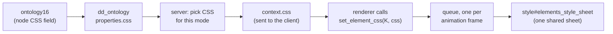

# Ontology CSS

> See also: [Ontology authoring](authoring.md) · [Overriding shared ontology nodes](local_ontology_overrides.md) · [CSS / LESS architecture](../ui/css_architecture.md) · [Themes](../ui/themes.md) · [dd_object](../dd_object.md)

An ontology node can carry its own CSS: a small JSON object in the node's
**CSS** field (`ontology16`, stored as `properties.css`). Dédalo scopes every rule
to that one element and writes it into the page at runtime. This page explains,
for ontology authors first and developers second, what you can write, which
selector each entry becomes, and how to check the result in the browser.

## When to use it

Use ontology CSS for **layout decisions that belong to one node**: how many grid
columns a field spans in its edit form, how a portal lays out its rows, the
height of one field's editor, a background colour that groups a few fields.
These are part of the definition of a section, travel with the ontology, and
reach every installation that uses it.

Do **not** use it for anything that belongs to a component *type* (every
`component_input_text`, every portal). Styling shared by all instances of a
type lives in the LESS sources of the code base and is built into `main.css` —
see [CSS / LESS architecture](../ui/css_architecture.md). As a rule: if the same
rule would be copied into many nodes, it belongs in the LESS.

## The shape

`properties.css` is an object. Each **key** is a selector *fragment*; each
**value** is an object of CSS declarations, written as in a stylesheet but in JSON:

```json
{
    ".wrapper_component": { "grid-column": "span 4", "background-color": "#fefed5" },
    ".content_data":      { "min-height": "40vh" }
}
```

- A declaration value is a **string** (`"span 4"`) or a **number** (`"order": 2`
  becomes `order:2`). Booleans, arrays and `null` are ignored.
- `content` values are always wrapped in single quotes: `"content": "A"` becomes
  `content:'A'`. A value such as `none` or `counter(x)` therefore cannot be
  written for `content`.
- A value may carry `!important` (`"width": "10px !important"`); it is passed
  through as written.
- A declaration value can also be a nested block — a media query, a hover state
  — see [Nested blocks](#nested-blocks-media-and-hover).

You never write the element's own class names: the engine adds them — see
[How a fragment is scoped](#how-a-fragment-is-scoped).

## Your first rule

1. Open the node in the Ontology area, for example
   [rsc85](https://dedalo.dev/ontology/rsc85) (*Name overwrite*).
2. Write the JSON in its **CSS** field (`ontology16`):
   `{ ".wrapper_component": { "grid-column": "span 4", "background-color": "#fefed5" } }`
3. Save the record.
4. Run **Process** (`tools/tool_ontology`) on the record. Saving changes only the
   editable record; the runtime keeps serving the old compiled `dd_ontology` row
   until the record is processed or its TLD regenerated — see
   [How changes apply live](authoring.md#how-changes-apply-live).
5. Reload a *People* record and inspect the field. The engine has inserted:

   ```css
   .rsc197_rsc85.rsc85.edit.wrapper_component { grid-column:span 4; background-color:#fefed5 }
   ```

   plus its [dark-theme](#dark-theme) counterpart. The rest of this page
   explains where `.rsc197_rsc85.rsc85.edit` comes from.

## How a fragment is scoped

Every element on the page carries a **scope class** built from the section it is
shown in and its own tipo: `<section_tipo>_<tipo>`. For example, the field
[rsc85](https://dedalo.dev/ontology/rsc85) (*Name overwrite*) in a record of
the *People* section [rsc197](https://dedalo.dev/ontology/rsc197) has the
class `rsc197_rsc85`, next to `rsc85` and the mode, `edit`.

!!! note "`section_tipo` is the section of the record, not the node's parent"
    `rsc85` belongs to section [rsc75](https://dedalo.dev/ontology/rsc75)
    (inside its group `rsc76`), but
    *People* records are stored in the virtual section `rsc197`, so the scope
    is `rsc197_rsc85`. The same component shown in another (virtual) section gets
    another scope class. This is what keeps one section's CSS from touching
    another's.

The engine joins a **scope key** (the classes, one after another) with each
fragment, in one of two ways:

| Your fragment starts with… | Rule | Result for scope key `K` |
| --- | --- | --- |
| `.wrapper` (`.wrapper_component`, `.wrapper_grouper`, `.wrapper_section`, `.wrapper_area`) | **compound**: glued to the scope key — the element's own wrapper | `.K.wrapper_component` |
| `>` (`> .content_data`, `>.list_body`) | appended after one space | `.K >.list_body` |
| anything else (`.content_data`, `.list_body`) | **direct child** of the wrapper | `.K > .content_data` |

Whatever follows the first part is kept as written, so
`.wrapper_component .input_value` becomes `.K.wrapper_component .input_value` —
any descendant of the wrapper.

A fragment that is a **comma list** is split, and every branch is scoped on its
own: `.content_data, .label` becomes `.K > .content_data, .K > .label`. Commas
inside brackets or quotes (`:is(.a, .b)`) do not split.

### Scope key per element

Which classes make up `K` depends on the element. The table below is reference
material: it is exactly what each renderer passes to the engine.

| Element | Scope key `K` | Notes |
| --- | --- | --- |
| component, edit | `<section_tipo>_<tipo>.<tipo>.edit` | |
| component, list cell | `<section_tipo>_<tipo>.<tipo>.list` | only when the server sends list css (see [Modes](#modes)); never for `component_filter` cells nor for Time Machine (`dd15`) cells |
| component, search | — | **not applied** by the search wrapper; `css.wrapper` / `css.label` are read there only as extra class-name lists. Exception: `component_security_access`, whose search view reuses the edit wrapper, gets it with `<section_tipo>_<tipo>.<tipo>.search` |
| section, edit | `<section_tipo>_<section_tipo>.edit` | also reads `add_class` |
| section, list | `<section_tipo>_<section_tipo>.list` | the CSS comes from the section's `section_list` child; merged with the computed column grid, see [Section lists](#section-lists) |
| `section_group` | `<section_tipo>_<tipo>.edit` | its wrapper class is `wrapper_grouper` |
| `section_tab` / `tab` | `<section_tipo>_<tipo>.edit` | |
| `component_portal`, edit | `<section_tipo>_<tipo>.<tipo>.edit` | like any component; the portal view also writes its own column grid, see [Portals](#portals) |
| area | `<tipo>_<tipo>.<mode>` | an area's section_tipo is its own tipo; opened from the menu the mode is `list`; also reads `add_class` |
| button (in the section list toolbar) | — | no rules: a button reads only `css.style`, a class name, see [Buttons](#buttons) |

### Section lists

A section in list mode does not use the section node's CSS. It uses the CSS of
its `section_list` child (for example
[rsc169](https://dedalo.dev/ontology/rsc169), the list of the *Audiovisual*
section [rsc167](https://dedalo.dev/ontology/rsc167)). The list view first
builds a rule for the column grid from the columns it shows, then adds the
child's entries **over it**:

```json
{ ".list_body": { "grid-template-columns": "<computed from the columns>" } }
```

!!! warning "A `.list_body` key replaces the computed grid"
    The merge is by key. A `section_list` CSS with its own `.list_body` entry
    replaces the whole computed object, `grid-template-columns` included —
    repeat the grid in your entry, or the columns lose their widths.

### Portals

A portal is a component, so its node CSS is scoped like any component
(`.<section_tipo>_<tipo>.<tipo>.edit`). Its view separately writes the row grid
from its columns under a shorter key, `.<section_tipo>_<tipo>.edit.view_<view> >
.list_body` (list: `.<section_tipo>_<tipo>.list.view_<view>`, not for the
mosaic view). The node rule has more classes, so a `grid-template-columns` you
write on `.wrapper_component > .list_body` wins over the computed one.

### Buttons

Buttons do not go through the engine. A button node shown in the section list
toolbar may carry `"css": {"style": "<class name>"}`; that class is added to the
button. Example: the *Add images* button
[tch136](https://dedalo.dev/ontology/tch136) (`button_import`, section
*Catalogue* `tch7`) has `{"style": "import_files"}`, so its button gets the class
`import_files`, styled in the LESS.

## Modes

The server decides which CSS an element receives in each mode, before the
client sees it.

- **Edit, and every mode other than list** (search, Time Machine…): the node's
  own CSS.
- **List**: a component's edit CSS is **not** sent — a grid placement written
  for the edit form makes no sense in a list cell. Sections and portals in list
  mode take the CSS of their `section_list` child instead (no child: none).
  Areas are the exception: an area has a single render, so its CSS is sent in
  every mode.
- **Reserved keys `list` and `search`.** A CSS object may carry a `list` and/or
  a `search` key holding a separate fragment map for that mode. In list mode
  `css.list` is sent even where the edit CSS is stripped; in search mode
  `css.search` replaces the base set. The reserved keys never reach another
  mode, and they are reserved words — you cannot use `list` or `search` as a
  selector fragment.

  ```json
  {
      ".wrapper_component": { "grid-column": "span 4" },
      "list": { ".wrapper_component": { "font-weight": "600" } }
  }
  ```

  No live node uses these keys on this install; shape only. Note that the
  search wrapper does not inject ontology CSS, so `css.search` has a visible
  effect only on components whose search view reuses the edit wrapper
  (`component_security_access`).
- **Section override.** A section node can set the CSS of one of its
  components: in the section's `properties.css`, a key that is the component's
  tipo holds that component's whole CSS map. It **replaces** the component's own
  CSS (no merge), in every mode, and is not stripped in list mode. No live
  section uses it on this install; shape only:

  ```json
  { "rsc85": { ".wrapper_component": { "grid-column": "span 2" } } }
  ```

  (written on the section node — here it would be `rsc197`'s CSS field).

A local override of a shared node replaces the CSS as a whole, too — see
[Overriding shared ontology nodes](local_ontology_overrides.md).

## Nested blocks: media and hover

Inside a declarations object, a key whose value is an **object** opens a nested
block. The engine writes it with native CSS nesting, inside the same rule:

| Nested key | Written as | Meaning |
| --- | --- | --- |
| `@media …`, `@supports …` | as written | the declarations apply under that condition |
| `:hover`, `:focus-within`, `::before` (starts with `:`) | `&:hover` | the element itself in that state |
| anything containing `&` (`&.active`, `.dark_panel &`) | as written | your own nesting selector |
| any other selector (`.dark_panel`) | `.dark_panel &` | the element when it is **inside** `.dark_panel` |

!!! warning "Unlike LESS, a nested plain selector is an ancestor"
    In LESS a nested `.x` is a descendant; here it means `.x &`. Write the `&`
    yourself for anything else:

    - descendant: `{ ".wrapper_component": { "& .input_value": { "color": "#333" } } }`
    - same element with another class: `{ ".wrapper_component": { "&.active": { "color": "#333" } } }`

```json
{ ".wrapper_component": { "grid-column": "span 5",
                          "@media screen and (max-width: 1024px)": { "grid-column": "span 10" } } }
```

Put the media query **inside** a fragment, as above. A media query as a
top-level key (`"@media …": { ".wrapper_component": {…} }`) is scoped like a
selector, produces an invalid rule and is dropped with a console warning.

## `add_class`

`add_class` is not CSS: it adds class names to nodes, so you can reuse a style
that already exists in the LESS. It is read by **sections in edit mode** and by
**areas**, and two targets are supported, `wrapper` and `content_data`:

```json
{ "add_class": { "wrapper": ["bg_warning"], "content_data": ["my_class"] } }
```

Areas also accept a single string (`"wrapper": "bg_warning"`). On a section a
string is split into single letters (`b`, `g`, `_`…), so always use an array.
Other elements ignore `add_class`. No live node uses it on this install.

## Dark theme

Colours in ontology CSS are written against the light palette, so the engine
adds a dark-theme counterpart for every **literal colour** it finds in
`background`, `background-color`, `border*-color`, `outline-color`, `color`,
`fill` and `stroke`. The counterpart keeps the hue and moves the lightness to
the dark band, using CSS relative colours:

| Property kind | Dark value |
| --- | --- |
| surface (`background`, `background-color`) | `hsl(from <colour> h calc(s * 0.42) 18%)` |
| line (`border-*-color`, `outline-color`) | `hsl(from <colour> h calc(s * 0.42) 34%)` |
| ink (`color`, `fill`, `stroke`) | `hsl(from <colour> h calc(s * 0.55) 78%)` |

It is a separate rule, `:root[data-theme="dark"] <selector> { … }` (for a comma
list, every branch gets the prefix), so switching theme needs no reload. Values that are already theme-aware (`var(--…)`),
keywords (`transparent`, `inherit`, `currentColor`), gradients, shorthands
(`1px solid #ccc`) and values with `!important` are left alone — use a
`var(--…)` token when you need full control in both themes (see
[Themes](../ui/themes.md)).

## What happens at runtime



In plain words:

1. **Server.** After the record is processed (`tools/tool_ontology` → Process,
   or a TLD regenerate), its CSS field becomes `properties.css` in
   `dd_ontology`. For each element it renders, the server
   picks the CSS for that mode ([Modes](#modes)) and sends it as the element's
   `context.css` — `properties.css` itself is never sent. Once processed, an edit to a
   node's CSS is served from the next request on.
2. **Client.** The renderer of the element (the wrapper builder) calls
   `set_element_css(K, css)` from `client/dedalo/core/page/js/css.js`, which
   turns each fragment into **one rule** (plus its dark counterpart).
3. **One shared sheet.** All rules live in a single `<style
   id="elements_style_sheet">` added to the end of `<head>`. Writes are queued
   and applied once per animation frame, so drawing a whole form causes one
   update.
4. **No duplicates.** A rule is remembered by its selector. Drawing the same
   element again with the same CSS does nothing; with different CSS the old rule
   is removed and the new one added. Two elements sharing a media query keep
   their own blocks, because the media query lives inside each element's rule.
5. **Cleanup.** After navigation, once more than 500 rules are held, the rules
   whose selector no longer matches anything on the page are removed. Rules of
   elements still on screen are never removed.

Because the rules come after `main.css` in the page, an ontology rule wins over
a LESS rule of equal specificity, and usually has more classes anyway.

## Limitations and gotchas

!!! warning "Legacy v5 `style` and `mixin` blocks are ignored"
    Many nodes still hold the old shape
    `{".column_numisdata77": {"style": {"width": "200px"}}}` (for example the
    list [numisdata122](https://dedalo.dev/ontology/numisdata122) of section
    `numisdata3`, *monedaiberica* install), or `"mixin": [".vertical"]`. These
    blocks never had any effect in this engine and are skipped: a `style` block
    logs a console warning when debug is on, a `mixin` array is skipped silently. To make one work, rewrite it in the current
    shape — and check it, because it will then change the layout.

- **`>` means direct child.** `.column_numisdata77` is scoped as
  `.K > .column_numisdata77`, but list columns sit several levels below the
  section wrapper. For deep nodes start the fragment with `.wrapper_…` and
  write a descendant path (`.wrapper_section .column_rsc244 …`), as in
  [Example 4](#example-4-a-section-list-column).
- **`.wrap_component` (v5) matches nothing.** The v7 wrapper class is
  `.wrapper_component` (`.wrapper_grouper` for groups).
- **`list` and `search` are reserved** top-level keys ([Modes](#modes)).
- **List mode drops component CSS.** If your rule shows in the edit form but
  not in the list, that is intended; use `css.list` or the section's
  `section_list` child.
- **Search forms get no ontology CSS**, except components whose search view
  reuses the edit wrapper (`component_security_access`).
- **The CSS field is replaced whole** by a local override or a section
  override — copy what you want to keep.
- **One rule per element and mode, not per instance.** Two lists of the same
  section on one page share the scope key, so the last one drawn sets the
  column grid for both.

## How to debug

1. **Inspect the element.** In DevTools select the field and look at its
   classes: `wrapper_component component_input_text rsc85 rsc197_rsc85 edit
   view_default`. Those are the classes your scope key must match.
2. **Find the rule.** In the *Elements* panel open
   `<head> > style#elements_style_sheet`; the *Styles* pane of the selected
   element lists the matching rules from it. Or list them all in the console:

   ```js
   [...window.elements_style_sheet.cssRules].map(rule => rule.cssText)
   ```

   The browser re-serializes the text (`>.list_body` shows as `> .list_body`,
   `color:white` as `color: white;`), but the rule is the same.
3. **No rule at all?** Check that the server sent it: the element's
   `context.css` in the API response (in list mode it is `null` for a plain
   component). With debug on, the response debug panel also lists
   the engine's registry (`elements_css_object`, the `get_inserted_rules()` map:
   selector → `{rule_text}`).
4. **Rule present but no effect?** It is a selector that matches nothing (a
   `>` that is not a direct child, a v5 class) or a more specific LESS rule wins
   — the *Styles* pane shows which.

## Worked examples

The tipos below are real nodes; the CSS is copied from `dd_ontology` of the
*monedaiberica* install (`numisdata`, `dd`, `rsc`, `ontology` TLDs). The output
is the rule text the engine inserts.

### Example 1: a field's width and colour

[rsc85](https://dedalo.dev/ontology/rsc85) (`component_input_text`,
*Name overwrite*), shown in a *People* record (section `rsc197`), edit mode:

```json
{ ".wrapper_component": { "grid-column": "span 4", "background-color": "#fefed5" } }
```

```css
.rsc197_rsc85.rsc85.edit.wrapper_component { grid-column:span 4; background-color:#fefed5 }
:root[data-theme="dark"] .rsc197_rsc85.rsc85.edit.wrapper_component { background-color:hsl(from #fefed5 h calc(s * 0.42) 18%) }
```

In list mode the server sends no CSS for `rsc85`, so the list cell is unstyled.

### Example 2: a responsive field with a nested media query

[ontology16](https://dedalo.dev/ontology/ontology16) (`component_json`, the
*CSS* field of the ontology editor itself). Editing a node of the `dd` TLD, the
record is in section `dd0`:

```json
{
    ".wrapper_component": {
        "grid-column": "span 5",
        "@media screen and (max-width: 1024px)": { "grid-column": "span 10" }
    },
    ".wrapper_component >.content_data": { "max-height": "40rem", "min-height": "40vh" },
    ".wrapper_component >.content_data .jse-menu": { "background-color": "#826b85" }
}
```

```css
.dd0_ontology16.ontology16.edit.wrapper_component { grid-column:span 5; @media screen and (max-width: 1024px) { grid-column:span 10 } }
.dd0_ontology16.ontology16.edit.wrapper_component >.content_data { max-height:40rem; min-height:40vh }
.dd0_ontology16.ontology16.edit.wrapper_component >.content_data .jse-menu { background-color:#826b85 }
:root[data-theme="dark"] .dd0_ontology16.ontology16.edit.wrapper_component >.content_data .jse-menu { background-color:hsl(from #826b85 h calc(s * 0.42) 18%) }
```

Its siblings `ontology17`–`ontology19` carry the same media query on the same
form; each keeps its own block.

### Example 3: a portal's row grid

[dd1504](https://dedalo.dev/ontology/dd1504) (`component_portal`, *Images*) in a
*Projects* record (section [dd153](https://dedalo.dev/ontology/dd153)), edit
mode:

```json
{
    ".wrapper_component": { "grid-column": "span 4" },
    ".wrapper_component > .list_body": {
        "grid-template-columns": "1fr 1fr 1fr 1fr 1fr",
        "@media screen and (max-width: 1024px)": { "width": "100%", "display": "contents" }
    },
    ".wrapper_component >.list_body >.content_data .section_record .component_image >.content_data": { "height": "12rem" }
}
```

```css
.dd153_dd1504.dd1504.edit.wrapper_component { grid-column:span 4 }
.dd153_dd1504.dd1504.edit.wrapper_component > .list_body { grid-template-columns:1fr 1fr 1fr 1fr 1fr; @media screen and (max-width: 1024px) { width:100%; display:contents } }
.dd153_dd1504.dd1504.edit.wrapper_component >.list_body >.content_data .section_record .component_image >.content_data { height:12rem }
```

The portal view also writes `.dd153_dd1504.edit.view_<view> > .list_body {
grid-template-columns:… }` from its columns; the node rule above has more
classes and wins.

### Example 4: a section list column

The *Audiovisual* section [rsc167](https://dedalo.dev/ontology/rsc167) in list
mode takes the CSS of its `section_list` child
[rsc169](https://dedalo.dev/ontology/rsc169), which styles the tags inside the
column of the widget [rsc244](https://dedalo.dev/ontology/rsc244)
(`component_info`):

```json
{ ".wrapper_section .column_rsc244 .wrapper_widget .widget .values_container .tags": { "display": "grid", "grid-template-columns": "1fr 1fr" } }
```

```css
.rsc167_rsc167.list > .list_body { grid-template-columns:<computed from the columns> }
.rsc167_rsc167.list.wrapper_section .column_rsc244 .wrapper_widget .widget .values_container .tags { display:grid; grid-template-columns:1fr 1fr }
```

The fragment starts with `.wrapper_section`, so it is glued to the section's own
wrapper and the rest is a descendant path — the way to reach a cell deep in the
list.

### Example 5: a group's inner grid

[rsc334](https://dedalo.dev/ontology/rsc334) (`section_group`,
*Identification*) of a *Bibliographical reference* record (section `rsc332`,
virtual of [rsc333](https://dedalo.dev/ontology/rsc333)):

```json
{ ".content_data": { "grid-template-columns": "repeat(10, 1fr)" } }
```

```css
.rsc332_rsc334.edit > .content_data { grid-template-columns:repeat(10, 1fr) }
```

### Example 6: an area

The area [dd355](https://dedalo.dev/ontology/dd355) (*Cultural*), opened from
the menu (mode `list`):

```json
{ ".wrapper_area": { "color": "white", "background-color": "#4fb492" } }
```

```css
.dd355_dd355.list.wrapper_area { color:white; background-color:#4fb492 }
:root[data-theme="dark"] .dd355_dd355.list.wrapper_area { color:hsl(from white h calc(s * 0.55) 78%); background-color:hsl(from #4fb492 h calc(s * 0.42) 18%) }
```

## For developers

- Engine: `client/dedalo/core/page/js/css.js` — `set_element_css(key, value)`,
  `prune_rules`, `prune_orphan_rules`, `get_inserted_rules`,
  `get_elements_style_sheet`. A value that is a function (used internally for
  the phone-card column labels, `#col_<id>::before { content:'<label>' }`)
  returns its own `{selector, value}`.
- Rules are tracked by the `CSSRule` object, not by selector text, so replace
  and prune work even when the browser re-serializes a selector (`:before` →
  `::before`).
- Server: the mode decision is `resolveEmittedPropertiesAndCss` in
  `src/core/resolve/structure_context.ts`.
- Tests: `client/dedalo/test/client/js/test_css.js` (browser, the engine) and
  `test/unit/structure_context_css.test.ts` (server, the mode table).
