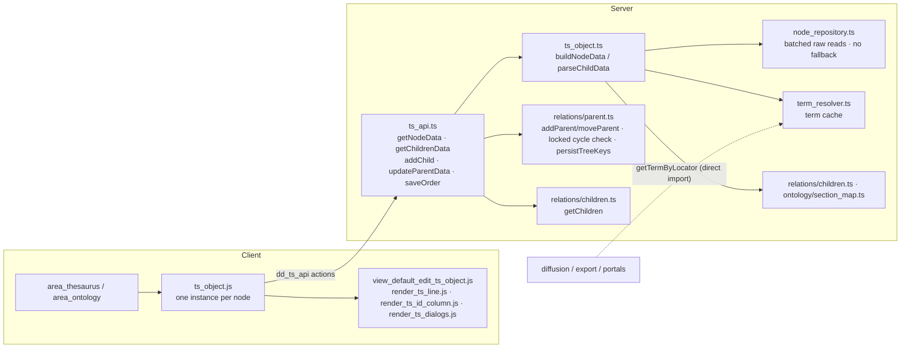

# ts_object

> The thesaurus/ontology **tree node** — the server-side builder that turns one term record into a renderable tree row, plus the client widget that owns one DOM node of the tree.

> See also: [Thesaurus & Ontology tree](../thesaurus/index.md) (the conceptual model) · [hierarchy](hierarchy.md) · [component_relation_parent](../components/component_relation_parent.md) · [component_relation_children](../components/component_relation_children.md)

This page is the **developer reference** for the `ts_object` subsystem. For the
conceptual model — *what a thesaurus tree is*, the bottom-up parent storage rule,
the section map and the `ddo_map` row definition — read
[Thesaurus & Ontology tree](../thesaurus/index.md) first; this document does not
repeat that material at length and instead documents the real modules, their
public functions and how the pieces wire together.

`ts_object` is **not one module but a small subsystem**: a server node builder
(`src/core/ts_object/ts_object.ts`), two server helpers it calls
(`term_resolver.ts`, `node_repository.ts`), a tree-search module
(`search.ts`), an API dispatch layer (`ts_api.ts`), and the client widget
(`client/dedalo/core/ts_object/js/ts_object.js` + its view files).

## Role

`ts_object` builds the representation of **one node** of a thesaurus/ontology
tree — a single term record rendered as a tree row. A thesaurus tree is not a
bespoke data structure: every row is an ordinary [section](../sections/index.md)
record (`es1_42`, `ts1_7`, …), and `ts_object.ts` reads that record's role
components (term, descriptor flag, indexable flag, order, children link,
indexation count) through the section map and emits the node shape the client
tree consumes.

On the **server**, `src/core/ts_object/ts_object.ts` is a set of plain exported
functions — `buildNodeData()`, `parseChildData()`, `getChildrenData()`,
`getArElements()`, `isIndexable()`, `hasChildrenOfType()` (private),
`getPermissionsElement()`, `getCountDataGroupBy()` — composing the
resolver/relations/search primitives directly. It is driven by
`src/core/ts_object/ts_api.ts`, which the HTTP dispatch
(`src/core/api/dispatch.ts`) forwards `get_node_data` / `get_children_data` /
the mutations into.

On the **client**, `ts_object.js` is a no-framework ES-module instance class,
one JS instance per DOM node.

Relative to neighbouring subsystems:

| subsystem | relationship |
| --- | --- |
| **[`section`](../sections/section.md)** | Every tree row *is* a section record. `ts_object.ts` resolves children, the section map and permissions through `src/core/relations/children.ts` and `ontology/section_map.ts`, and reads raw record columns directly. |
| **[`hierarchy`](hierarchy.md)** | Describes a whole tree (TLD, typology, root terms). The order component tipo is resolved via `getComponentOrderTipo()` (`relations/children.ts`), which walks the section map's `order` role under the `thesaurus` scope. |
| **`section_map`** | The role-to-component map (`term`/`parent`/`order`/`is_descriptor`/`is_indexable`/`model`). `ts_object.ts` and its helpers resolve roles through `ontology/section_map.ts`. |
| **[`component_relation_parent`](../components/component_relation_parent.md) / [`component_relation_children`](../components/component_relation_children.md)** | The edge model: the *child* stores the parent locator; children are computed by querying who points at the parent (`src/core/relations/children.ts`, `parent.ts`). `ts_object.ts` only **reads** them — all writes go through `ts_api.ts`. |
| **[`component_relation_index`](../components/component_relation_index.md)** | The "U" indexations icon: `getCountDataGroupBy()` counts indexations against the term via `countInverseReferences()` (`src/core/search/search_related.ts`) to build the icon value. |
| **Diffusion / export / portals** | Consume `term_resolver.ts` through `getTermByLocator()` / `getTermDataByLocator()` — plain exported functions imported directly; there is no facade layer. |

!!! warning "`ts_object.ts` reads; it never mutates the tree"
    The module is **read-only**: it builds node data and counts. All tree
    mutations (add child, move/`update_parent_data`, reorder) live in
    `ts_api.ts`, inside `withTreeTransaction()` (`tree_locks.ts`) with per-node
    advisory locks, and write through `relations/parent.ts`, whose locked reads
    and locked cycle check are described in
    [the thesaurus lock law](../thesaurus/index.md#the-lock-law-no-lost-update-no-stored-cycle).
    The only state `ts_object.ts` *changes* is its own module-level cache (and
    only via `invalidateNode()`).

## Responsibilities

- **Build one node's data** — read the `section_list_thesaurus` `ddo_map`
  (`getArElements()`), resolve each element (term, icons, link_children)
  against the preloaded matrix record, and emit the node object the client
  renders (`buildNodeData()`).
- **Resolve and paginate children** — given a parent, compute its children
  locators through `getChildren()`/`countChildrenOrNull()`
  (`relations/children.ts`), and turn each into a node
  (`getChildrenData()` → `parseChildData()`).
- **Resolve node flags** — `is_descriptor` (descriptor vs ND, flipped inline
  during element resolution), `isIndexable()`, the per-parent `order`, and
  whether a node *has* descriptor/ND children (`hasChildrenOfType()`,
  private).
- **Count indexations** — for the "U" icon, count records that index the term
  (and, in the recursive variant, the term plus all its descendants) via
  `getCountDataGroupBy()`.
- **Resolve permissions** — the per-node `button_new`/`button_delete`
  permission integers (`getPermissionsElement()`).
- **Term resolution (delegated)** — resolve a term string/raw data from a
  locator via `term_resolver.ts`, with its cache.
- **Batched raw reads (delegated)** — kill the N+1 component loads on wide
  nodes via `node_repository.ts` (one SQL query per section group). It is
  **batch-first, with no per-component fallback** — see
  [`node_repository.ts`](#node_repositoryts--public-api).
- **Cache hygiene** — targeted eviction after mutations (`invalidateNode()`
  in `ts_object.ts`, which also evicts the term cache); there is no
  "clear-all" call to make, since every `dd_ontology` write already fans out
  through `clearOntologyDerivedCaches()`.
- **Client widget (`ts_object.js`)** — own one DOM node, expand/collapse state,
  child loading + dedup, rendering, search-path opening, drag-and-drop move,
  delete, indexation grid, order editing, and instance lifecycle.

## Files & structure

```text
src/core/ts_object/
├── ts_object.ts          server node builder (this subsystem's core) — buildNodeData, parseChildData, getChildrenData, getArElements, isIndexable, getPermissionsElement, getCountDataGroupBy, invalidateNode
├── term_resolver.ts      term string/data resolution + the term cache (getTermByLocator, getTermDataByLocator, invalidateNode, clearTermCache)
├── node_repository.ts    batched raw matrix reads (N+1 killer), no per-component fallback (fetchNodeInfo, batchDescriptorFlags)
├── search.ts             tree search / ancestor-expansion (searchThesaurus, getHierarchyTermsSqo)
└── ts_api.ts             the tree API: getNodeData, getChildrenData, addChild, updateParentData, saveOrder

client/dedalo/core/ts_object/
├── css/
└── js/
    ├── ts_object.js                instance class: API, state, expand/search/move/delete
    ├── view_default_edit_ts_object.js  render / render_children / render_child / render_wrapper / pagination
    ├── render_ts_line.js           row elements (term, icons, link_children); model-based dispatch
    ├── render_ts_id_column.js      the id/order column + the inline order form
    ├── render_ts_dialogs.js        the delete-term dialog
    ├── render_edit_ts_object.js    the edit/search entry (assigned to .edit / .search)
    └── drag_and_drop.js            drag-and-drop move wiring
```

The API surface that drives the server side is `src/core/ts_object/ts_api.ts`
(read actions `get_node_data`, `get_children_data`; mutations `add_child`,
`update_parent_data`, `save_order`) — five actions, wired under the `dd_ts_api`
key in `src/core/api/dispatch.ts`. See
[Tree mutations](../thesaurus/index.md#tree-mutations).

## Data model

### The node object (`buildNodeData()` output)

The unit `ts_object.ts` produces is a flat `TsNodeData` object:

```json
{
    "section_tipo"  : "es1",
    "section_id"    : 42,
    "ts_id"         : "es1_42",
    "ts_parent"     : "es1_5",
    "order"         : 3,
    "mode"          : "list",
    "lang"          : "lg-eng",
    "is_descriptor" : true,
    "is_indexable"  : true,
    "children_tipo" : "hierarchy49",
    "has_descriptor_children" : true,
    "ar_elements"   : [
        { "type": "term", "tipo": "hierarchy25", "value": "Valencia", "model": "component_input_text" },
        { "type": "icon", "tipo": "hierarchy40", "value": "U:37", "model": "component_relation_index", "count_result": { "total": 37, "totals_group": [ ] } },
        { "type": "link_children", "tipo": "hierarchy49", "value": "button show children", "model": "component_relation_children" }
    ],
    "permissions_button_new"    : 2,
    "permissions_button_delete" : 2
}
```

- **`ts_id` / `ts_parent`** are the node identity: `"{section_tipo}_{section_id}"`
  (`ts_parent` is `null` for roots). Same identity the client uses. Note
  `section_id` on the wire is **always a string** — `buildNodeData()` stamps
  `String(sectionId)`.
- **`ar_elements`** is the resolved tree row, one entry per `ddo_map` element
  that survives processing. Element `type` ∈ `term` | `icon` | `img` |
  `link_children` | `link_children_nd` (the last one is **synthesized** by
  `resolveElementValue()` when a node has ND children).
- **`is_descriptor`** starts `true` and is flipped to `false` inline (inside
  `resolveElementValue()`'s `icon`/`ND` branch) when the ND icon's component
  resolves to "no" (`section_id === 2`).
- **`children_tipo`** is the `component_relation_children` tipo, captured from
  the `link_children` element — set to `null` for non-descriptors (ND terms
  carry no children config).

### `ar_elements` value rules (per element type)

These are the rules in `resolveElementValue()` / `getComponentDataLang()`
(`ts_object.ts`):

| element | how its value is built |
| --- | --- |
| `term` | Every non-empty value of the term component(s) in the data language, joined with `' \| '`; an empty language falls back through the term language chain (see *The term language chain* below) and is wrapped as `` `<mark>${value}</mark>` `` (after escaping) to mark it untranslated. |
| `icon` `ND` | Consumed server-side: sets `data.is_descriptor = false`, then **skips** the element (never rendered as an icon). |
| `icon` `CH` | Always skipped. |
| `icon` `U` (model `component_relation_index`) | Value becomes `` `${icon}:${total}` `` from `getCountDataGroupBy()`; zero-use icons are dropped. The element also carries a `count_result` whose `totals_group` entries are enriched with their section labels (`termByTipo()`, a direct `dd_ontology.term` read, structure-lang-first). |
| `icon` `M` | Rendered like any other icon, and additionally carries `model_value` — the **model name** of the term next to it (`"area_tool"`). See [The `M` icon's model badge](#the-m-icons-model-badge) below. |
| `icon` (other) | Rendered only when the component has data; empty icons are skipped. |
| `link_children` | Sets `children_tipo` and `has_descriptor_children`; value is `'button show children'` or `'button show children unactive'`. If the node also has ND children, an extra `link_children_nd` element is appended. |
| `component_portal` / `component_autocomplete_hi` | Each locator value is replaced by its resolved term string (`getTermByLocator(locator, DATA_LANG, true)`). |
| legacy `component_relation_struct` | Always skipped (the `model === 'box elements'` guard in `processElementDetails()`). |

Two element behaviours are **deliberately not resolved** in the tree and are
ledgered in `ts_object.ts`'s own coverage note: a `component_relation_related`
element does **not** get its inverse references merged in (a tree term is rarely
a related component), and a `component_svg` element does **not** resolve to a
file URL. The indexation *grid* (tag indexation, as opposed to the "U" count) is
likewise out of scope for the node builder — only the counts are produced here.

### The `M` icon's model badge

An element whose resolved value is `'M'` gets one extra field:

```json
{ "type": "icon", "tipo": "ontology6", "value": "M", "model_value": "area_tool", "model": "component_portal" }
```

`model_value` is the name of the **model** the term implements. The ontology
tree renders it as a small orange badge to the right of the `M` button, hidden
until the user presses `Ctrl+M` — that is what turns the tree into a readable
schema (see [area_ontology](../areas/area_ontology.md#the-model-badge-ctrlm)).

The gate is the **resolved** value, not the `ddo_map` `icon` key, so a
`component_relation_index` element whose value became `"M:3"` never matches.

Resolution (`resolveModelValue()` in `ts_object.ts`) does not go through the
target section's `term` scope — an `M` component displays its target by its own
rules:

1. The **raw locators** are read off the record, not the value
   `getComponentDataLang()` produced: for the portal family that has already been
   flattened through the target's `thesaurus` term scope, which for an ontology
   model record is `[term, tld, section_id]` and collapses to the bare tld.
2. The tipos to read on the target come from the component's own
   `properties.source.request_config[].show.ddo_map` (`section_tipo: 'self'`
   entries) — `ontology6 → [ontology5, ontology9]`,
   `hierarchy27 → [hierarchy25]`. Fields join with the config's
   `fields_separator` (default `', '`), multiple locators with
   `records_separator` (default `' | '`).
3. Each value resolves through `getDdoValueByLocator()` (`term_resolver.ts`) with
   the same term language chain as every term read (below). This is
   load-bearing — model-name records store their term in a single language, so a
   strict data-lang read would leave every badge empty in any other UI language.

A component that declares no usable `ddo_map` yields an empty string (the client
suppresses the badge) and logs a warning; a tree read never fails over a
decoration.

### The term cache (in `term_resolver.ts`)

`term_resolver.ts` holds the **only** term cache, `termByLocatorCache`, keyed
`` `${section_tipo}_${section_id}_${scope}_${lang}` ``. It self-caps at 1000
entries (full-drop on overflow, not an LRU). The `M` badge shares it under a
`` `ddo:${tipos}` `` scope key rather than keeping a private cache, so it
inherits the same invalidation. It evicts per node on the
`` `${tipo}_${id}_` `` prefix (`invalidateNode()` in `term_resolver.ts`), and
registers with `clearOntologyDerivedCaches()` for a full flush. `ts_object.ts`
does **not** duplicate this cache — it only keeps a separate `resolvedChildCache`
(node-identity keyed, bounded 1000, full-drop on overflow) for the recursive
indexation search.

## Instantiation & lifecycle (server)

There is no class to instantiate — `buildNodeData()` is a plain `async
function` taking every input as an explicit parameter:

```ts
export async function buildNodeData(
	sectionTipo: string,
	sectionId: number | string,
	options: TsOptions,        // order / is_indexable / model / have_children / area_model
	tsParent: string | null,   // "{tipo}_{id}", or null for roots
	principal: Principal,      // the auth principal — permission checks need this explicitly
): Promise<TsNodeData>
```

```ts
// Build one node and read its first element value
import { buildNodeData } from 'src/core/ts_object/ts_object.ts';

const data = await buildNodeData('es1', 42, {}, null, principal);
data.ar_elements[0].value; // e.g. "Valencia"
```

`options` (`TsOptions`) is the per-node configuration bag: `order`,
`is_indexable` (prefetched), `model` (boolean — ontology "model" view),
`have_children` (forced-children case, e.g. persons), and `area_model`
(`'area_ontology'` switches the ontology-area behavior on). Every field is a
plain object property.

## Public API (server)

### `ts_object.ts` — node building & children

| function | purpose |
| --- | --- |
| `buildNodeData(sectionTipo, sectionId, options, tsParent, principal)` | Build the node object: iterate the `ddo_map`, resolve every element, compute `is_descriptor`/`is_indexable`/`children_tipo`/`has_descriptor_children` and the button permissions. Preloads the record **once** for the whole element loop. |
| `getChildrenData(sectionTipo, sectionId, childrenTipo, defaultLimit, areaModel, tsObjectOptions, pagination, principal)` | Resolve, count (SQL, via `countChildrenOrNull()` with a load-and-count fallback) and paginate a parent's children, then turn each into a node via `parseChildData()`. Returns `{result:{ar_children_data,pagination}, msg, errors}`. Refuses when `childrenTipo`'s model isn't `component_relation_children`. |
| `parseChildData(locators, areaModel, tsObjectOptions, parentLocator, principal)` | Turn an array of child locators into node objects. **Prefetches** order + `is_indexable` in one batched query (`fetchNodeInfo()`, parent-aware); a locator absent from the batch gets `order: null` directly. |
| `getArElements(sectionTipo, model)` | Read the `section_list_thesaurus` `ddo_map` for the section, with virtual→real section fallback and the `link_children`/`link_children_model` handling for the ontology "model" view. |

### `ts_object.ts` — node flags & predicates

| function | purpose |
| --- | --- |
| `isIndexable(sectionTipo, sectionId)` | Hierarchy/ontology roots are never indexable; a missing/false section_map `is_indexable` role → false; else read the first `is_indexable` locator (`section_id === 1` ⇒ true). |
| `hasChildrenOfType(arChildren, type, options)` *(private)* | Whether any child is a `descriptor` (1) or `nd` (2). Batched via `batchDescriptorFlags()`. Empty children + `options.have_children` forces the descriptor case. |

The ontology-area switch is not a standalone predicate: the check is inlined
where `options.area_model === 'area_ontology'` matters (`getArElements()`).

### `ts_object.ts` — indexations & permissions

| function | purpose |
| --- | --- |
| `getCountDataGroupBy(sectionTipo, sectionId, componentTipo, ddoEntry)` | Count indexation callers grouped by section via `countInverseReferences()` (`search/search_related.ts`). With `show_data` on the ddo entry, first resolves the term's children **recursively** (`getChildrenRecursive()`, cached by node identity) and counts the whole branch. |
| `getPermissionsElement(sectionTipo, elementName, principal)` | Resolve the integer permission for `'button_new'`/`'button_delete'` (special-cased for hierarchy/thesaurus root sections via `getPermissions()`), or any other element model (recursive child lookup via a local `dd_ontology` subtree walk). |

### `ts_object.ts` — term resolution

Every caller (diffusion, export, portals, `ts_object.ts` itself) imports
`term_resolver.ts` directly:

| function | module | purpose |
| --- | --- | --- |
| `getTermByLocator(locator, lang, fromCache, scope)` | `term_resolver.ts` | The string term for a locator. |
| `getTermDataByLocator(locator, scope)` | `term_resolver.ts` | The merged raw component data across the scope's term tipos. |
| `getComponentOrderTipo(sectionTipo)` | `relations/children.ts` | The order component tipo, resolved through the section map's `order` role under the `thesaurus` scope. |

### `ts_object.ts` — cache management

| function | purpose |
| --- | --- |
| `invalidateNode(sectionTipo, sectionId)` | Targeted eviction after a mutation: evicts the node's term cache (`term_resolver.ts`'s own `invalidateNode()`) and clears `resolvedChildCache` entirely. |

There is **no manual "clear everything" call** — every `dd_ontology` write fans
out through `clearOntologyDerivedCaches()`, which both `term_resolver.ts`'s
`clearTermCache()` and the resolver's caches register with.

### The term language chain

Every literal term part — the section_map term, an explicit ddo label, the tree's
`term` element, a portal showing a thesaurus term — follows one rule. The part is
every non-empty value of its language, joined with `' | '`. A translatable
component with no value in the requested language takes the first non-empty one
of: the hierarchy's main language, `lg-nolan`, then the project languages in
configuration order. Nothing past the project languages: a value held only in a
language no project declares is not shown. A non-translatable component reads
`lg-nolan` only. `getTermTextByLocator()` reports whether the fallback supplied
the text (`untranslated`); the tree turns that into its `<mark>`, while
`getTermByLocator()` — what exports, publication and search read — returns the
plain text.

### `term_resolver.ts` — public API

| function | purpose |
| --- | --- |
| `getTermByLocator(locator, lang = DATA_LANG, fromCache = false, scope = 'thesaurus')` | Resolve the term **string**: gather the scope's term tipos, read each component value through the term language chain, join with the scope separator. Falls back to a locator-string id when no term map exists. Caches per scope + lang. |
| `getTermTextByLocator(locator, lang = DATA_LANG, fromCache = false, scope = 'thesaurus')` | `getTermByLocator()` plus the `untranslated` flag: `{text, untranslated}`. For screens, which decorate after escaping. |
| `getTermDataByLocator(locator, scope = 'thesaurus')` | Resolve the merged **raw** component data across the scope's term tipos. Not cached. |
| `getDdoValueByLocator(locator, tipos, fieldsSeparator = ', ', lang = DATA_LANG)` | Resolve a locator's display string from an **explicit tipo list** instead of the section_map term scope — the `M` model badge. Same term language chain. Shares the cache under a `` `ddo:${tipos}` `` scope key. |
| `invalidateNode(sectionTipo, sectionId)` | Evict all cache keys for one node (all langs/scopes) on the `` `${tipo}_${id}_` `` prefix. |
| `clearTermCache()` | Full cache reset — registered with `clearOntologyDerivedCaches()`, so it runs automatically on any ontology write. |

!!! note "Scope defaults to `'thesaurus'`"
    The two locator readers default `scope = 'thesaurus'`; passing `null` walks the
    section_map scope chain instead. The cache key is scope-aware, to avoid
    cross-scope pollution.

### `node_repository.ts` — public API

The N+1 killer for wide nodes. It is **batch-first with no fallback**, and that
is a deliberate design decision worth knowing:

!!! warning "No per-component fallback"
    There is no per-component resolution path to fall back to, so the repository
    does not pretend one exists:

    - `fetchNodeInfo()` **throws** on an unresolvable section (bad table/tipo
      grammar) — a malformed locator is a hard error the caller must surface,
      not a silent miss.
    - `batchDescriptorFlags()` skips an unresolvable section **per-tipo** (that
      group's flags stay unresolved) rather than aborting the whole batch.
    - A locator that resolves but has no matching row still yields the
      documented default (`{order: null, is_indexable: false}`).

| function | purpose |
| --- | --- |
| `fetchNodeInfo(locators, parentLocator?)` | One query per `section_tipo` group resolving `order` (number column, paired to the parent when `parentLocator` narrows it) + `is_indexable` (relation column, `[0].section_id === 1`). Returns a map `` `${tipo}_${id}` → {order, is_indexable} ``. |
| `batchDescriptorFlags(locators)` | One query per group resolving the `is_descriptor` flag (first locator's `section_id`, `1`\|`2`). Returns a map of `int\|null` flags. |

## Client widget (`ts_object.js`)

`client/dedalo/core/ts_object/js/ts_object.js` is a no-framework ES-module
instance class: one instance per DOM node, instances cached in the global
instances map. It talks to `ts_api.ts` through the `dd_ts_api` action names.

### Instance key

```javascript
const key_order = ['section_tipo','section_id','children_tipo','target_section_tipo','thesaurus_mode','ts_parent']
```

`get_instance(options)` builds the key with `key_instances_builder(options)` and
returns a cached instance when present (refreshing its `caller`), otherwise
builds, registers and initializes a new one. **`ts_parent` is part of the key on
purpose**: the same term visible under two parents is two nodes and must not
steal each other's DOM.

### Public methods (selected)

| method | purpose |
| --- | --- |
| `init(options)` / `build(autoload=false)` | Initialize the instance and (optionally) load + render its data. |
| `get_node_data()` | Fetch this node's data from `dd_ts_api.get_node_data`. |
| `get_children_data(options)` | Fetch children from `dd_ts_api.get_children_data`, **deduping** concurrent requests with the same signature (`children_request` / `children_request_signature`). |
| `set_open(is_open, {persist, force_reload})` | **The only** expand/collapse entry point. Flips `is_open` synchronously, lazy-loads + renders children when empty (or on force reload), projects to the DOM via `sync_open_dom()`, and persists the state. |
| `sync_open_dom()` | The **only** place the `open` / `hide` classes change. |
| `render_children(options)` / (view) `render_child` | Build child nodes into `DocumentFragment`s and attach synchronously; register children in the parent's `ar_instances`. |
| `update_children_state(options)` | Re-fetch/re-render children and refresh content after a change. |
| `get_children_recursive(options)` | Resolve all descendants (used by the recursive indexation button). |
| `add_child()` | Create a child term via `dd_ts_api.add_child`. |
| `update_parent_data(options)` | Move this node to a new parent via `dd_ts_api.update_parent_data` (source props `new_parent_*` / `old_parent_*`). |
| `swap_parent(options)` | Apply a move client-side; triggers `rekey()`. |
| `rekey()` | After `ts_parent` changes: delete old instance key → rebuild → re-add, migrate persisted status and `ar_instances` membership, sync `node.dataset.id`. |
| `save_order(value)` | Persist sibling order via `dd_ts_api.save_order`. |
| `toggle_nd(button_obj)` | Toggle the ND-children view. |
| `delete_term(options)` | Delete the term (and destroy self + persisted status); callers must capture `self.caller` **before** calling it. |
| `show_indexations(options)` | The "U" button: render a **`dd_grid` with view `'indexation'`** into the row's `indexations_container` (toggle on second click; grid cached per button). Does **not** open the component. |
| `show_component_in_ts_object(options)` | The generic "open this element's component inline" path (the default ts-line dispatch). |
| `parse_search_result(data, to_hilite)` | Orchestrate search-result rendering: `build_search_instances` → `hierarchize_search_instances` (orphans reported, never dropped) → `open_search_branches` (top-down recursion) → `hilite_search_results`. |
| `open_record(section_id, section_tipo)` | Open the term's full record in an edit window. |
| `refresh_element(hilite, callback)` / `hilite_element()` / `reset_hilites()` | Re-render / highlight a single row. |

!!! warning "ts-line dispatch is by model, not type"
    `component_relation_index` ("U") elements arrive with `type:'icon'` like any
    other icon. `render_ts_line.js` must dispatch them by
    `model === 'component_relation_index'`; matching by `type` silently routes
    the U button to the generic open-component path. See
    [Indexations](../thesaurus/index.md#indexations-the-u-button).

## How it fits with the rest of Dédalo



1. **Read flow.** The client `ts_object.js` calls `dd_ts_api.get_node_data` /
   `get_children_data`, dispatched to `ts_api.ts`. It builds the node payload
   via `buildNodeData()` (or `parseChildData()` for a batch), which resolves
   each row through `section_map` + raw record reads, batching the hot reads
   through `node_repository.ts`.
2. **Edge model.** A node's children are never stored — they are computed by
   `getChildren()`/`countChildrenOrNull()` (`src/core/relations/children.ts`)
   searching who points at the parent via the
   [`component_relation_parent`](../components/component_relation_parent.md)
   locator. `ts_object.ts` only reads this; `ts_api.ts`'s mutations write it
   through `relations/parent.ts`.
3. **Term resolution.** The string shown for a portal/select/autocomplete
   value anywhere in Dédalo (the work UI, exports, diffusion) flows through
   `term_resolver.ts`'s `getTermByLocator()`, imported directly.
4. **Cache hygiene.** `invalidateNode()` (`ts_object.ts`) is called by the
   tree's mutation path in `ts_api.ts` after a successful commit; every
   `dd_ontology` write additionally fans out through
   `clearOntologyDerivedCaches()` automatically.

## Examples

### Build one node's data (server)

```ts
import { buildNodeData } from 'src/core/ts_object/ts_object.ts';

const node = await buildNodeData('es1', 42, {}, null, principal);

node.ts_id;          // "es1_42"
node.is_descriptor;  // true
node.children_tipo;  // "hierarchy49" (undefined if non-descriptor)
node.ar_elements[0]; // { type:"term", tipo:"hierarchy25", value:"Valencia", model:"component_input_text" }
```

### Turn child locators into nodes (the API path)

```ts
import { parseChildData } from 'src/core/ts_object/ts_object.ts';

// children = getChildren(sectionId, sectionTipo, childrenTipo) — parent→child locators
const arChildrenData = await parseChildData(
	children,
	'area_thesaurus',
	null,
	{ section_tipo: sectionTipo, section_id: sectionId },
	principal,
);
// order + is_indexable were prefetched in one batched query per section group;
// a locator absent from the batch gets order:null directly (no per-child fallback)
```

### Resolve a term string from a locator (used by diffusion/export/portal)

```ts
import { getTermByLocator } from 'src/core/ts_object/term_resolver.ts';

const term = await getTermByLocator(locator, DATA_LANG, true);
// the second→nth call for the same node hits the cache
```

### Invalidate a node after a mutation

```ts
import { invalidateNode } from 'src/core/ts_object/ts_object.ts';

// inside a successful add_child / move / reorder transaction (ts_api.ts), post-commit:
invalidateNode(sectionTipo, sectionId);
// evicts the node's cached term strings and clears resolvedChildCache
```

## Related

- [Thesaurus & Ontology tree](../thesaurus/index.md) — the conceptual model: bottom-up parent storage, the section map, the `ddo_map` row, mutations, indexations, and configuring a new thesaurus section. **Read this first.**
- [hierarchy](hierarchy.md) — the per-tree descriptor (TLD, typology, root terms) and the order/section-map helpers `ts_object.ts` calls.
- [section](../sections/section.md) — every tree row is a section record.
- [section_map](section_map.md) — the role-to-component map every element resolution starts from.
- [component_relation_parent](../components/component_relation_parent.md) — the stored upward edge (the cycle guard's home: `assertParentLinksAcyclic()` in `relations/parent.ts`).
- [component_relation_children](../components/component_relation_children.md) — the computed downward edge; supplies `countChildrenOrNull()`.
- [component_relation_index](../components/component_relation_index.md) — the indexation backlinks behind the "U" icon.
- [component_portal](../components/component_portal.md) — the canonical related component whose values `ts_object.ts` resolves to term strings.
- [Locator](../locator.md) — the pointer type every edge and term value is built from.
