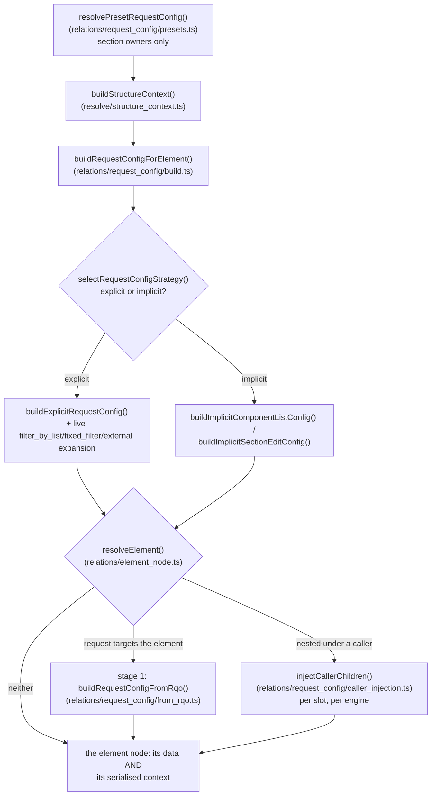

# Request Config Architecture

`src/core/relations/request_config/{build,explicit,implicit,filters,external,presets}.ts`
implements the system; the pure contract (schemas + the strategy-selection rule)
lives in `src/core/concepts/request_config.ts`.

## Overview

The `request_config` system is Dédalo's **server-side** mechanism for defining how a section or component retrieves and displays its data. It is the configuration half of the work API: the server resolves a `request_config` per element and injects it into the element's context; the client then turns it into one or more [RQO](rqo.md)s for the actual calls. The request_config declares:

- **What** data to display (the `ddo_map` columns/fields)
- **How** to search and pick records (`search` / `choose` layouts)
- **Where** to get the data (target `section_tipo` sources, external API engines)
- **Which** elements to resolve but never render (`hide`)
- **How much** to fetch (sqo limits, pagination) and **with what UI** (interface controls)

For the wire-level message the client builds from this config, see [rqo.md](rqo.md). For copy-paste ontology JSON by scenario, see the cookbook [request_config_examples.md](request_config_examples.md).

## Architecture

The system is a module set under `src/core/relations/request_config/`, called from the horizontal read engine (`src/core/section/read.ts`) and from `src/core/resolve/structure_context.ts`. There is no per-instance object carrying its own config — the build is a pure function of `(properties, context)`.

```
relations/request_config/build.ts       # buildRequestConfigForElement() — the strategy selector + entry point
├── concepts/request_config.ts          # pure contract: zod schemas + selectRequestConfigStrategy()
├── relations/request_config/explicit.ts# EXPLICIT parser (ddo self-resolution, get_ddo_map, sqo.section_tipo sources)
├── relations/request_config/implicit.ts# IMPLICIT: the ontology-relation-graph walk
├── relations/request_config/presets.ts # per-user/section layout preset override (STAGE-2, section owners only)
├── relations/request_config/filters.ts # filter_by_list / fixed_filter live expansion
└── relations/request_config/external.ts# non-dedalo api_engine → target section's api_config
```

### Module responsibilities

| Module | Responsibility | Key exports |
|-------|----------------|-------------|
| `concepts/request_config.ts` | Pure contract: schemas, the explicit/implicit selection rule | `requestConfigSchema`, `selectRequestConfigStrategy()`, `EXPLICIT_CONFIG_REQUIRED_MODELS` |
| `relations/request_config/build.ts` | Entry point: preset override, LIST/TM section_list substitution, then explicit/implicit dispatch | `buildRequestConfigForElement()`, `getElementColumnsMap()`, `findSectionListChild()` |
| `relations/request_config/explicit.ts` | Explicit config parsing: ddo self-resolution, mode/label enrichment, `get_ddo_map`, the enriched `sqo.section_tipo` ddo objects, per-ddo permission gating | `buildExplicitRequestConfig()`, `resolveSqoSectionTipos()`, `buildSqoSectionTipoDdos()` |
| `relations/request_config/implicit.ts` | The ontology-relation-graph walk (component list targets + the full section edit-form tree) | `buildImplicitComponentListConfig()`, `buildImplicitSectionEditConfig()`, `resolveVirtualEditScope()` |
| `relations/request_config/from_rqo.ts` | Stage 1: the config of the element a request TARGETS, built from the request's own `show` (client grammar, per-ddo grant judgement, the scrubbed and clamped client `sqo`) | `buildRequestConfigFromRqo()` |
| `relations/request_config/caller_injection.ts` | Caller children: the slots a caller's map declares for a nested element replace that element's own, per slot and per engine | `injectCallerChildren()` |
| `relations/request_config/presets.ts` | Per-user saved layout overrides (section `dd1244`) | `resolvePresetRequestConfig()`, `getActiveRequestConfigPresets()`, `selectMatchingPreset()` |
| `relations/request_config/filters.ts` | Live `filter_by_list` / `fixed_filter` expansion (record/DB data, never cached) | `expandFilterByList()`, `expandFixedFilter()` |
| `relations/request_config/external.ts` | Attaches the TARGET section's `api_config` for non-`dedalo` engines, shaped for publication (credential keys stripped, unknown keys dropped, `http(s)`-only URLs) | `resolveExternalConfig()` |

Every build is a plain async function call — there is no config-level cache to invalidate (see [Caching](#caching-and-the-cache-key) below for what that means in practice). `build.ts`, the pure-contract boundary in `concepts/request_config.ts`, and the `explicit`/`implicit` builders are the things to understand first; `presets.ts`/`filters.ts`/`external.ts` are the live-expansion special cases.

## Explicit vs implicit configuration

This is the most misunderstood part of the system, so read it precisely. The selection is one function, `selectRequestConfigStrategy()` (`src/core/concepts/request_config.ts`):

```typescript
// src/core/concepts/request_config.ts
export function selectRequestConfigStrategy(properties: unknown): 'explicit' | 'implicit' {
  const requestConfig = (properties as { source?: { request_config?: unknown } } | null)
    ?.source?.request_config;
  return requestConfig !== undefined && requestConfig !== null ? 'explicit' : 'implicit';
}
```

`relations/request_config/build.ts` calls this rule and dispatches to `buildExplicitRequestConfig()` (`explicit.ts`) or the graph walk in `implicit.ts` — data-driven: there is no per-model requirement, only whether the node's properties carry `source.request_config`. (Some code comments still use the historical names `v6`/`v5` for explicit/implicit respectively — the modules themselves are `explicit.ts`/`implicit.ts`.)

### Explicit — the modern config (`relations/request_config/explicit.ts`)

Explicit is the **preferred strategy**: an ontology-driven configuration. The node's `properties->source->request_config` holds a JSON **array** of config objects, each parsed into a `request_config_object` shape. Everything — target sections, the show/search/choose/hide layouts, sqo defaults, interface switches — is declared by hand. New ontology definitions should use the explicit form.

A minimal explicit node (full scenarios live in the [cookbook](request_config_examples.md)):

```json
{
  "source": {
    "request_config": [
      {
        "api_engine": "dedalo",
        "type": "main",
        "sqo": { "section_tipo": [{ "value": ["numisdata3"], "source": "section" }] },
        "show": { "ddo_map": [ { "tipo": "numisdata27", "section_tipo": "self", "parent": "self" } ] }
      }
    ]
  }
}
```

### Implicit — the legacy-but-active auto-derived fallback (`relations/request_config/implicit.ts`)

Implicit is **not dead or deprecated code**. It **runs automatically, on every request, for every ontology node that has no explicit `properties->source->request_config`**. It is the live default for un-migrated nodes — the majority of components in a typical ontology never declare an explicit config and are served by the implicit walk on every read. It is the real graph walk, not a stub — load-bearing for classic simple relations (select/radio/check_box target definitions).

Instead of reading an explicit array, the implicit builder **derives** the display config by walking the ontology relation graph:

1. **Component list targets** (`buildImplicitComponentListConfig`) — the first `section`-model node among the source's `relations` becomes the TARGET SECTION (stripped from the ddo list); `exclude_elements` marker nodes and the deprecated `dd249` security component are skipped; `component_filter`/`component_filter_master` always target the projects section (`dd153`/`dd156`) instead; a section_list child with no section node falls back to the component's main `related` section (`getMainRelatedSectionTipo`).
2. **Section edit-form tree** (`buildImplicitSectionEditConfig`) — for a SECTION in edit mode: a recursive ontology walk collects every `component_*`/`section_group*`/`section_tab`/`tab` descendant (excluding `component_dataframe`, which renders through its main component), honoring virtual-section resolution (`resolveVirtualEditScope` — a virtual section borrows the REAL section's children minus its first `exclude_elements` set) and per-ddo view defaults. **Dead legacy models are dropped** (`DEAD_LEGACY_MODELS`: `component_security_areas`, `component_autocomplete_ts`, `component_html_file`, `component_ip`, `component_layout`, `component_score`) — v5-era models removed in v6 that survive in ontologies (e.g. `dd249` under the users section `dd234`). They have no server descriptor and no client JS module, so an emitted ddo makes the client 404 on its dynamic import and abort the whole edit render. The legacy names v7 keeps ALIVE as registry aliases (`component_input_text_large`, `component_security_tools`, `component_state`, `component_relation_struct`) are NOT on that list — `getModelByTipo()` already resolves them to their live target.

**The critical normalization point:** the implicit builder wraps its derived result in **exactly the same parsed-item shape** as the explicit builder (`api_engine:'dedalo'`, `type:'main'`, with `show`/`sqo`) and returns a **one-element array matching what the explicit builder returns, so callers need no branching** — `build.ts` calls either builder through the same `ParsedRequestConfigItem[]` return type. Downstream code (the resolvers in `src/core/relations/`, the structure-context stamping) cannot tell which strategy produced a config.

Un-migrated nodes are expected to eventually move to an explicit config — that does not mean the implicit walk is inert; it is the active default until they do. The only genuinely dead corner is the explicit **throw**: `component_relation_parent` and `component_relation_children` (`EXPLICIT_CONFIG_REQUIRED_MODELS`) raise an error forcing migration to an explicit config. Everything else the implicit builder handles silently and indefinitely.

| | Explicit | Implicit |
|---|---|---|
| Source | `properties->source->request_config` array | derived by walking the relation graph |
| Status | preferred / modern | legacy **but active default** for un-migrated nodes |
| Output | `ParsedRequestConfigItem[]` | **same** `ParsedRequestConfigItem[]` (one element) |
| Runs when | the node declares a config | the node declares **no** config (every request) |
| Hard failure | — | throws for `component_relation_parent`/`children` |

Per-ddo permission gating (dropping ddos the current user holds permission 0 on) is wired into the explicit builder for SECTION-owned configs: `processSingleDdo()` calls `ddoIsAuthorized()` (`src/core/security/permissions.ts`) against the request's live principal (`currentPrincipal()`, ALS-scoped) and drops unauthorized ddos. It only gates section-owned configs — portal and other component-owned configs are not gated at this step.

## Construction flow

`buildRequestConfigForElement()` runs two concerns in sequence: an optional per-user layout-preset override, then the base build (section_list substitution + strategy selection + the matching builder). What the REQUEST then changes is decided by the element node the read resolves for each element occurrence (`relations/element_node.ts` `resolveElement`): stage 1 when the request targets the element, the caller's children when it is nested — see [RQO-derived narrowing](#rqo-derived-narrowing-the-reverse-path-partial). Every call is a plain, stateless async function of `(properties, context)` scoped to the current request (`AsyncLocalStorage`; see `src/core/resolve/request_lang.ts` for the pattern) — there is no cross-request cache to bleed between users (see [Caching](#caching-and-the-cache-key) below).



### Base build — strategy selection (every call)

`buildRequestConfigForElement()` runs the section_list LIST-mode substitution (below), then `selectRequestConfigStrategy()`, then the matching builder. There is no deterministic/cacheable-vs-live distinction at this layer — every call runs the full build; `filters.ts`'s live `filter_by_list`/`fixed_filter` expansion is simply always current.

### RQO-derived narrowing (the reverse path, partial)

The base build always runs first (time machine, `tool_qr`, graph view, "portal full grid in one read" — [cookbook #18](request_config_examples.md#18-portal-full-grid-in-one-read)). What a request then changes is decided ONCE per element occurrence, by the element node the read resolves (`relations/element_node.ts` `resolveElement`):

- **Stage 1** — the request TARGETS the element and carries a `show`: `relations/request_config/from_rqo.ts` `buildRequestConfigFromRqo` builds the config from the request (validated, consolidated, client ddos outside the client grammar dropped).
- **Caller children** — the element sits under a caller whose map declares children for it: `relations/request_config/caller_injection.ts` `injectCallerChildren` replaces the matching slot (`show` / `search` / `choose` / `hide`) of the element's FIRST config item of each engine.
- **Governing ddo** — the caller's line for the element supplies its page size (`sqo.limit`), `view`, `mode`, `lang`, `parent_grouper` and a `properties` merge.

The element's context is serialised from that same node (`section/node_contexts.ts`, `buildStructureContext` with `configFrom: {source: 'emission', node}`), so its `request_config` always describes what its data used. The doors that build a context without a node name their reason from a closed list (`OWN_CONTEXT_REASONS` in `resolve/structure_context.ts`, censused by `test/unit/structure_context_own_census.test.ts`). When one element (same `tipo`, `section_tipo`, `mode`) resolves different configs under different parents in one read, each config ships its own context entry, and those entries and their data items carry `caller_chain` — the ancestor tipo path, joined by `>` — so the client binds each cell to the right one. Under one parent the first config wins, as for identical configs: a configuration that varies with the owning record (an `sqo.fixed_filter` read from the record) ships the first row's context, not one per row.

### Per-call overlay (session sqo)

`src/core/security/session_store.ts` maintains a per-session SQO store: a SECTION read in `list`/`edit` mode persists its resolved sqo into the session (`setSessionSqo()`, keyed by the section tipo) unless the caller opts out (`source.session_save === false`, used by secondary windows). The section's context exposes the **previous** stored value back as `sqo_session` (`src/core/section/context.ts`, read live from the request's `AsyncLocalStorage`-scoped session) — the client is expected to resend it to resume pagination/filter continuity on the next call. There is no automatic server-side fallback: a client that omits its filter/limit on a follow-up call is not silently replayed against its previous navigation state — continuity relies on the client reading and resending `sqo_session`.

### User layout presets

A per-user (or public, as a fallback) layout override is supported: `resolvePresetRequestConfig()` (`src/core/relations/request_config/presets.ts`) resolves an active preset for the `(tipo, section_tipo, mode)` triple, for SECTION owners only, BEFORE the base build, without mutating the ontology-cached properties. Presets are records in section `dd1244`: `dd1242` (tipo), `dd642` (section tipo), `dd1246` (mode), `dd654` (owning user, null = public), `dd640` (public flag), `dd1566` (active flag, SQL-filtered), `dd625` (the `request_config_object[]` payload). When an active preset matches, its `dd625` payload is injected as `properties.source.request_config` onto a clone of the element's properties, so the existing explicit builder parses it with no special-casing. The active-preset list is cached and invalidated on any write/delete to `dd1244`; the per-user match itself is always computed live from the request's principal and never cached.

## request_config_object shape

`requestConfigItemSchema` (`src/core/concepts/request_config.ts`) is a zod schema with **`.passthrough()`**: an unrecognized key on a parsed item is kept, not dropped — the schema documents the known fields but does not police extras.

```typescript
interface request_config_object {
  api_engine: 'dedalo' | string;   // internal engine, or an external adapter name (e.g. 'zenon')
  type: 'main' | string;           // config type ('main' is the primary one)
  sqo: {                           // query defaults (the SQO the client copies into its RQO)
    section_tipo: object[];        // target-section sources (see vocabulary below)
    fixed_filter?: object;         // context/record-derived filter (disables caching)
    filter_by_list?: object;       // live DB list pre-filter (disables caching)
    filter_by_locators?: object[];
    limit?: number;
    offset?: number;
    operator?: '$or' | '$and';
  };
  show: {                          // mandatory display context
    ddo_map?: dd_object[];         // columns/fields to show
    get_ddo_map?: object;          // OR resolve the ddo_map dynamically (see below)
    sqo_config?: object;           // display-scoped sqo tuning (limit, offset, operator, full_count)
    interface?: object;            // UI switches — see rqo.md (#show-interface) for the table
    fields_separator?: string;
    records_separator?: string;
  };
  search?: { ddo_map?: dd_object[]; get_ddo_map?: object; sqo_config?: object; };
  choose?: { ddo_map?: dd_object[]; fields_separator?: string; };
  hide?:   { ddo_map?: dd_object[]; };  // resolved server-side, never rendered
  api_config: object | null;       // external-engine connection block; ALWAYS present, null on dedalo items
}
```

`show` is the mandatory display context. `search`/`choose`/`hide` are optional and share the `show` sub-shape. The `interface` switches are documented **once, canonically, in [rqo.md → `show.interface`](rqo.md#show-interface)** — do not duplicate that table here.

## dd_object (DDO) shape

A **Data Description Object** is a single column/field entry in a `ddo_map`. The most relevant fields:

`src/core/concepts/ddo.ts` splits this into two schemas with different trust levels: `ddoSchema` is a **strict whitelist** (zod's default `.strip()`, dropping anything not listed) — it is the security gate for any ddo a CLIENT sends (`show`/`search`/`choose` on an inbound RQO). Server-resolved ddos (the `ProcessedDdo` interface the explicit/implicit builders emit, `relations/request_config/explicit.ts`) carry a wider, open field set (an index signature keeps every enrichment field) — the whitelist only applies at the untrusted client boundary, not to what the ontology/graph-walk builders produce server-side.

```typescript
interface dd_object {
  // identity / resolution
  tipo: string;                  // ontology identifier of the element
  model?: string;                // component model name
  section_tipo?: string|string[];// target section ('self' resolves at runtime)
  parent?: string;               // parent element tipo ('self' resolves at runtime)
  parent_grouper?: string;       // grouper the element belongs to (layout grouping)
  // presentation
  label?: string; labels?: object; lang?: string;
  mode?: string; view?: string; children_view?: string;
  css?: object;                  // per-ddo style overrides (from properties.css)
  color?: string; role?: string;
  // behavior / access
  id?: string; type?: string; permissions?: number;
  buttons?: array; tools?: array;
  sortable?: boolean; autoload?: boolean;
  show_in_inspector?: boolean; show_in_component?: boolean;
  value_with_parents?: boolean;
  // data shaping
  columns_map?: array; target_sections?: array; section_map?: object;
  fields_separator?: string; records_separator?: string;
  fn?: string; data_fn?: string; parser_args?: object; data_slice?: object;
  matrix_table?: string; diffusion_tipo?: string; options?: object;
  section_filter?: array; component_filter?: array;
  request_config?: array;        // nested config (e.g. a portal's own columns)
}
```

See [dd_object.md](dd_object.md) for the per-field contract. Note `parent_grouper` (used to nest a ddo under a grouper in the layout) and `css` (per-ddo style overrides, sourced from the node's `properties.css`) — both appear in cookbook examples and are real, settable fields.

### Nesting — a `ddo_map` is a flat list, made a tree by `parent`

A ddo whose `parent` names a *relation* component is resolved **inside that component's target section**, and its own children below it, to as many levels as the map declares. On the `monedaiberica` install the `numisdata3` list column is three levels deep: `numisdata77` (`component_portal`, targeting `numisdata4`) → `numisdata164`/`numisdata165` (`component_portal`, the obverse and reverse faces, targeting `rsc170`) → `rsc29` (`component_image`, the thumbnail actually shown in the cell).

Three rules worth knowing before you author a nested map.

!!! info "The caller's children replace the nested component's own, slot by slot"
    Every element of a nested map has ONE effective config, built from its own `request_config` and the children its caller declares for it. The caller's map is matched to an element by `parent` (and, for an engine other than `dedalo`, by `api_engine`), and it replaces only the slots it fills: children the caller declares under `show` replace the element's own `show`; a slot the caller leaves empty (`hide`, `search`, `choose`) keeps the element's own. A level the caller does **not** declare falls back to the element's own `request_config` — in list mode its `section_list` — in every mode. So declaring `numisdata164` without `rsc29` resolves `numisdata164` with its own columns; it does not render an empty cell.

    A real example, from the `rsc`/`tch` core ontology: `tch197` (`component_portal` "Tasks", targeting `rsc1389` "Work process") lists `rsc1399` (Task), `rsc1400` and `rsc1402` (`component_autocomplete`, both targeting `rsc197` "People"). For `rsc1400` it declares `rsc86` (Surname) then `rsc85` (Name); `rsc1400`'s own `show` is `rsc85` then `rsc86`. Inside the Tasks portal the "Assigned user" cell therefore reads *surname, name* — the caller's order — while the same `rsc1400` opened on its own section reads *name, surname*. For `rsc1402` the caller declares `rsc85` then `rsc86`, so that cell reads *name, surname*.

    Because a map is flat, children match by `parent` alone: one map that names the same component under two different parents gives it the UNION of the children declared for it. Two different callers (two portals with their own maps) each give it their own.

!!! note "Depth and cycles are bounded"
    Nesting is bounded at **12 levels** (`MAX_DDO_DEPTH`, `src/core/relations/element_node.ts`). A chain the ontology drives stops one level before the bound and the response carries a `relation.depth_bound_stopped` notice naming where it stopped; a map sent by the client that would go past it is refused with `request.invalid_rqo` rather than resolved part-way. Records cycle too — a person whose portal points back to the record above it — and a record already being expanded higher up the same chain is not expanded again: the chain stops there with a `relation.record_cycle_stopped` notice. Real chains are two or three levels, so these bounds only catch a malformed map or cyclic data.

!!! note "Paging a nested portal keeps its columns"
    The next page of a nested portal is read with the same effective config as the first page: the client sends the chain of callers it is nested under (`rqo.source.callers`), the server verifies that chain against the ontology, and the page resolves the columns the caller declared. A chain that does not verify is ignored (the element falls back to its own config), never trusted.

## Self-resolution and dynamic `section_tipo` sources

The ontology cannot know installation-specific tipos, so configs use placeholders resolved **server-side** before the client ever sees them.

### `self` in a ddo (`processSingleDdo` self-resolution)

`processSingleDdo()` (`relations/request_config/explicit.ts`) resolves `self` references. One subtlety worth making explicit: for a normal (non-dataframe) ddo, `section_tipo: "self"` resolves to the ITEM'S resolved SQO **target** sections (the child lives at the portal's targets, not at the caller) — only `component_dataframe` resolves `self` to the caller's own section (frames live on the caller's record):

| Field | `self` resolves to |
|-------|--------------------|
| `section_tipo` | the item's resolved `sqo.section_tipo` targets — or the CALLER's own section_tipo (scalar) for `component_dataframe` |
| `parent` | `context.ownerTipo` (the current element's tipo) |

!!! warning "`section_tipo: \"self\"` is valid only at the first level"
    `self` names the targets of the element that owns the map, so it is meaningful only for a ddo whose `parent` is that element (`parent: "self"`). Below the first level — a ddo whose parent is a nested relation component — the read skips the ddo and the response carries an `ontology.ddo_self_refused` notice naming it. That holds for every map owner, a section's own `section_list` / edit map included (the notice's owner is then the section); only a door that has no response to carry it — the Time Machine scope derivation, the caller-chain verifier, the area boot map and the context-only own-config build — writes a bounded server log line instead. Declare the section explicitly (`"section_tipo": "rsc197"`) or as a source array (`"section_tipo": [{"source": "hierarchy_types", "value": [2]}]`), which a nested ddo resolves the same way a `sqo.section_tipo` does. The maintenance reconcile check `ddo_self_depth` lists every installed definition that still declares a deep `self`, so they can be corrected on the master ontology before a reader meets the notice.

### `sqo.section_tipo` source vocabulary

The `sqo.section_tipo` is an **array of source descriptors** (`{source, value}`), resolved by `resolveSqoSectionTipos()` (`relations/request_config/explicit.ts`). The vocabulary:

| `source` | Resolves to |
|----------|-------------|
| `section` (default) | TLD-active-checked literal section tipos in `value` |
| `self` | the caller's own section_tipo, `value` ignored |
| `hierarchy_types` | the ACTIVE hierarchy sections (`resolveHierarchySectionsFromTypes()`) whose typology matches the typology ids in `value` |
| `section_model` | the MODEL section paired with each section in `value` (`getModelSectionForSection()`) — the hierarchy registry pairing `hierarchy53` → `hierarchy58`, else the caller's TLD followed by `2`; non-section candidates are refused. **No `value` = the caller's own section**, like `self` |
| `ontology_sections` | every registered ontology's target section (`resolveOntologySections()`), `value` ignored |
| `field_value` | a live read of the caller's own ACTIVE records, taking each named component's data values (`value`, a list of component tipos) as target tipos, keeping only the ones that resolve to a section model |
| `hierarchy_terms` | each entry's locator `section_tipo` (the values are term locators) |

A bare string `'self'` (not wrapped in a `{source, value}` object) also resolves directly. Every resolved tipo is deduplicated and then dropped if its ontology model cannot be resolved.

A component model may also declare one of these sources as its **default target** (the descriptor facet `targetSource`, `src/core/relations/request_config/target_sources.ts`). The default is applied by `buildRequestConfigForElement()` only when the built config resolved no target section at all, so a declared `sqo.section_tipo` always wins. Today one model declares one: [component_relation_model](components/component_relation_model.md#target-resolution) declares `section_model`.

### `get_ddo_map` — dynamic ddo_map

Instead of hardcoding `ddo_map`, a `show`/`search`/`choose` block may carry a `get_ddo_map` directive of the form `{model: 'section_map', columns: [...]}`. `resolveGetDdoMap()` (`relations/request_config/explicit.ts`) reads `getSectionMapValue()` (`src/core/ontology/section_map.ts`). Lets multiple sections share a common column set: a component tipo seen under several target sections merges into ONE ddo whose `section_tipo` becomes the array of those sections.

```json
{
  "show": {
    "get_ddo_map": {
      "model": "section_map",
      "columns": [ { "path": ["components", "mint"] }, { "path": ["components", "type"] } ]
    }
  }
}
```

The `section_map` itself is the global scope/term map built per section. A full dynamic-ddo_map scenario is in the [cookbook](request_config_examples.md).

## `filter` vs `filter_by_list` vs `fixed_filter`

Three distinct filtering concepts that are easy to confuse:

| Key | Lives on | Meaning | TS resolver |
|-----|----------|---------|---------|
| `filter` | the **SQO** (RQO side) | the live query `WHERE` the client sends per call (search box, panel) | n/a — part of the request, not the config; see [sqo.md](sqo.md) |
| `filter_by_list` | `sqo.filter_by_list` | a pre-filter dropdown whose option values are read **live from the DB** | `expandFilterByList()` (`relations/request_config/filters.ts`) |
| `fixed_filter` | `sqo.fixed_filter` | a context/record-derived filter that varies by `section_id`, over three sources: `fixed_dato` (embedded SQO filter objects), `component_data` (multi-hop live read of the calling record's own data), `hierarchy_terms` (thesaurus-subtree section_id IN-filter, capped at 50,000 expanded ids) | `expandFixedFilter()` (`relations/request_config/filters.ts`) |

A `hierarchy_terms` term that expands past 50,000 ids is REFUSED with
`ontology.invalid_node` naming the term and the cap. A `fixed_filter` is
hand-authored ontology config and this filter is a narrowing device: an
expansion that large names a root where the author meant a branch, so it is
reported as the configuration error it is rather than silently truncated.

Both are resolved inside `buildExplicitRequestConfig()` (`explicit.ts`) whenever the raw sqo carries the key, reading LIVE record/DB data. There is no cache-invalidation signal to flip because the build never caches (see [Caching](#caching-and-the-cache-key)) — every call already re-reads this live data.

## Pagination

`src/core/section/read.ts` applies the section-level defaults directly when the client sends no limit (`rqo.sqo.limit` absent/null); `src/core/relations/relation_core.ts`'s `ownEditLimit()`/`PORTAL_LIST_LIMIT` apply the component-level defaults for portal/relation cells. There is no single defaults entry point to link to — search for `PORTAL_LIST_LIMIT` and the `rqo.sqo.limit` default branches in `section/read.ts` if you need to change these numbers.

### Limit priority (highest → lowest)

1. the RQO's own `sqo.limit` (clamped client-side by `sanitizeClientSqo`, §7.5)
2. the config's declared `sqo.limit` / `show.sqo_config.limit` (LAST request_config item wins — `ownEditLimit()`)
3. mode/model heuristic default (below)

### Default limits

| Caller | Mode | Default limit | Location |
|--------|------|---------------|--------------|
| section | edit | 1 | `section/read.ts` |
| section | other (list, ...) | 10 | `section/read.ts` |
| component | edit | `DEDALO_MAX_ROWS_PER_PAGE` (10) | `relations/request_config/build.ts` + `relations/relation_core.ts` `ownEditLimit() ?? maxRowsPerPage` |
| component | other (list, ...) | 1 | `relations/relation_core.ts` `PORTAL_LIST_LIMIT` |

### The component edit default is on the wire

A component's edit-mode request_config that declares neither `sqo.limit` nor `show.sqo_config.limit` (every implicit config, and explicit ones without a limit) gets `sqo.limit = DEDALO_MAX_ROWS_PER_PAGE` stamped by `buildRequestConfigForElement()` (`relations/request_config/build.ts`). The client paginator divides by `rqo.sqo.limit`: without that stamp it computed one page and hid itself while the server paged the data. A component portal then takes the page size the server actually used from `data.pagination.limit` (`component_portal.js`), so a section ddo_map `limit` that differs from the config still pages correctly. Wire entry: `engineering/wire_contract/WC-2026-10-30-request-config-default-page-size.md`.

### Session override

The per-session SQO store (`src/core/security/session_store.ts`, see [Per-call overlay](#per-call-overlay-session-sqo) above) carries the previous navigation state, but nothing consults it as an automatic limit fallback: a client that omits its filter/limit on a follow-up call gets the mode/model heuristic default above, not its previous session state. Continuity depends on the client reading `sqo_session` from the section context and resending it.

## Caching and the cache key

There is no config-level cache: every `buildRequestConfigForElement()` call is a fresh, stateless computation scoped to the current request (`AsyncLocalStorage`) — there is no cache key to compute and no clone boundary to protect, because nothing is ever cached in the first place. A handful of narrower intermediate lookups DO cache (the hierarchy-sections list, the all-ontologies target-section list, the active-presets list, the per-section `button_new`/`button_delete` lookup — each in its own module, invalidated on the relevant ontology/data write), but the assembled `request_config` result itself is always recomputed.

!!! note "Why the button lookup is one of them"
    `buildSqoSectionTipoDdos()` enriches **every** resolved sqo target section, and above read
    level it probes each for a `button_new` and a `button_delete` child. Uncached, a section
    with neither cost four queries (two misses, then the virtual-section fallback's two) — so a
    config whose `sqo.section_tipo` source is `ontology_sections`, which resolves to every
    registered ontology's target section, paid that per target on every single build. On a
    205-ontology install one such component resolved in 42 ms; cached, 0.64 ms. It is ontology
    shape, not record data, so it invalidates with the rest of the ontology caches — authoring
    a new `button_new` still shows up immediately.

## Error contract and warnings

An invalid tipo, an unresolvable node, or a missing model simply produces `null`/is filtered out of the ddo_map (the `return null` steps in `processSingleDdo()`), with no report. `EXPLICIT_CONFIG_REQUIRED_MODELS` (`component_relation_parent`/`children`) is the one case that throws instead of dropping silently.

The raw maps a relation component's LIST cell expands (`resolveListCellMap()` / `resolveOwnConfigMap()` / `resolveFrameConfig()` in `src/core/section/list_definitions/section_list.ts`) do not pass through `processSingleDdo()`, so `pickConfig()` applies the same rule there: a ddo whose tipo has no resolvable model is dropped with a `[section_list] dropped ddo …` server warning. This is what keeps a shipped config naming an optional TLD the installation does not have (the `rsc` place components rsc92/rsc65/rsc119 name `tchi15`) from failing the whole record read with `request.invalid_tipo`. Gate: `test/unit/list_cell_unresolvable_ddo_native.test.ts`. Three skips ARE reported, because a reader would otherwise chase a missing column:

| What was skipped | Where it is reported |
|------------------|----------------------|
| A ddo declaring `section_tipo: "self"` below the first level | an `ontology.ddo_self_refused` notice in the response's `notices[]`, naming the owner, the ddo, its parent and its depth — for every map owner, a SECTION's own `section_list` / edit map included (owner = the section). Only a door with no response (Time Machine scope derivation, caller-chain verifier, area boot map, context-only own-config build) writes one bounded `[request_config/explicit]` server log line instead |
| A chain stopped by the record-cycle or the depth bound | a `relation.record_cycle_stopped` / `relation.depth_bound_stopped` notice in `notices[]` |
| Client ddos dropped or limits clamped by stage 1 (the request's own `show`) | one bounded `[request_config/from_rqo]` server log line per element |

The notice codes and the envelope's `notices[]` are described in [Errors](system/errors.md). For any other empty `ddo_map`, step through `buildRequestConfigForElement()`/`processSingleDdo()` directly.

## Best practices

1. **Use an explicit config for new nodes.** The implicit walk will keep serving un-migrated nodes, but explicit config is auditable and predictable — and it is the better-tested path (`test/parity/relation_corpus_config.test.ts`).
2. **Use `self`** for `parent` and ddo `section_tipo` rather than hardcoding installation tipos.
3. **Prefer the `{source, value}` object form** for `sqo.section_tipo` — a bare `"self"` string still resolves, but the object form is the documented shape.
4. **Define `show`, `search` and `choose` separately** for autocomplete components. Without a `choose.ddo_map` the search results reuse `search` (or `show`) as their columns; the client builds them read-only either way (`build_rqo_search`, `common.js`, turns a ddo `mode: "edit"` into `list`), so a column pinned to `edit` for in-cell editing in the caller's table renders as text in a result row, never as an editable field.
5. **Prefer `get_ddo_map`** for column sets shared across sections.
6. **Let the server own limits** (`limit: null`) so the mode/model default wins; client limits are clamped anyway. Do not rely on cross-request session-limit continuity — the client must resend `sqo_session` itself (see [Session override](#session-override)).
7. **Test under multiple user permissions** — per-ddo permission gating only applies to SECTION-owned explicit configs; portal and other component-owned configs are not gated at the `processSingleDdo()` step.
8. **Keep configs auditable by construction** — since there is no separate structural-validation pass, malformed `request_config` JSON fails at build time inside `processSingleDdo()` rather than at a dedicated audit step; test new configs against `test/parity/relation_corpus_config.test.ts`.

## Troubleshooting

- **Empty `ddo_map`** — first look at the response's `notices[]` and the server log for the reported skips (see [Error contract and warnings](#error-contract-and-warnings)); otherwise verify the `section_tipo` source resolves and that the node/model lookups in `processSingleDdo()` succeed, stepping through the builder directly.
- **`self` not resolving** — remember it resolves to the item's SQO TARGET sections for a normal ddo, and to the CALLER's own section only for `component_dataframe` (`processSingleDdo()`); confirm which one applies.
- **Config changes not taking effect** — there is no config-level cache (see [Caching](#caching-and-the-cache-key)), so a stale value here is almost certainly upstream (the ontology read cache) rather than a request_config cache mismatch.
- **`component_relation_parent`/`children` throws** — these models require an explicit `request_config`; give the node one.
- **A nested column renders empty** — a level the map does not declare falls back to the element's own config (see [Nesting](#nesting--a-ddo_map-is-a-flat-list-made-a-tree-by-parent)), so a map that stops short is not the cause. Look in the response's `notices[]`: an `ontology.ddo_self_refused` notice means the leaf declares `section_tipo: "self"` below the first level (declare its section explicitly); a `relation.record_cycle_stopped` or `relation.depth_bound_stopped` notice means the chain was stopped by a record cycle or the depth bound. With no notice, check the leaf's `parent` names the relation component directly above it and, for a column of the section itself, that the user holds a grant on it: a section column the user may not read is dropped, while the children of a relation component are shown at least read-only.
- **`request.invalid_rqo` on a read that used to work** — check the map for a `parent` cycle; nesting is capped at 12 levels.
- **Preset not applied** — presets only override SECTION owners (`context.ownerIsSection`); confirm the preset's `(tipo, section_tipo, mode)` triple matches and that it is marked active (`dd1566`).

## API reference

```typescript
// src/core/relations/request_config/build.ts — the entry point, start here
export async function buildRequestConfigForElement(
  ownProperties: unknown,
  context: RequestConfigContext,
): Promise<ParsedRequestConfigItem[]>

// src/core/concepts/request_config.ts — the pure explicit/implicit selection rule
export function selectRequestConfigStrategy(properties: unknown): 'explicit' | 'implicit'
```

### Related files

- `src/core/relations/request_config/build.ts` — entry point: LIST-mode section_list substitution + explicit/implicit selector
- `src/core/concepts/request_config.ts` — pure contract: zod schemas, `selectRequestConfigStrategy`, `EXPLICIT_CONFIG_REQUIRED_MODELS`
- `src/core/relations/request_config/explicit.ts` — explicit config parsing, ddo self-resolution, `get_ddo_map`
- `src/core/relations/request_config/implicit.ts` — the ontology-relation-graph walk
- `src/core/relations/request_config/presets.ts` — per-user saved layout overrides
- `src/core/relations/request_config/filters.ts` — `filter_by_list` / `fixed_filter` live expansion
- `src/core/relations/request_config/external.ts` — non-`dedalo` engine `api_config` attachment
- `src/core/resolve/structure_context.ts` — serialises an element node's effective config onto its context (`configFrom({source: 'emission', node})`); it does no narrowing of its own
- `src/core/relations/element_node.ts` — `resolveElement`: one element node per parent occurrence, its effective config (own config with the caller's slots injected, the governing ddo's `limit`)
- `src/core/relations/request_config/caller_injection.ts` — how a caller's `ddo_map` children replace an element's own slots
- `src/core/relations/request_config/from_rqo.ts` — stage 1: the `show`/`search` a request sends, checked and merged onto the element's config

## Related documentation

- [Request Query Object (RQO)](rqo.md) — the wire message the client builds from this config; canonical [`show.interface` controls table](rqo.md#show-interface)
- [Request Config Examples](request_config_examples.md) — cookbook of annotated ontology JSON by scenario
- [Search Query Object (SQO)](sqo.md) — the `filter`/`limit`/`order` carried inside the RQO
- [DD Object](dd_object.md) — per-field DDO contract
- [Ontology index](ontology/index.md) — ontology nodes, sections and the relation graph the config draws from
- [Request Config Presets](ontology/request_config_presets.md) — per-installation layout overrides (`dd1244`)
