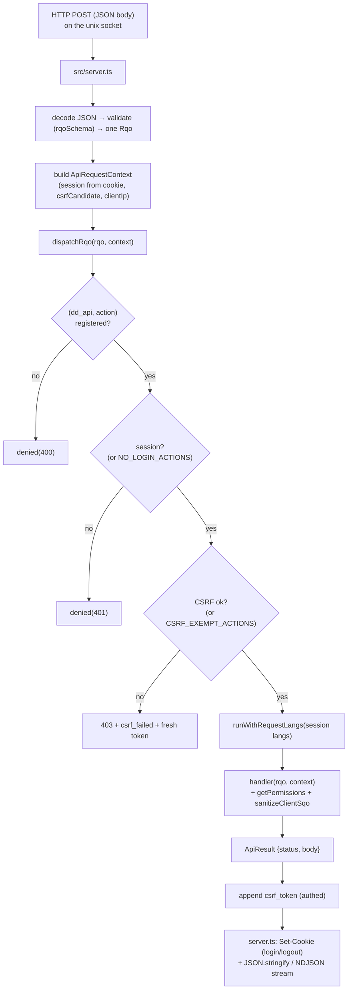

# api

> See also: [RQO](../rqo.md) · [SQO](../sqo.md) · [dd_object (ddo)](../dd_object.md) ·
> [Architecture overview](../architecture_overview.md)

The API subsystem is the single HTTP entry point of the Dédalo **work system**: it
decodes a Request Query Object (RQO), runs the security gates, dispatches the
action to a registered handler, and returns a standard JSON envelope whose
`data` is the `{context, data}` ddo.

This page is the **subsystem reference**. For the *request format* itself — every
RQO property, the action catalogue, the response-envelope fields — read
[RQO](../rqo.md) first; this document describes the **machinery** that receives
and routes an RQO, and does not repeat the property tables.

## Role

The API layer is the only network boundary of the work system: every client→server
call passes through it. It is two modules — a thin HTTP transport edge
(`src/server.ts`, a `Bun.serve` listener) and a central dispatcher
(`src/core/api/dispatch.ts`) — plus the per-class handlers in
`src/core/api/handlers/` and a small set of read-only view endpoints.

| Neighbour | Relationship |
| --- | --- |
| [`login`](login.md) / [`security`](security.md) | The API layer enforces *their* policies at the boundary — login check, CSRF, permission gates — but does not own the policy logic. |
| [search (SQO)](../sqo.md) | A read or count action hands the request's `sqo` to `buildSearchSql()`. The handler is where the *untrusted* SQO is scrubbed (`sanitizeClientSqo`). |
| `section` / components | The handlers call the section and component resolvers (`readSection`, `saveComponentData`, …) and ship the resulting ddo. **The API never reads the matrix directly.** |
| [`request_config`](../request_config.md) | The `show` / `search` / `choose` ddo_maps in the RQO are resolved into context+data by the resolvers; a client-sent ddo_map is always re-validated server-side. |
| diffusion | `dd_diffusion_api` fronts the native diffusion engine (`src/diffusion/`). |

!!! note "A registry of async handlers, not a class hierarchy"
    Handlers are plain `async` functions held in one **explicit map**,
    `ACTION_REGISTRY` (`dd_api → action → handler`), assembled in `dispatch.ts`
    from the per-class handler modules. There is **no dynamic method lookup**: an
    unregistered `(dd_api, action)` pair simply does not exist. The registry is the
    single source of truth for what the API can do.

## Responsibilities

- **Single entry point** — `server.ts` receives the raw HTTP request on a unix
  socket (the reverse proxy owns TCP and TLS), routes the API paths, decodes the
  JSON body, and validates it into one RQO with a zod schema.
- **Boundary security** — the dispatcher runs the untrusted-input gates *before*
  the handler body: the `(dd_api, action)` allowlist, the login check and the CSRF
  verification. Inside each data handler the untrusted SQO is scrubbed and the
  caller's permission is asserted.
- **Dispatch** — route the RQO to `ACTION_REGISTRY[dd_api][action]`.
- **Response shaping** — guarantee the standard envelope (`ok`, `request_id`,
  and then `data` or `error`), append the session's fresh CSRF token, set the
  session cookie on login and logout, stream NDJSON where a handler asks for it,
  and convert a top-level throwable into a safe error envelope. The conversion
  is a **chokepoint**: handlers throw to fail and return `ok(data, …)` to
  succeed, and one converter (`src/core/errors/convert.ts`) is the only thing in
  the engine that writes a failure body — so every failure gets the same shape,
  the same disclosure rules and the same status.
- **Session lifecycle at the edge** — resolve the session from its cookie, thread
  it through the request-scoped context, and open the per-request language scope.
- **Observability** — every outcome, gate denials included, emits a structured
  access-log line and counters.

## Key concepts

**RQO in, envelope out.** One HTTP call carries exactly one RQO; the response is
either `{ok: true, request_id, data, …}` or `{ok: false, request_id, error, …}`,
and a session always gets a fresh `csrf_token` appended to it — on a failure too.
The `data` shape depends on the action: a `read` returns the ddo
`{context, data}`, a `count` returns `{total}`, a `start` returns
`{context, data}` with the installation `environment` alongside. A failure
carries a registered `error.code` from a closed set and a status derived from that
code's category; the full field list is in
[the API reference](../../api/dedalo_api_v1.md#response-envelope).

**Two-level dispatch.** The top-level `action` selects the *handler* and must be
registered. Inside a data action, the per-element modifier `source.action` selects
the *behavior variant* — `read` with `source.action: 'get_data'` resolves one
component instead of the whole section; `source.action: 'resolve_data'` resolves
injected search-filter locators. See
[RQO → two-level dispatch](../rqo.md#action-string-mandatory).

**The handler class is chosen by `rqo.dd_api`**, defaulting to `dd_core_api`.

**Defence in depth, request-scoped.** Three independent gates stand between the
socket and the handler body, and each data handler adds its own permission gate
plus the per-record projects ACL.

!!! warning "Writing a handler function does not expose it"
    A new `async` handler is unreachable until it is an entry in
    `ACTION_REGISTRY`. There is no reflection fallback and no "any exported
    function is callable" rule. **Registration is the allowlist** — this is
    structural, not a convention.

    All request state is threaded explicitly through an `ApiRequestContext`.
    There are no request globals.

## Files & structure

```text
src/
├── server.ts                     # Bun.serve HTTP edge: route + decode + validate + shape output
└── core/
    ├── api/
    │   ├── dispatch.ts           # ACTION_REGISTRY assembly, the gates, the envelope
    │   ├── handlers/             # one module per dd_api class
    │   ├── response.ts           # the ApiResult type (status + body)
    ├── errors/                   # the closed error registry + THE converter (envelope, MCP, stream)
    │   ├── raw_view.ts           # read-only /api/v1/raw endpoint
    │   └── environment_view.ts   # read-only /api/v1/environment endpoint
    ├── section/read_facade.ts    # the read sub-action routing
    ├── security/                 # session_store.ts (sessions + CSRF), auth.ts, permissions.ts
    ├── search/                   # sql_assembler.ts etc. (reached through read/count)
    └── resolve/                  # request_lang.ts (per-request lang scope), structure_context.ts, …
```

`dispatch.ts` is **registry assembly + gates + envelope only**. The per-class
handler bodies live in `src/core/api/handlers/<class>.ts`.

### The registered handler classes

`dispatchRqo()` accepts only these `dd_api` values — the top-level keys of
`ACTION_REGISTRY`. They are the client wire contract.

| `dd_api` key | Concern |
| --- | --- |
| `dd_core_api` | The core data lifecycle: `start`, `read`, `read_raw`, `create`, `duplicate`, `delete`, `save`, `count`, the element/section contexts, `get_section_terms`, `get_indexation_grid`, `get_environment`. |
| `dd_utils_api` | Utilities: `login`, `quit`, `change_lang`, locks, uploads, `get_system_info`, `get_login_context`, `get_record_info` (a record's created / modified / published metadata — [inspector](../ui/inspector.md)), the SQO→SQL dev console, and the update-server surfaces. |
| `dd_tools_api` | `user_tools` and `tool_request` (per-tool action dispatch). |
| `dd_ts_api` | Tree operations: `get_node_data`, `get_children_data`, `add_child`, `update_parent_data`, `save_order`. |
| `dd_area_maintenance_api` | The maintenance widgets: `widget_request`, `get_widget_value`, `lock_components_actions` — admin-gated inside the dispatcher. |
| `dd_diffusion_api` | The diffusion engine: `diffuse`, `validate`, `get_process_status`, `list_processes`, `cancel_process`, `get_diffusion_info`, `get_engine_advisory`, `retry_pending_deletions`, `rebuild_media_index`. |
| `dd_component_portal_api` | `delete_locator` (bulk locator removal). |
| `dd_component_text_area_api` | Transcription tags: `get_tags_info` (resolve a text's marks into the records they point at), `delete_tag` (remove one tag's marks from every language of the text). |
| `dd_component_av_api` | `create_posterframe`, `delete_posterframe`, `get_media_streams`. |
| `dd_component_3d_api` | `move_file_to_dir`, `delete_posterframe`. |
| `dd_component_info` | `get_widget_data`. |
| `dd_rag_api` | Retrieval: `semantic_search`, `retrieve`, `get_agent_context`, `similar_to`, `ask`, `embed_groups`, `similar_objects`, `search_by_text_image`, `characterize_object` (retrieval actions accept a `group` facet). ACL-gated inside the handlers. |
| `dd_identify_api` | Object identification: `find_matches` (the records sharing a seed's identifying features, with the per-criterion breakdown), `identify_by_image`, `get_proposals`, `resolve_type_link`. Needs a `properties.identify` profile on the section; declines cleanly without one. All four are READS, ACL-gated inside the engine. |
| `dd_external_api` | `search` — a third-party catalogue searched THROUGH the engine, so the request passes the host allowlist, the SSRF guard, the breaker and the byte cap. The client names only its own component and the query. |
| `dd_mcp_api` | The in-process agent bridge: `mcp_proxy`, `agent_models`, `agent_chat`, `agent_chat_stream`, `agent_apply`. **Fail-closed** — every action refuses unless the agent HTTP surface is explicitly enabled. |
| `dd_error_report_api` | `receive_report` — machine-to-machine error intake, reachable only where the receiver is enabled. |

## Request lifecycle



A JSON POST reaches `src/server.ts` on the unix socket. The server matches the API
path, parses the body, validates it into one `Rqo`, resolves the session from the
cookie, and builds an `ApiRequestContext` (request id, client IP from
`X-Forwarded-For`, the session, the raw session token, and the CSRF candidate —
the `X-Dedalo-Csrf-Token` header, falling back to the RQO's own `csrf_token` key).
It then calls `dispatchRqo()`.

Inside the dispatcher the RQO passes the gates **in order** — the `(dd_api,
action)` registry allowlist, the login check (with a small `NO_LOGIN_ACTIONS`
allowlist), and the CSRF verification (with a `CSRF_EXEMPT_ACTIONS` list) — before
the handler runs inside the per-request language scope. Each data handler adds its
own permission gate and scrubs the untrusted SQO. The handler returns an
`ApiResult`; the dispatcher appends the session's fresh `csrf_token`, and
`server.ts` sets the session cookie on login or logout and serializes the JSON (or
streams NDJSON).

One narrower gate rides alongside: the **error-report intake** is reachable only
where the receiver is enabled. There is no install action on the wire — a server
that is not installed does not start at all
([installer reference](../../install/installer_reference.md#a-server-that-is-not-installed-refuses-to-start)).

### What `server.ts` does — and does not

`src/server.ts` is intentionally thin. It handles only the transport edge:

- `Bun.serve` on a **unix socket**; the reverse proxy owns TCP, TLS and the
  `Secure` cookie flag.
- Routes the API paths, the media path (session-gated, fail-closed), and the
  read-only raw/environment views.
- Reads the body and parses it; on a parse failure returns `400` with
  `error.code = "request.malformed_body"`. Validates with `rqoSchema`; on failure
  returns `400` with `error.code = "request.invalid_rqo"` and
  `details.issue_paths` — the failing property paths only, never the submitted
  values. A route that matches nothing is `404 resource.not_found`. All four are
  built by the same converter as every other failure.
- Handles the **multipart** upload branch before JSON dispatch, resolving its own
  cookie and CSRF candidate.
- Builds the `ApiRequestContext` and awaits `dispatchRqo(rqo, context)`.
- Shapes the response: `Set-Cookie` on login/logout, `application/x-ndjson` when a
  handler returns a raw NDJSON stream, otherwise JSON.

The *policy* — who may call what — lives one layer down, in `dispatch.ts`.

## The dispatcher surface

`src/core/api/dispatch.ts`:

| symbol | purpose |
| --- | --- |
| `dispatchRqo(rqo, context)` | The central router: registry allowlist → login check → CSRF check, open the request-scoped language context, run the handler, catch any throwable into a uniform error envelope through the single converter, append the session `csrf_token`, and emit the access-log line (which carries `error_code` / `error_category` on a failure). Returns an `ApiResult`. |
| `NO_LOGIN_ACTIONS` | The actions runnable without a session, keyed on the `${dd_api}:${action}` **pair**. |
| `CSRF_EXEMPT_ACTIONS` | The bootstrap and machine-to-machine actions exempt from CSRF, keyed on the same pair. |
| `ApiRequestContext` | The per-request state the HTTP layer threads explicitly: `requestId`, `clientIp`, `session`, `sessionToken`, `csrfCandidate`, and the lazily-resolved `principal`. |

!!! warning "The gate sets are keyed on the pair, not the action name"
    `NO_LOGIN_ACTIONS` and `CSRF_EXEMPT_ACTIONS` hold `${dd_api}:${action}`
    strings. A future handler in another class whose action name collides must
    **not** inherit the exemption — that is exactly the bug the pair key prevents.

CSRF verification is `verifyCsrf(session, candidate)` (constant-time, in
`session_store.ts`). The client echoes the token back via the
`X-Dedalo-Csrf-Token` header — or, for the two transports that cannot set a
header, in the payload itself: the `csrf_token` form field on a multipart upload
(`media/ingest/upload_endpoint.ts`) and the `csrf_token` RQO key on the
`beforeunload` lock-release beacon (`navigator.sendBeacon`). The header always
wins when both are present. Read and count are **not** exempt. On a CSRF failure the dispatcher
returns `403` with `error.code = "auth.csrf_failed"`, and the body carries the
session's **current** `csrf_token`, so the client's transparent single retry can
succeed.

Sessions are the rotating server-side sessions of
`src/core/security/session_store.ts`, issued by the Argon2id login in `auth.ts`.

## `dd_core_api` — the core data lifecycle

The default handler class. Every action is an
`async (rqo, context) => Promise<ApiResult>`.

### Record lifecycle

| action | purpose |
| --- | --- |
| `start` | Build the first-boot context (`environment` + a structure context). Not logged in → the login element context; logged in → the deep-linked page element (or the default section in list mode) plus the optional menu shell. A **section** deep link that carries a record id (`?tipo=<section>&section_id=<id>`) is answered in **edit** mode, whatever mode the link asks for — the record id *is* the edit request; component and area links keep their requested mode. |
| `read` | Read records as context+data. Gates on `(section_tipo, tipo)` and on every SQO target section. Routing is owned by `src/core/section/read_facade.ts`: menu reads, area reads, `get_relation_list`, `resolve_data` (search-filter chips), `get_data` (a single component / portal pagination), Time Machine reads, else the whole section via `readSection`. |
| `read_raw` | The full raw stored value(s) for a SQO's matched records; read-gated (level ≥ 1) on every SQO target section. |
| `relation_targets` | The census behind "Open relationships": which sections the records of a source set point at, with the exact record total of each (`data: [{tipo, label, total}]`). Input in `options.source` (a [`referenced_by` source set](../sqo.md#relationship-filter-leaves-referenced_by)); read-gated (level ≥ 1) on every source section; reads the source records' stored `relation` column (log sections are valid sources); unreadable targets are omitted; hidden relation components add a `perm.out_of_scope` notice; one 30 s deadline for the whole census, past it `db.statement_timeout`. |
| `create` | Create a record in the target section; write-gated (level ≥ 2). Returns the new `section_id`. |
| `duplicate` | Clone a record; write-gated, plus a per-record scope check for non-admins. |
| `delete` | `delete_record` (removes the row, Time Machine snapshot first) or `delete_data` (the default — empties the row's components); write-gated. A multi-record SQO delete is global-admin only. |
| `save` | Persist changes: gate level ≥ 2 on `(section_tipo, tipo)`, apply `data.changed_data` through `saveComponentData`, run the server-side observers, audit the activity, and echo the saved component in the canonical DataItem shape. |
| `count` | The record total for a search (`full_count`), or the inverse-reference count for `mode: 'related'`. The same permission gates and projects ACL as `read`. |

### Context, terms and environment

| action | purpose |
| --- | --- |
| `get_element_context` | Resolve one element's structure context (section, component, area or tool); read-gated. |
| `get_section_elements_context` | The edit-mode search-filter panel's element list; permissions always enforced server-side. |
| `get_section_terms` | Batch-resolve the labels of a set of locators. The batch size is capped and truncated loudly past the cap. |
| `get_indexation_grid` | Build the tag-indexation grid for a record. Requires `section_tipo`, `section_id` and `tipo`. |
| `get_environment` | The full client environment / bootstrap payload. No-login and CSRF-exempt. |

## How it fits with the rest of Dédalo

- **[RQO](../rqo.md)** — the message this subsystem decodes. The RQO page owns the
  property tables, the action catalogue and the envelope fields; this page owns the
  *machinery*.
- **[SQO](../sqo.md)** — the query carried in `rqo.sqo`. The data handlers are the
  only place an untrusted SQO is scrubbed; from there it flows to
  `buildSearchSql()`.
- **[dd_object (ddo)](../dd_object.md)** — what a data action *returns*: the
  handlers pack the `{context, data}` ddo into `data`.
- **[Architecture overview](../architecture_overview.md#the-request-lifecycle)** —
  the wider round trip.
- **[login](login.md) / [security](security.md)** — the session, CSRF and
  permission policies the gates enforce. The API layer is the *enforcement point*;
  those subsystems are the *policy source*.
- **[request_config](../request_config.md)** — the ddo_map layouts the data actions
  resolve.
- **[Diffusion](diffusion.md)** — `dd_diffusion_api` fronts the native diffusion
  engine, the only subsystem that talks to MariaDB.

## Examples

### The dispatch contract, server side

```ts
// src/server.ts (essence)
const rawBody = await request.json();
const parsedRqo = rqoSchema.safeParse(rawBody);           // validate → one Rqo
if (!parsedRqo.success) return jsonFailureResponse(                    // → the converter
    new DedaloError('request.invalid_rqo', { details: { issue_paths } }), context.requestId);

const apiContext: ApiRequestContext = {
    requestId: context.requestId,
    clientIp: request.headers.get('x-forwarded-for')?.split(',')[0]?.trim() ?? 'local',
    session: sessionToken !== undefined ? getSession(sessionToken) : null,
    sessionToken: sessionToken ?? null,
    csrfCandidate: request.headers.get('x-dedalo-csrf-token') ?? parsedRqo.data.csrf_token ?? null,
};

const outcome = await dispatchRqo(parsedRqo.data, apiContext); // gates + handler + csrf_token
return new Response(JSON.stringify(outcome.body), { status: outcome.status });
```

### A minimal read RQO and its response

Request — see [RQO](../rqo.md) for the full property reference:

```json
{
    "action" : "read",
    "dd_api" : "dd_core_api",
    "source" : { "typo":"source", "type":"section", "model":"section",
        "tipo":"oh1", "section_tipo":"oh1", "section_id":3, "mode":"edit", "lang":"lg-eng" },
    "sqo"    : { "section_tipo":["oh1"], "limit":1, "offset":0,
        "filter_by_locators":[{"section_tipo":"oh1","section_id":3}] }
}
```

Response — `data` carries the [ddo](../dd_object.md):

```json
{
    "ok"         : true,
    "request_id" : "…",
    "data"       : { "context": [ ], "data": [ ] },
    "csrf_token" : "…"
}
```

The same read refused for want of a permission:

```json
{
    "ok"         : false,
    "request_id" : "…",
    "error"      : { "code": "perm.denied", "category": "permission",
                     "message": "Insufficient permissions",
                     "label_key": "no_access_page", "retryable": false },
    "csrf_token" : "…"
}
```

with HTTP `403` — the status follows the code's category. See
[the API reference](../../api/dedalo_api_v1.md#response-envelope) for the full
field list and the category-to-status table.

### Adding a remote action

```ts
// An async function alone is NOT callable. It becomes reachable only when it is
// registered in ACTION_REGISTRY under its dd_api key and action name:
const ACTION_REGISTRY: Record<string, Record<string, ActionHandler>> = {
    dd_core_api: {
        /* … existing … */
        my_new_action: async (rqo, context) => { /* gate perms, do work */ },
    },
};
```

Without the registry entry, `dispatchRqo()` rejects the call with
`denied(400, 'Undefined or unauthorized method (action)')`.

## Related

- [RQO](../rqo.md) — the request format decoded here.
- [SQO](../sqo.md) — the query carried inside the RQO and scrubbed in the handlers.
- [dd_object (ddo)](../dd_object.md) — the `{context, data}` unit returned in `data`.
- [Architecture overview](../architecture_overview.md) — where the API sits in the
  work system.
- [login](login.md) · [security](security.md) — the policies the gates enforce.
- [request_config](../request_config.md) — the ddo_map layouts resolved by data
  actions.
