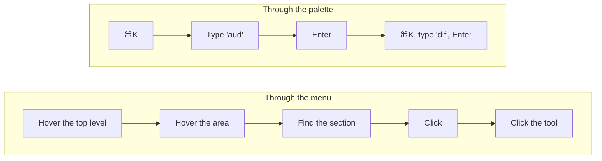
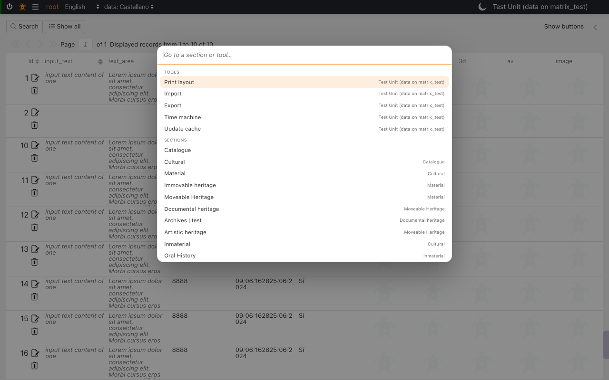
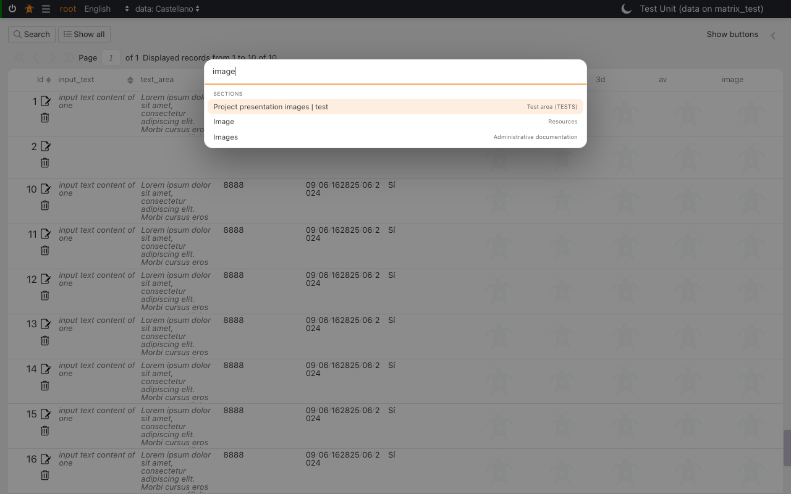
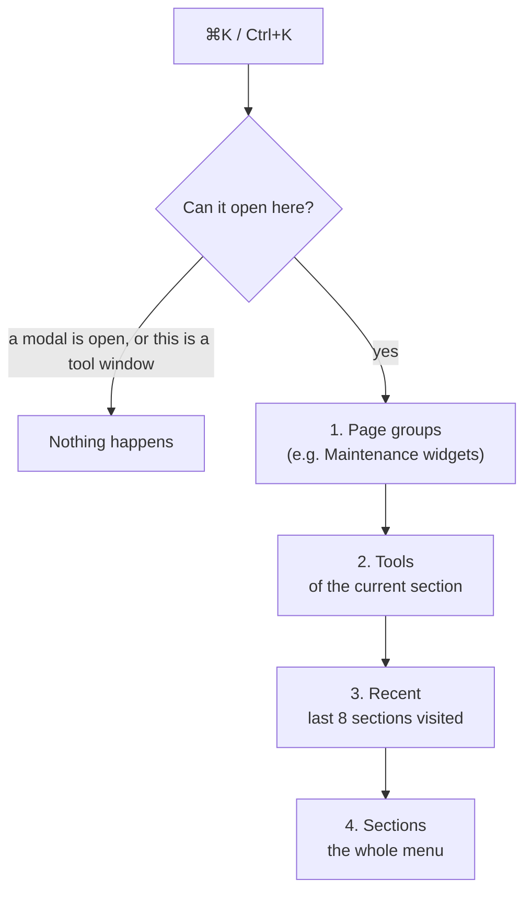
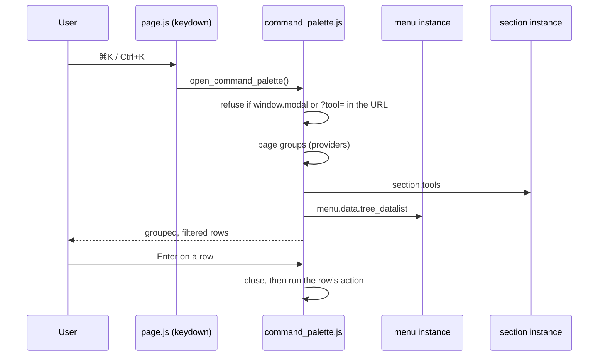
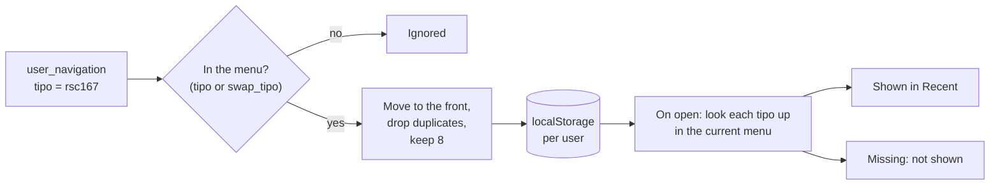

# command palette

> See also: [page](page.md) · [menu](menu.md) · [inspector](inspector.md) ·
> [UI building blocks](index.md)

The **command palette** is a search box that opens anywhere in the back office
with <kbd>⌘</kbd>+<kbd>K</kbd> on a Mac or <kbd>Ctrl</kbd>+<kbd>K</kbd> elsewhere. You type part of a name and
press <kbd>Enter</kbd> to jump to a section or open one of the current section's
tools. This page explains what it does and does not do, and how it works, for
users and for developers who extend it.

## Why it exists

Cataloguers often repeat the same round in several sections: open the Image
section (`rsc170`), open Diffusion; open the Audiovisual section (`rsc167`),
open Diffusion again. Opening a tool is already one click from the
[inspector](inspector.md), so the slow part is reaching each section through the
[menu](menu.md) tree. The palette shortens that to a few keystrokes:



Every tool of every section can be reached the same way, so **no tool gets a
keyboard shortcut of its own**. One key to remember means no two tools can
claim the same keys, no tool can take a key the browser owns, and a tool added
later is listed without anyone choosing a key for it.

## Using it



| key | action |
| --- | --- |
| <kbd>⌘</kbd>+<kbd>K</kbd> / <kbd>Ctrl</kbd>+<kbd>K</kbd> | Open the palette (pressed again inside it: close it). |
| typing | Filter every group, by name and by the text on the right. Case and accents are ignored: `audiovis` finds *Audiovisual*, `image` finds *Image* and *Images*. |
| <kbd>↓</kbd> / <kbd>↑</kbd> | Move the selection. It wraps from the last row to the first. |
| <kbd>Enter</kbd> | Run the selected row. |
| <kbd>Esc</kbd> | Close. Focus goes back to where it was before the palette opened. |
| click outside the box | Close. |

Each row shows its name on the left and, on the right, where it belongs: the
section a tool acts on, or the menu entry a section sits under.



## What it lists

Rows are grouped, always in this order:



| group | source | notes |
| --- | --- | --- |
| **Page groups** | Added by the page you are on (see [Adding a group](#adding-a-group)). | Today only the Maintenance area (`dd88`) adds one: its widgets, listed first. A widget that can destroy data is shown in red, as on the maintenance map. |
| **Tools** | The current section's `tools` — the same list its tools menu shows. | Opens the tool exactly as its button does, with the same section and the same selected records. `tool_identify` is listed only when object identification is enabled. |
| **Recent** | The sections you went to most recently, newest first, at most 8. | Kept per user, in this browser. |
| **Sections** | The menu's own data (`tree_datalist`). | Areas are listed too, as the menu lets you open them. Untranslated names stay in *italic*, as in the menu. |

Nothing is fetched from the server when the palette opens: every group is
built from what the page has already loaded.

## What it does not do

- **It does not grant or widen access.** Sections come from the menu, which the
  server has already filtered by your permissions, and tools come from the
  section's own context. If you cannot open something through the menu or the
  section, it is not in the palette either.
- **It does not search records.** It finds sections and tools by name, never the
  data inside them. Use the section's search for that.
- **It does not open over a modal or inside a tool window.** In a tool opened in
  its own window there is no menu and no section to act on.
- **It does not remember a section you reached by typing its address.** Only
  moves made inside the application to a menu section (through the menu, the
  palette, or any other in-app link to it) are added to *Recent*. Reloading
  the page is not a move.
- **It does not share recents between browsers or devices.** They are saved in
  this browser only; another computer, or a cleared browser, starts empty.
- **It does not switch the section a tool works on.** A tool always acts on the
  section you are in. To run Diffusion on Audiovisual, go to Audiovisual first,
  then open the tool.
- **It does not add per-tool shortcuts**, and nothing can be configured per
  install or per user.

!!! note "Existing tool shortcuts still work"
    A tool can still declare keyboard events in its own properties (`tool_ontology`
    binds <kbd>Ctrl</kbd>+<kbd>S</kbd>). The palette does not change or replace them.

## How it works

The palette is one client module, `client/dedalo/core/common/js/command_palette.js`.
It has no server part and no setting.

### Wiring



- `page.add_events()` calls `init_command_palette(page)` so the palette knows the
  current page, and its document `keydown` handler opens the palette on
  <kbd>⌘</kbd>+<kbd>K</kbd> / <kbd>Ctrl</kbd>+<kbd>K</kbd>.
- The palette's own input handles <kbd>↑</kbd>, <kbd>↓</kbd>, <kbd>Enter</kbd> and
  <kbd>Esc</kbd> and stops them there, so the page-wide <kbd>Enter</kbd> (run the section
  search) and <kbd>Esc</kbd> (leave the active field) never fire while it is open.
- The box is built once, the first time it opens, and appended to `body`.
  Rows are rebuilt on every keystroke.

### What a row does

| row | action |
| --- | --- |
| tool | `open_tool({ tool_context, caller: section })` — the same call as the tool button, so a tool that opens as a modal or a window keeps doing so. |
| section | `navigate_to_menu_item()` from `render_menu_tree.js` — the function the menu itself calls when you click an entry, including its `swap_tipo` redirect and the reload after a page error. |
| page group | whatever the page registered (see below). |

### How recents are recorded

The palette listens to the `user_navigation` event, which the menu, the
palette and other in-app links publish to move the page. When the target is in the
menu, its `tipo` goes to the front of the list:

```js
// published by the menu or the palette when you go to Audiovisual
event_manager.publish('user_navigation', {
	source : { tipo : 'rsc167', model : 'section', mode : 'list', config : null }
})
```

The list is saved in `localStorage` under one key per user, newest first:

```json
// localStorage['dedalo_palette_recent_<user_id>']
["rsc167", "rsc170"]
```

Only `tipo`s are stored, never labels. Each time the palette opens, every stored
`tipo` is looked up in the **current** menu: the name is shown in the current
language, and a section you can no longer open is simply left out. A menu entry
that redirects through `config.swap_tipo` is recorded under the menu entry's
own `tipo`, so it shows with the name you saw in the menu.



## Adding a group

A page area can put its own rows at the top of the palette. Register a
provider when the area renders and remove it when the area is destroyed:

```js
import {add_palette_provider} from '../../common/js/command_palette.js'

// returns the function that removes the provider again
const remove_palette_provider = add_palette_provider(() => {
	// called every time the palette opens: return [] when not applicable
	if (!document.body.contains(root)) { return [] }
	return widgets.map(w => ({
		group	: 'Maintenance',          // heading the rows appear under
		label	: w.label,                // matched by the search
		hint	: 'Database',             // right-hand text, also matched
		css		: w.danger ? 'danger' : '', // optional row class
		action	: () => open_widget(w.id) // run on Enter or click
	}))
})

// in the area's destroy()
remove_palette_provider()
```

This is how the Maintenance area (`client/dedalo/core/area_maintenance/js/render_area_maintenance.js`)
lists its widgets. Its *Find a tool ⌘K* button opens the same palette
(`open_command_palette()`), so there is one palette on that page, not two.

!!! warning "Always remove the provider"
    A provider that is never removed keeps its rows — and the area it closes
    over — alive after you leave the page. Check `document.body.contains(root)`
    inside the provider as well, so a provider that outlives its area returns
    no rows.

## Module reference

`client/dedalo/core/common/js/command_palette.js`:

| export | purpose |
| --- | --- |
| `init_command_palette(page)` | Bind the current page. The first call also starts recording recents. Called by `page.add_events()`. |
| `open_command_palette()` | Open it. Returns `false`, and does nothing, over a modal, in a tool window, or when there is nothing to list. |
| `close_command_palette(refocus = true)` | Close it and, by default, give focus back. |
| `add_palette_provider(fn)` | Add a page group. Returns the function that removes it. |
| `build_items()` | Every row for the current page, in display order: `{group, label, hint, css, action}`. |
| `get_recent()` / `push_recent(tipo)` | Read and update this user's recents. |
| `fold(text)` | Lower-case and remove accents; the search compares folded text. |

Labels used: `tools`, `recent`, `sections`, `command_palette_placeholder` and
`command_palette_empty`, all translated in every application language. Styles
live in `client/dedalo/core/page/css/layout/command_palette.less`.

## Testing

- `test_command_palette` (browser client suite, `bun run test:client`) builds a
  fake page and checks: which tools are listed, the `<mark>` untranslated flag,
  recents from `user_navigation` (with `swap_tipo`, a stale `tipo` and the limit
  of 8), accent-insensitive filtering, <kbd>Enter</kbd>, the arrow keys, <kbd>Esc</kbd> with
  focus return, page groups, and that nothing opens over a modal.
- The rows are native buttons kept out of the <kbd>Tab</kbd> order: the keyboard path is
  the input's arrows and <kbd>Enter</kbd>. The click outside the box that closes it is
  recorded in `engineering/client_a11y_backlog.json`, because <kbd>Esc</kbd> is its
  keyboard equivalent.
