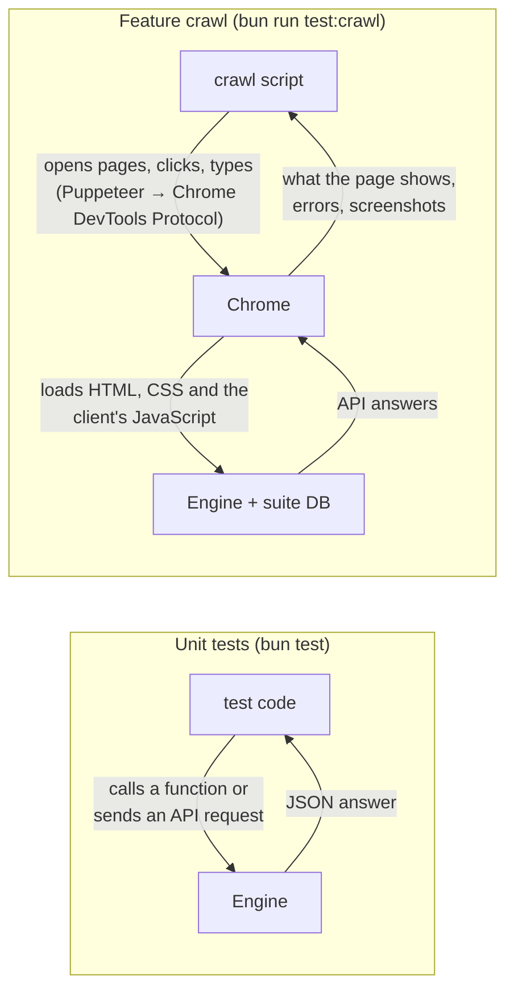
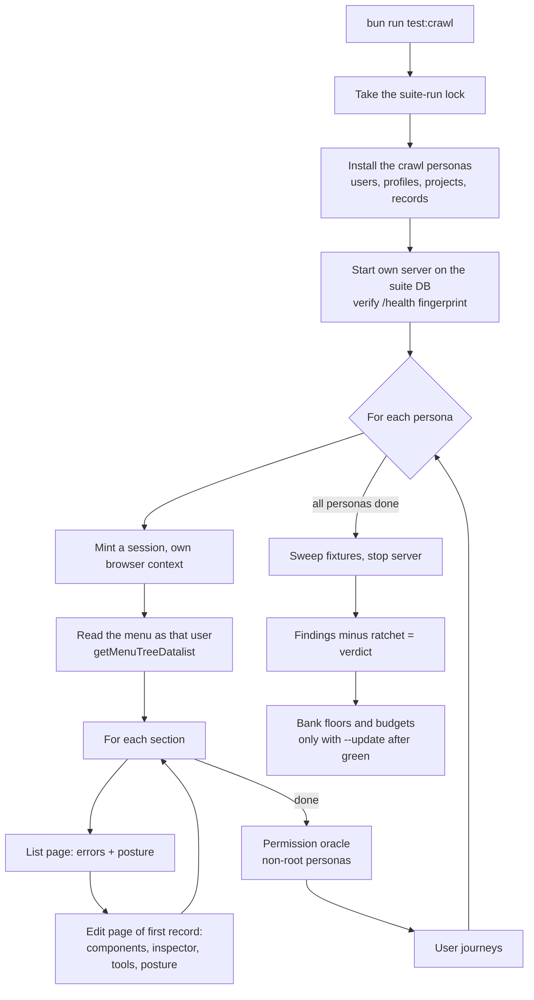
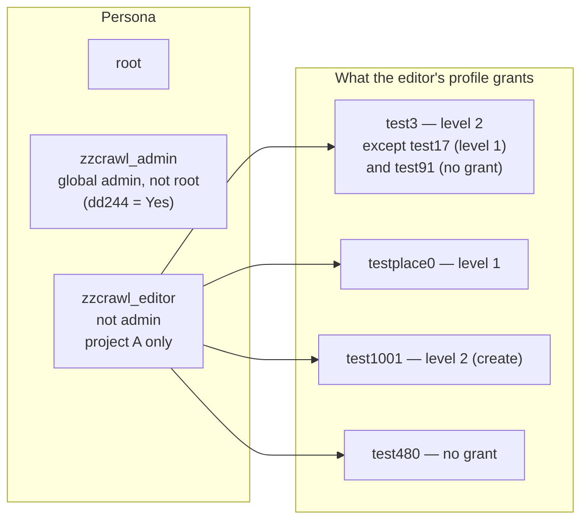
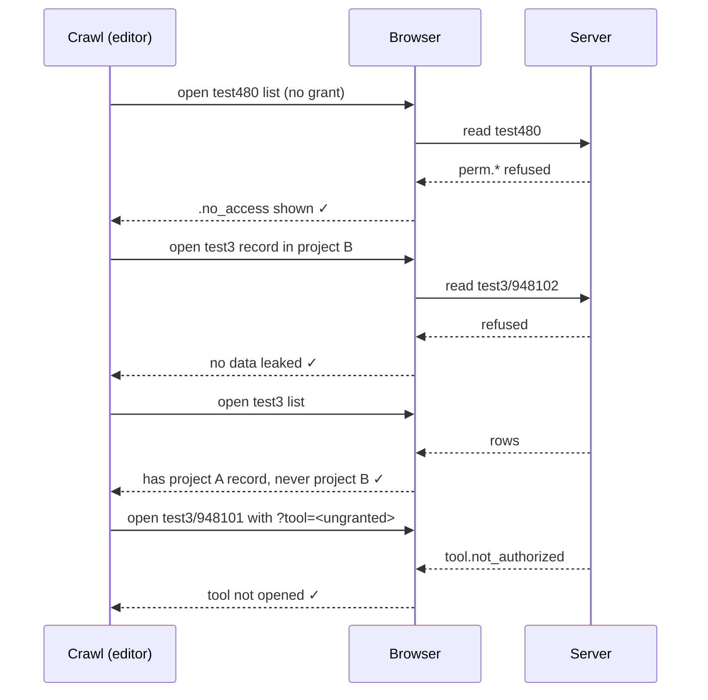
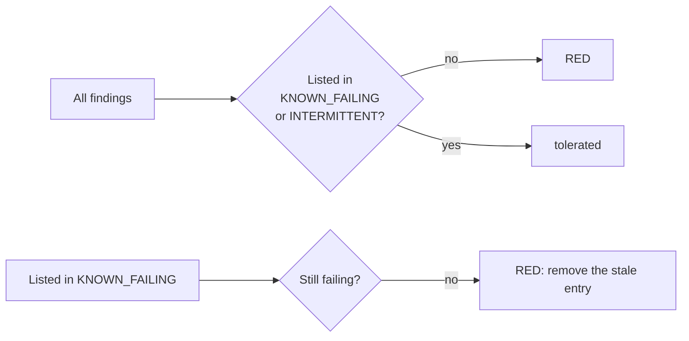
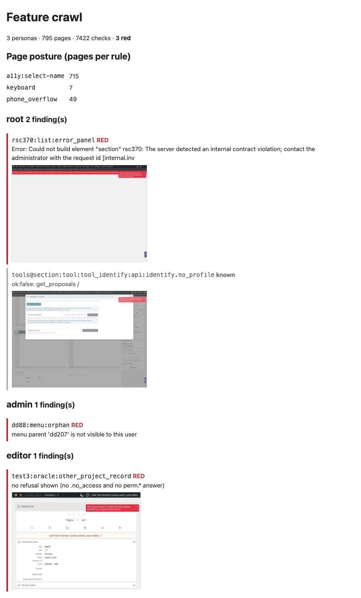
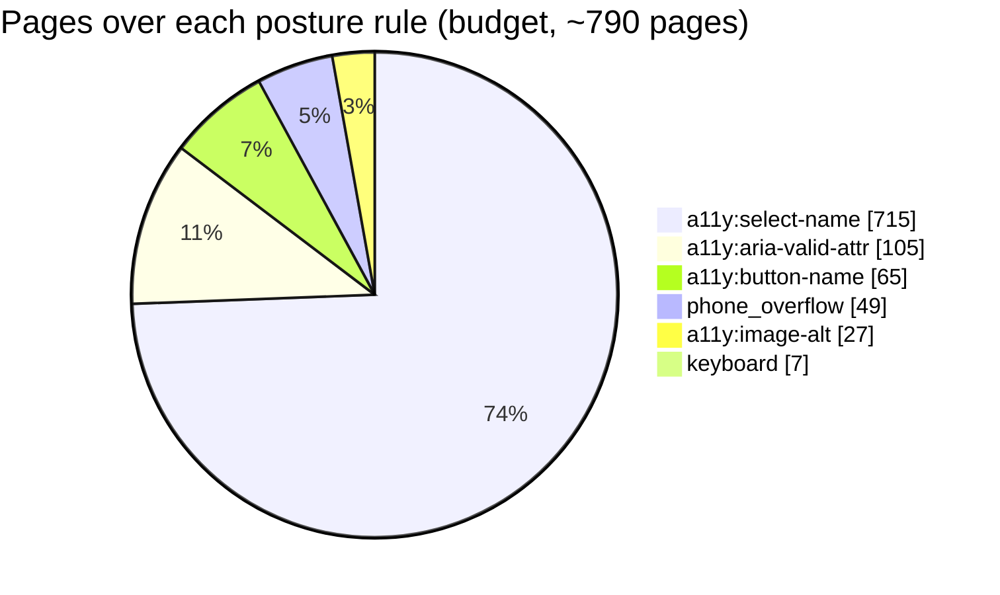

# The feature crawl

```bash
bun run test:crawl            # scripts/feature_crawl.ts
```

## In a nutshell

- **What it is:** an automatic tester that uses Dédalo the way people do: in a real web
  browser, logged in, clicking through the menus.
- **Who it pretends to be:** three users with different rights. One is the all-powerful
  `root`. One is an administrator who is still limited by their permissions. One is an
  ordinary editor who may only work on one project.
- **What it does:**
  - It opens every section each user's menu shows them, as a list and as one record.
  - On each page it checks for errors and for data the user should not see.
  - It also checks basic accessibility and whether the page fits a phone screen.
  - It tries to open, by typing the address directly, things the user is not allowed to
    reach. Each must be refused.
  - It carries out a few real tasks (log in, edit and save, create a record, export) and
    checks the result in the database.
- **Where it runs:** only on the separate test database the suite builds
  (`bun run test:db:setup`). It never touches an installation's real records.
- **Result:**
  - A run is **green** when nothing new is wrong.
  - It is **red** when any problem appears that is not already listed, with a reason,
    as a known one.
  - With `--out <dir>` it also writes a report with a screenshot of each problem.

## Why it matters

A Dédalo installation holds records that several teams share, and each user may see only
part of them. Most of what can go wrong there only shows up in the browser, and only for
some users:

- **Hiding is not protecting.** A menu that hides a section is not a refusal. If the
  server still serves that section to someone who types its address, an editor can read
  another project's records. The crawl tries exactly that, as each user.
- **A form can fail for one user only.** A screen may work for the administrator who
  tested it and still break for an editor with fewer rights. The crawl repeats every page
  for each kind of user.
- **The unit tests do not open the browser.** The engine's thousands of unit tests check
  the server's answers. They cannot see a page that throws an error while it draws, a
  read-only field that can still be typed into, or a tool that never opens.
- **Problems cannot pile up unnoticed.** Every known problem is listed with its reason,
  and the list can only shrink. The crawl must also reach a minimum number of pages, so
  it cannot quietly skip part of the application and still pass.

## What "a real browser" means here

The crawl doesn't imitate a browser. It runs **Google Chrome**, the same program people
use, and controls it from a script.



**How it works:**

- **The program.** [Puppeteer](https://pptr.dev/) starts Chrome and sends it commands
  over the Chrome DevTools Protocol, the same channel Chrome's own developer tools use. It
  uses the Chrome installed on the machine, or the one named in
  `PUPPETEER_EXECUTABLE_PATH`.
- **The pages.** Chrome loads Dédalo's client from the crawl's own server: the same HTML,
  CSS and JavaScript an installation serves. It draws the pages exactly as a user's
  browser would. Nothing in the client is replaced or mocked.
- **The user.** Each persona gets its own isolated browser context, like a separate
  private window, with its own session cookie. One persona can never borrow another's
  login.
- **The actions.** Journeys type into fields key by key and click buttons with real mouse
  events, so the client's own event handlers run, including the automatic save when a
  field loses focus (the journey presses Tab). The `login_form` journey types the username and password into the
  real login form.
- **What it watches.** Chrome reports to the script every uncaught JavaScript error, every
  console error and every API answer. The script also reads the page as drawn: which
  components rendered, whether an error panel appeared, which inputs are enabled.
- **Why it matters.** A unit test can only prove the server's answer was right. The crawl
  proves the page that answer produced works. A field drawn as editable that should be
  read-only, a tool that crashes while opening, or a page that throws while drawing only
  show up here.

**Where it differs from a person at a screen:**

| | Feature crawl | A person |
|---|---|---|
| Window | Invisible ("headless") by default. `--headful` shows it. | Visible |
| Logging in | A session is created directly and handed to Chrome, to save time. The `login_form` and `admin_grant_propagates` journeys use the real login form. | Always the login form |
| Screen size | 1400 × 1000. Each page is also checked at 360 × 740 (phone). | Any |
| Browser | Chrome only | Chrome, Firefox, Safari, … |
| Inspector blocks | Opened by a click event fired inside the page, not by a mouse movement | Mouse or touch |
| Reading state | Sometimes asks the client's own modules what is on screen (for example, the list of component instances), where no visible label shows it | Looks at the screen |
| Judging looks | Never: it checks behaviour, not appearance | Sees everything |

!!! note "Reading this page as an AI agent"
    The commands, file paths and finding ids on this page are exact and can be used as
    written. The ground truth is the code: `scripts/feature_crawl.ts` (the walk),
    `test/helpers/feature_crawl_ratchet.ts` (known failures and banking rules),
    `test/helpers/journey_cases.ts` and `test/helpers/tool_operation_cases.ts` (what is
    and is not exercised). Counts on this page (pages, checks, budgets) are dated
    2026-10-29. Read the current values from `engineering/crawl_inventory.json` and
    `engineering/crawl_posture_budget.json`. Never run the crawl at the same time as
    `bun test` or `bun run test:client`; they share one lock and the second run is refused.

## At a glance

| | |
|---|---|
| **Runs on** | The suite database only (the same verified server door as `bun run test:client`). |
| **Users** | `root`, a non-root global admin and a project-scoped editor. |
| **Visits** | Every menu section in list mode, then its first visible record in edit mode. |
| **Checks per page** | Errors, components, inspector, tools, accessibility, keyboard, phone width. |
| **Then** | The permission oracle (direct-URL refusals) and the user journeys. |
| **Verdict** | Red on any finding not listed in the shrink-only ratchet. |
| **Size** | ~790 pages and ~9,600 checks per full run (floors: 774 pages, 9,351 checks). |

## How a run flows



The walk is driven by data the server already holds. The list of sections comes from the
menu the server builds for that user. The expected permission level of each component
comes from `getPermissions`. The expected tools come from `getUserTools`. Nothing the
crawl compares against is written by hand.

## The three personas

The crawl walks as `root` and as two users built by
`test/helpers/crawl_persona_fixture.ts`. Both live only in the suite database, at
explicit ids, and are swept after the run.



| Persona | Admin | Bound by grants | Why it is here |
|---|---|---|---|
| `root` | yes | no | The widest view: every section, every tool. |
| `zzcrawl_admin` | yes | yes (`dd774`) | Proves a global admin who is not root is still limited by their grants. |
| `zzcrawl_editor` | no | yes | Every grant level at once: edit, read-only, hidden, denied, and one project out of two. |

The fixture only *shapes* the situation. The crawl reads every expected level back
through the real permission functions, so a fixture typo cannot make a check pass.

## What it checks on every page

| Check | Fails when |
|---|---|
| `js_error` | The page throws an uncaught error. |
| `api:<code>` | Any API answer comes back `ok:false`. |
| `error_panel` | The client shows an error panel that no API error explains. |
| `blank` | The section instance never renders. |
| `load` | The page does not load within 60 s. |
| `a11y:<rule>` | axe reports a violation of **critical** impact. |
| `keyboard` | 15 presses of Tab never move focus off the page body. |
| `phone_overflow` | At 360 px wide the page scrolls sideways. |

On edit pages it also checks:

| Check | Fails when |
|---|---|
| `component_render:<model>` | One component per model does not reach `rendered`. |
| `component_error:<model>` | That component shows an error panel. |
| `component_leak:<tipo>` | A component renders although the user holds no grant on it. |
| `component_level:<tipo>` | The client shows a level higher than the server grants. |
| `component_readonly:<tipo>` | A level-1 (read-only) component has an enabled input. |
| `inspector` | An inspector block shows `.inspector_block_failure` after it is opened. |
| `tool_offered:<tool>` | The page offers a tool that `getUserTools` does not grant. |
| `tool_open:<tool>` / `tool_error:<tool>` | An offered tool fails to open, or opens with an error panel. |

And once per menu:

| Check | Fails when |
|---|---|
| `menu:orphan` | A menu entry's parent is not visible to the user. |

### The permission oracle

Hiding a link is not security. For each non-root persona the crawl opens, **by direct
URL**, things that user must not reach. Each must be refused (a `no_access` page or a
`perm.*` answer), never served and never a crash.



## User journeys

A crawl only *looks*. A journey *acts*: it types, clicks and confirms like a user, then
checks the result **on the server**, not on the screen. Journeys are data in
`test/helpers/journey_cases.ts`.

| Journey | What it proves |
|---|---|
| `login_form` | Wrong password refused, right password accepted, through the form. |
| `logout_ends_session` | After logout the old session is refused. |
| `two_tabs_logout` | Logging out in one tab ends the session in the other. |
| `edit_save_reload` | A typed value is saved and survives a reload. |
| `readonly_save_refused` | A save on a level-1 component is refused by the server, whatever the UI hides. |
| `unsaved_changes_warning` | Leaving a page with unsaved edits is guarded. |
| `restore_component_value` | An earlier value is restored from history. |
| `create_record_in_own_project` | An editor's new record lands in their own project; then deleted. |
| `filter_offers_own_projects_only` | The project picker offers the editor only their projects. |
| `tool_export_csv_respects_projects` | A CSV export holds no record from another project. |
| `admin_grant_propagates` | A grant, then a revoke, is visible on the user's very next request (no stale cache). |
| `activity_and_tm_attribution` | Activity and Time Machine record the action under the right user. |

A journey shape, in short:

```ts
edit_save_reload: {
	personas: ['root', 'editor'],
	writes: true,            // suite DB only; skipped in audit mode
	async run(ctx) {
		// open the record, type into the input, blur to save,
		// reload, then read the value back from the SERVER and compare
	},
},
```

## Reading a result

Every finding has one id: `<persona>:<section_tipo>:<mode>:<check>`.

```text
editor:test3:edit:component_readonly:test17   component_text_area test17 is read-only (1) but has 1 enabled input(s)
editor:test480:oracle:no_grant                no refusal shown (no .no_access and no perm.* answer)
root:journey:edit_save_reload:outcome         <first line of the journey's error>
```

(Illustrative: the shapes are the crawl's own; a green run prints none of them.)

The verdict is **findings minus the ratchet**:



- `KNOWN_FAILING` (`test/helpers/feature_crawl_ratchet.ts`) holds each tolerated finding
  with its reason. It is **shrink-only**: an entry that no longer fails turns the run red
  until it is removed. Today it holds one entry (`tool_identify` has no identify profile
  on the suite DB).
- `INTERMITTENT` holds real races that do not reproduce every run. Today it is empty.
- `--strict` ignores both lists.

`--out <dir>` writes `crawl_report.json`, a self-contained `crawl_report.html` grouped by
persona and section, and one screenshot per finding.

### Sample report

The report comes in three forms: the terminal output, a JSON file and an HTML page. The
samples below are real output from this repository's suite database.

#### Terminal: a green full run

This run, from 2026-10-29, was run with `--update`. Each finding prints as `known` (tolerated by the ratchet) or `FAIL` (red),
with its detail on the next line. Then come the totals, pages per posture rule, and what
`--update` banked. The exit code is `0`.

```text
known root:tools@section:tool:tool_identify:api:identify.no_profile
      ok:false: get_proposals  /
known root:tools@section:tool:tool_identify:api:identify.no_profile
      ok:false: find_matches  /

3 personas, 790 pages, 9641 checks, 2 findings, 0 red.
posture a11y:aria-valid-attr: 105 pages
posture a11y:button-name: 65 pages
posture a11y:image-alt: 27 pages
posture a11y:select-name: 715 pages
posture keyboard: 7 pages
posture phone_overflow: 49 pages
banked engineering/crawl_inventory.json: 790 pages, 9641 checks
banked engineering/crawl_posture_budget.json
```

#### Terminal: a red run

This excerpt is from the first full run, on 2026-10-27, before the bugs it found were
fixed. The exit code is `1`.

```text
3 personas, 795 pages, 7422 checks, 32 findings, 32 red.
FAIL  root:rsc370:list:api:internal.invariant
      ok:false: read section rsc370/rsc370
FAIL  root:rsc370:list:error_panel
      Error: Could not build element "section" rsc370: The server detected an internal contract violation; …
FAIL  root:tools@component_json:tool:tool_error:tool_upload
      tool rendered its error panel (caller component_json hierarchy60 on hierarchy1): Error : TypeError: Cannot read properties of undefined (reading 'allowed_extensions') …
FAIL  root:dd15:edit:components
      edit page rendered no component
FAIL  admin:dd88:menu:orphan
      menu parent 'dd207' is not visible to this user
FAIL  editor:test3:oracle:other_project_record
      no refusal shown (no .no_access and no perm.* answer)
```

How to read one line, using the last finding as the example:

| Part | Value | Meaning |
|---|---|---|
| persona | `editor` | Which user saw it. |
| section | `test3` | The section tipo. Tool findings use `tools@<caller model>`; journeys use `journey`. |
| mode | `oracle` | `list`, `edit`, `area`, `tool`, `menu`, `oracle` or the journey name. |
| check | `other_project_record` | Which check failed (see the tables above). |
| detail | `no refusal shown …` | What was observed: here, another project's record was opened without being refused. |

A crawl finding points at the place a problem *shows*, not at its cause. In the run above,
the `rsc370` pair (`api:` + `error_panel`) is one server fault seen twice: once in the API
answer, once in what the page showed. Start from the `api:<code>` finding.

#### `crawl_report.json`

The JSON file is meant for scripts and agents. It holds the same findings with no
formatting.

```json
{
	"audit": false,
	"pagesVisited": 795,
	"checksRun": 7422,
	"findings": [
		{ "id": "root:rsc370:list:api:internal.invariant", "detail": "ok:false: read section rsc370/rsc370" },
		{ "id": "admin:dd88:menu:orphan", "detail": "menu parent 'dd207' is not visible to this user" },
		{ "id": "editor:test3:oracle:other_project_record", "detail": "no refusal shown (no .no_access and no perm.* answer)" }
	],
	"stale": [],
	"auditBlocked": []
}
```

| Key | Meaning |
|---|---|
| `findings` | Every finding, tolerated or not. Whether it counts as red is decided by the ratchet, not stored here. |
| `stale` | `KNOWN_FAILING` entries that passed this run: they must be removed. |
| `auditBlocked` | Audit mode only: write requests the browser aborted. |

#### `crawl_report.html`

The HTML page is meant for people. Findings are grouped by persona. Each has a red bar
(`RED`) or a grey one (`known`), its detail and the screenshot taken at that moment.



This image shows four findings from the 2026-10-27 run, re-rendered with the current
report layout. The real page lists all of a run's findings.

### Posture is budgeted per rule, not per page

Accessibility, keyboard and phone-width debt is too large to list page by page, so it is
counted: how many pages break each rule. The budget lives in
`engineering/crawl_posture_budget.json`. A rule over budget, or a new rule, is red.



A green full run with `--update` **lowers** each budget to what was observed and drops a
rule no page breaks any more. A budget only rises by a hand edit whose commit says why.

### Coverage floors

A crawl that quietly stopped reaching a menu branch would still be green, so a full run
must also reach the floors in `engineering/crawl_inventory.json` (774 pages, 9,351
checks). `--update` raises them after a green full run, less a small slack (2 % pages,
3 % checks) because lazily rendered components make the check count drift between
identical runs.

## Options

| Option | Effect |
|---|---|
| `--persona root,admin,editor` | Walk only these personas. |
| `--only <tipo,…>` | Visit only these sections. |
| `--max <n>` | Stop after *n* sections per persona. |
| `--journey a,b` / `--no-journeys` | Run only these journeys / none. |
| `--concurrency <n>` | Pages in parallel (default 4). |
| `--out <dir>` | Write the JSON + HTML report and screenshots. |
| `--headful` | Show the browser. |
| `--strict` | Ignore the ratchet. |
| `--update` | After a green **full** run, bank floors and budgets. |

A narrowed run (`--only`, `--persona`, `--max`, `--journey`, `--no-journeys`) never
checks or banks the floors.

## Audit mode — a read-only report on staging

```bash
bun run test:crawl --audit --i-know-this-is-staging \
    --url https://staging.example.org --entity <name> --as admin,editor --out report/
```

Run **on the staging host**, from its checkout: it reads that install's own
configuration. It walks real existing users and produces a report, with no ratchet.

Guards:

- The explicit `--i-know-this-is-staging` flag.
- `/health` at `--url` must name `--entity`.
- Every API request whose action is not a read is **aborted in the browser** and listed in
  the report, so no page can write, whatever it tries.
- Sessions are minted for the named users and destroyed at the end.
- No fixtures, no journeys, and tools that open a new window are not opened.

## What it does not do

Know the limits before trusting a green run.

| Not covered | Why / where instead |
|---|---|
| Every record | Only the **first** visible record of each section is opened in edit. |
| Every component | One component **per model** per page, plus every component whose grant differs. |
| Visual regressions | Screenshots are taken only for findings; nothing compares pixels. |
| Speed | A page that loads in 59 s passes. Load time is not gated. |
| Full accessibility | Only axe violations of **critical** impact count; serious and lower are ignored. |
| Full keyboard use | The check only proves Tab reaches *a* control, not that tab order reaches every action. |
| Most tool operations | Every offered tool is **opened**; only 7 tools have their main action run (`TOOL_OPERATED` in `test/helpers/tool_operation_cases.ts`). The other 32 are listed with a reason in `TOOL_OPERATION_PENDING`. |
| 19 journeys | Written down but not built yet, each with a reason, in `JOURNEYS_PENDING`: search and sort, media upload, relations editing, thesaurus moves, concurrent edits, publishing, server-down handling, and more. |
| Hosted CI | It needs a browser and the suite database, so it runs locally or in the self-hosted tier (`engineering/CI.md`). |
| Running beside other suites | `bun test`, `bun run test:client` and the crawl share one lock; a second run is refused. |

The hermetic half of the contract is `test/unit/feature_crawl_tripwire.test.ts`: every
`tools/tool_*` directory is operated, pending with a reason, or grant-only; written and
pending journeys never overlap; every `KNOWN_FAILING` id is well-formed; and the editor
persona can never be an admin, so the oracle can never pass by comparing admin with admin.

## See also

- [Testing](testing.md) — the unit, parity and client tiers this sits beside
- [Tools](tools/index.md) — how tools are granted and opened
