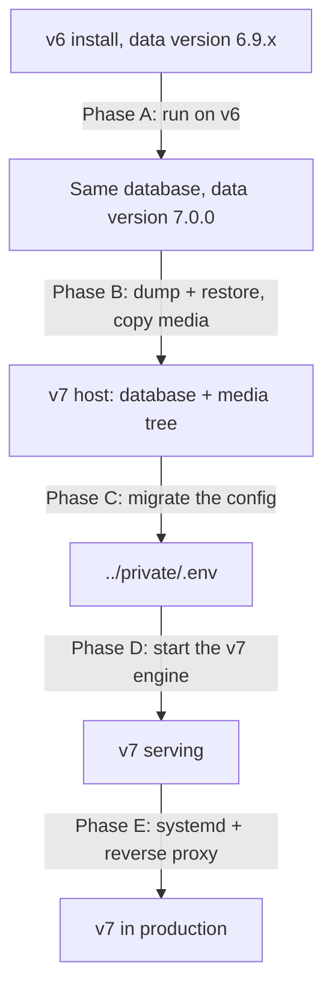

# Migrating a v6 install to v7

> See also: [What changed in v7](../config/whats_changed_v7.md) · [Upgrading](upgrading.md) · [Backup](../management/backup.md) · [area_maintenance](../core/areas/area_maintenance.md) · [Server-side observers](../core/system/observers.md) · [Troubleshooting](troubleshooting.md)

This page is the whole operator path from a running Dédalo v6 to a running Dédalo v7: what the old engine does to your data, how you move the database and the media, and what to do when the data itself turns out to be wrong.

## 1. What this migration is

Two engines, one handover. **The v6 engine transforms your data into the v7 format, in place, in its own database.** Only then does the v7 engine take over that database. The v7 engine cannot do the transform — it deliberately ships no v6 update catalog, and pointed at an untransformed database it will simply report that there is nothing to update.



The transform ships as a **self-contained maintenance package** for v6, `close_v6_prepare_v7`. It is part of the Dédalo **v6** source tree — `core/area_maintenance/widgets/close_v6_prepare_v7/` — and not of the v7 repository, because it runs on v6: take it from a v6 checkout at 6.9.1 or later. It carries its own copy of the transforming engine and runs it as a separate process, so nothing in your v6 install is upgraded or replaced by installing it. Deploying it is three steps — see [get and deploy the package](#25-get-and-deploy-the-package).

!!! danger "The transform rewrites the v6 database in place"
    It is not a copy-then-convert. The only way back to v6 is the database backup — see [rollback](#10-rollback). Everything below assumes you have one.

## 2. Before you start

### Backups

Four stores, with v6 paths — do not take them from the v7 backup list, whose fourth store (`../private/`) and `MEDIA_PATH` do not exist on a v6 host. [Backup](../management/backup.md) describes the equivalent set on v7 only.

1. The **matrix database**: `pg_dump --host localhost --username <v6 user> --format custom --file dedalo_v6.custom.backup <v6 db>`.
2. The **media root** — the directory holding `image/ av/ pdf/ 3d/ svg/`.
3. The **RAG vector database**, if you use semantic search.
4. The v6 **`config/` directory**, including any included `private/config.inc`: it holds `DEDALO_INFORMATION` / `DEDALO_INFO_KEY`, the key material the password migration needs.

Restore-test the database dump before you touch anything:

```shell
createdb dedalo_restore_test
pg_restore --dbname dedalo_restore_test --no-owner --no-privileges dedalo_v6.custom.backup
psql -d dedalo_restore_test -c "SELECT count(*) FROM matrix_dd;"
dropdb dedalo_restore_test
```

`pg_restore` must exit 0 and the count must be non-zero. A dump that has never been restored is not a backup.

!!! warning "A database backup alone is not enough"
    The old configuration files hold the key material that makes the stored passwords readable. Lose them and the password migration in Phase D cannot run. See [backup](../management/backup.md).

### Preconditions

| Check | Required value | Where to look |
| --- | --- | --- |
| Data version | **6.9.1 or later, and below 7.0.0** | the `matrix_updates` table; the v6 preparation panel reports it |
| v6 ontology | **updated**: the nodes `ontology43` (machine name) and `ontology44` (use machine name) are present | run the ontology update in the v6 Maintenance area; the preflight refuses without them (code 10) |
| You are logged in as | the Dédalo **superuser** | the panel refuses anyone else |
| Maintenance mode | **on** before anything that writes | [maintenance status](../management/maintenance_status.md) |
| Dump tool on the **v6** host | `pg_dump --version` not older than the v6 server's `SELECT version();`, and not older than the v7 target's major | the preflight fails hard if the dump cannot run |
| Server on the **v6** host | the PostgreSQL that already serves v6 — the transform runs there, in place | — |
| Server on the **v7** host | PostgreSQL 18 plus the client tools | [Install by hand › `host_packages`](manual_install.md#manual-host_packages) |
| Free disk on the **v6** host | at least 2× the database size plus 20% — the deep preflight and the migrate run each take a full backup | `df -h <backup dir>` against `SELECT pg_size_pretty(pg_database_size(current_database()));` |

If you cannot install PostgreSQL 18 client tools on the v6 host, dump remotely from the v7 host instead: `pg_dump --host <v6 host> …`.

The version is checked as a **range**, not an exact match: any v6 at or after 6.9.1 and below 7.0.0 is eligible, so an install kept current (6.9.2, 6.9.3, …) migrates without any adjustment. Below 6.9.1, update it on v6 first — that floor can never be forced. At or above 7.0.0 the database is already migrated.

!!! note "One ontology update on v6, then nothing more"
    The migration builds the v7 ontology itself, from the v6 one, as its first step: there is no v7 ontology import to do. It does need one ordinary **v6 ontology update** first, the one that defines the machine-name nodes `ontology43` and `ontology44`. They come with the ontology, not with a data update, so the data version cannot prove they are there: the preflight checks for the nodes themselves and refuses without them (code 10). That refusal cannot be forced.

### Inventory — what you must carry to the v7 host

- [ ] The **matrix database** (dumped *after* Phase A).
- [ ] The **media tree** — the whole directory holding `image/`, `av/`, `pdf/`, `3d/`, `svg/`.
- [ ] The **v6 configuration directory**, for Phase C and for the password migration.
- [ ] The values you will have to set by hand: the media root, the public hostname and scheme, the backup path, the default interface and data language. See the [hand-set keys](#52-hand-set-keys).
- [ ] Your denied areas, if you had any — they are not expressed as settings in v6 and must be re-declared.

### 2.5 Get and deploy the package

The package is `close_v6_prepare_v7/` in the Dédalo **v6** source tree, under `core/area_maintenance/widgets/`. Take it from a v6 checkout at 6.9.1 or later; there is no build step.

1. Copy the whole `close_v6_prepare_v7/` folder onto the v6 server, somewhere the maintenance user can read and write — **preferably outside the web root**. If it must live inside, deny HTTP access to it.
2. Copy `close_v6_prepare_v7/widget/prepare_v7/` (the class and its `js/`) into the v6 install's `core/area_maintenance/widgets/prepare_v7/`. If the package does not sit inside the v6 tree, set `PREPARE_V7_PACKAGE_ROOT` so the class can find it.
3. Register the widget in v6's maintenance-area widget list with `id = 'prepare_v7'` — that id is what makes v6 load both the widget class and its `js/prepare_v7.js`.
4. Set ownership to the user the v6 web server runs as, then verify the copy:

    ```shell
    ./verify_package.sh
    ```

    Expected last line: `Package is self-contained.` Anything else — in particular `Package is INCOMPLETE.` — means a partial copy: fix it before continuing, do not run the transform.

5. Turn maintenance mode on and reload the v6 Maintenance area. The panel **Prepare installation for v7** appears, with its action buttons.

### Prepare the v7 host first

A migrated instance is **not an installer instance**: the installer only installs into an empty database, and a migrated database is not one (see [6.1](#61-do-not-run-the-installer)). Prepare the host by hand instead, with [Install by hand](manual_install.md#a-migrated-v6-host): the packages, the service user and its directories, the pinned Bun runtime and the release, and the empty database and role — its steps from [`host_packages`](manual_install.md#manual-host_packages) to [`host_database`](manual_install.md#manual-host_database). Its engine step is not run: the migration fills the database. The units and the web server come after Phase D verification, as [Phase E](#8-phase-e-run-it-as-a-service).

That page creates a service user first. Which of the two cases you are in decides whether you do so:

| Your case | The service user |
| --- | --- |
| **A new v7 host** — a fresh machine, nothing of v6 on it | Run it as written: `useradd --system --user-group …` creates the user *and* a group of the same name. |
| **An in-place upgrade** — v7 goes on the box that runs v6 | **Adopt the existing user.** Do not create a second one: the home, the media tree and the backups already belong to it. What must change is its **group** — see [Phase E](#8-phase-e-run-it-as-a-service). |

From here on, **the service user** means whichever of the two you have.

!!! warning "An in-place upgrade needs a group change before the first boot"
    A v6 install's service user normally has the **web server's** group as its primary group, because the v6 engine ran inside the web server. v7 does not, and a systemd unit that names a group which does not exist refuses to start. [Phase E](#8-phase-e-run-it-as-a-service) is where you fix it: four commands, but finding them from the error message alone is a bad afternoon.

## 3. Phase A — transform the data, on v6

All of this happens on the v6 host, in the v6 Maintenance area, in the panel labelled **Prepare installation for v7**.

The panel opens with a readiness snapshot: whether you are the superuser, whether maintenance mode is on, the data version found in the database, the engine version, the package and engine paths, and the log file it will write. **While maintenance mode is off, the panel offers no action buttons at all.**

Run the three modes in order.

### 3.1 Preflight

Writes nothing. It checks the version gate, the database connection, that the backup tool can actually run, and the structure of your data.

!!! note "A plain preflight cannot see your data yet"
    It runs before the v7 ontology exists, so no component model resolves and every value is reported as an orphan tipo. This mode verifies the *environment*, not the data. The next one verifies the data.

### 3.2 Deep preflight

Takes the backup, builds the v7 ontology from the v6 one, then reviews your data **with the models resolved** and previews the diffusion mapping — and stops there. It writes, so maintenance mode must be on. The backup lands in `var/backup/` inside the package unless you point `--backup-dir` elsewhere; the review lands in `var/data_review.json` next to the log.

This is the mode that tells you whether your data is clean. It classifies every finding into three buckets, reported as counters on the panel and in detail in the review file the run writes:

| Bucket | Meaning | What you do |
| --- | --- | --- |
| **auto-fixed** | repaired in memory during the run — most often a value stored as a bare language map, which gets wrapped, or a fabricated map view, which is [repaired below](#the-fabricated-map-view) | nothing |
| **notices** | dropped on purpose, typically a value under a tipo that no longer exists in the ontology — or kept as it is and only reported, like the [machine-name](#ontology-machine-names) notices | read them, decide whether the loss matters |
| **needs attention** | the ontology model and the stored shape disagree — a human must decide | **fix it before migrating**; this is the only bucket that blocks |

A non-empty *needs attention* bucket fails the preflight. See [when something goes wrong](#9-when-something-goes-wrong-data-errors).

Both counters and the review file are written **before** the migration writes a single converted row, so a large *auto-fixed* count is something you read and understand first, not something you discover afterwards. Only this mode produces real counts for the repair below: a plain preflight runs without the ontology, so no component model resolves and no geolocation finding can appear.

#### The fabricated map view

An *auto-fixed* count in the tens of thousands is normal, and it is almost always this. It has one cause, and the migration repairs it while it converts.

A geolocation item holds two independent things: the **view** — `lat` / `lon` / `zoom`, the map framing an operator chose — and the **features**, the shapes drawn on the map. Earlier editors seeded the view with the client's factory map position, `39.462571 / -0.376295` (the Dédalo facilities' own coordinates), **into the record's value** at the moment the form was drawn, and the save button did not ask whether anything had actually changed. So merely opening a record and pressing save stored a view nobody chose.

That pair is a factory default, not a place. An item holding it exactly is fabricated, and the migration takes it out so that no v7 database is born carrying it. (v7 publication refuses the pair as well, so a fabricated view never reaches a consumer either way — but fabricated data has no business sitting in a new store.)

What the run does with each affected item, and nothing more:

| Stored value | What the migration does |
| --- | --- |
| the default view, and nothing drawn on the map | the **whole item is removed**, altitude included. The record ends with *no* geolocation — which is the truth about a record nobody ever located |
| the default view, with features drawn on the map | the features are kept untouched and the **view is fitted to them**: `lat`/`lon` become the bounding-box centre of every feature on that item. Zoom, altitude and the drawing itself are preserved exactly |
| anything else | untouched. `0 / 0` is a coordinate like any other and survives; no other value is special-cased |

!!! note "Fitting a view to the features is not authoring a location"
    A view is a frame, not a claim about where the thing is. When the fabricated pair sits on an item that carries features, clearing the view would discard framing for work that exists, and keeping it would frame the studio instead of the work — so the migration fits the frame to the work. That is what a view is for; it asserts no feature. For a single drawn point the fitted view *is* that point, verbatim. If the geometry yields no usable position, nothing is fitted and the item is **kept exactly as it is** for review.

!!! warning "`0` publishes on v7, and it did not on v6"
    The v6 emptiness test was falsy-based, so an item stored at `lat 0` or `lon 0` published nothing. On v7 `0` is a real coordinate — the equator and the prime meridian — and it publishes. The migration does not touch those items, deliberately: `0 / 0` is a legal position and mechanically indistinguishable from one somebody meant. If your v6 store used `0 / 0` as a placeholder, that is a **curatorial** clean-up to do before you publish, and the review file will not flag it.

!!! note "A record genuinely located near the studio keeps its own coordinates"
    There is no true positive to protect. The pair is the client's factory default, so a record merely *named* after that city carries it as fabricated as any other record does — a genuinely positioned record holds its own coordinates, which are not this pair. Nothing correct is caught, and there is no place-name test anywhere in the migration.

Two more things the migration does not do: it never repairs **history** — the Time Machine pass rewrites nothing, and a history row whose payload is *only* the default view is deleted rather than edited — and it never renumbers a multi-item component: a default-only item sharing its component with other items is reported and migrated unchanged, for a human to decide.

Where the numbers are: the **auto-fixed** counter on the panel, and `var/data_review.json` next to the log, which counts the removed items (`GEOLOCATION_DEFAULT_ITEM_REMOVED`) and the refitted views (`GEOLOCATION_VIEW_FITTED_TO_GEOMETRY`) on separate lines so you can tell the two apart; the two "kept for review" cases are notices (`GEOLOCATION_DEFAULT_ITEM_MIXED`, `GEOLOCATION_GEOMETRY_NO_POSITION`). Expect the thesaurus store to dominate the count: the geolocation field hangs off a section group every thesaurus section inherits, so a term that never had anything to do with a place can still carry a fabricated view. Read your own preflight for the figures — there is no representative number to compare against.

!!! note "The ontology step is safe to leave in place"
    Building the v7 ontology only *adds* — the matrix tables are not rewritten and the v6 data is intact. An install can sit at that state and continue later. Run steps 1 and 2 (the numbered list in [3.3](#33-migrate)) are idempotent, so re-running after a partial failure is safe.

### 3.3 Migrate

The real run: backup → transform → passwords → diffusion ontology. It is launched detached and in the background; the panel answers with the process id and a pointer to the log:

```text
Migration started in background (pid 12345). Watch var/prepare_v7.log.
```

The panel then tails the last 200 lines of that log every 5 seconds. The log lives at `var/prepare_v7.log` inside the package and is rotated to `var/prepare_v7.log.previous` on each launch.

The panel is only a tail: closing it does not stop the run. From the shell, `ps -p 12345` says whether the process is still alive, and the log's terminal lines are what tell you how it ended — each phase writes `exited with code <n>` (the codes below), and a complete run ends with `=== PREPARE V7: DONE. …`. If the process is gone and no such line was written, the run was killed: re-run it (run steps 1 and 2 are idempotent).

What the run does, in order:

1. **Backup**, then build the v7 ontology.
2. **Schema and data transform**: sets the [ontology machine names](#ontology-machine-names) on the ontology records, adds the v7 typed columns (`data`, `relation`, `string`, `date`, `iri`, `geo`, `number`, `media`, `misc`, `relation_search`, `meta`) to 23 matrix tables, then redistributes each record's single v6 value blob into them by component model — applying, on the way, the same repairs the deep preflight counted, including [the fabricated map view](#the-fabricated-map-view). Rebuilds the time machine, drops the legacy `datos` column, migrates the dataframe pairing locators to the v7 contract, materialises IRI titles, then **unifies `section_id` as an integer** inside every stored locator (the historical string form `"7"` becomes `7`, across all content tables, the time machine and the ontology relations — external-service references such as zenon's zero-padded remote ids are recognised by shape and kept verbatim, and anything unconvertible is reported in the log, never guessed), and finally builds and backfills the two derived search stores from the unified form. The unification records a `section_id_int_normalize` marker row in `matrix_updates` — a future engine release refuses to boot without it, so do not delete it.
3. **Passwords**: converts every recoverable account to Argon2id.
4. **Diffusion ontology**: rewrites the diffusion properties.

!!! note "The review and the run are the same pass"
    The deep preflight and the migration run the same transform; the preflight simply does not save. So the *auto-fixed* counts you read in [3.2](#32-deep-preflight) are not a prediction of what the run might do — they are what it will do. Every repair is applied in memory, on the way into the v7 columns; the legacy value column is never rewritten in place — except on the ontology records, where the [machine names](#ontology-machine-names) are written in the v6 shape just before the transform — and the backup taken as the run's first step is the undo for all of it.

#### Ontology machine names

Every v7 ontology node carries a language-free **machine name** (`ontology43`) next to its translatable label (`ontology5`), and a **use machine name** flag (`ontology44`, Yes or No). A node is a name when the engine reads its term as an identifier: the model definitions, and the nodes whose model is a database, table, table alias, matrix table, field, diffusion domain, or an RDF / OWL term. Every other node is a label. v6 had only the label, so the migration sets both on every ontology record, right before the transform, and the transform then converts them like any other value. The preflights review it without saving, and the deep preflight converts the ontology records with those values applied in memory, as the run will find them.

| Situation | What the migration does |
| --- | --- |
| a value already set (by the master ontology or by you) | kept, never overwritten; one that contradicts the classification is a notice, `MACHINE_NAME_FLAG_MISMATCH` |
| a flag Yes already set on a label node that has no machine name | the label is left untouched, no name is derived. *Needs attention*: `MACHINE_NAME_MISSING` |
| a name node with one Spanish term | the term becomes the machine name and is **removed** from the label; the other languages stay as labels (differing ones are a notice, `MACHINE_NAME_LABEL_KEPT`); flag Yes |
| a name node without a Spanish term, one distinct value in the other languages | that value is moved, with a notice `MACHINE_NAME_FROM_<LANG>` |
| a name node with several distinct terms, or several Spanish items | flag Yes, **no machine name**: nothing is ever picked. *Needs attention*: `MACHINE_NAME_AMBIGUOUS` |
| a name node with no term at all | *needs attention*: `MACHINE_NAME_MISSING` |
| every other node | flag No |
| a local override (`localontology0`) | the same rules, but only for what it overrides: an override that changes neither term nor model is left alone, and only a Spanish override term moves (`MACHINE_NAME_OVERRIDE_NOT_SPA` otherwise); an override that makes a label node a name without a Spanish term of its own is *needs attention*: `MACHINE_NAME_MISSING` |

History follows the name: the Spanish-term history rows of every node that ends with a machine name and no Spanish label are re-keyed to the machine name, so a restore lands in the new component. Only the key changes, never the value, and the move itself writes no history. The step is idempotent, and only a database failure stops the run there, before anything has been converted. After the upgrade, the v7 engine checks the result on every node and reports a disagreement as a named defect.

Duration is a function of how many rows you have. There is no progress bar: the runner prints a `progress:` heartbeat about every 10 seconds. **No heartbeat for several minutes means the run is stuck** — read the log tail and check the database for locks.

### 3.4 After the run — what to check

- The data version in `matrix_updates` reads **7.0.0**. That row is written only after run steps 1 and 2 both succeed.
- Read the log for errors. Not every error stops the run:

!!! danger "A stamped 7.0.0 does not mean every row converted"
    A failing schema step aborts immediately and stamps nothing — the database is left half-migrated at the v6 version, and you re-run. But a failing *script* step that is not marked fatal is logged and the run **continues to the version stamp**. That includes the main data-reformat step. Rows that failed to convert are carried past the stamp. Search the log before you declare the migration clean:

    ```shell
    grep -n "Error on run_scripts\|Request done with errors" var/prepare_v7.log
    ```

    Each hit names the failing step and the affected table and record id. Note them, re-run the migration (it is idempotent) and grep again; rows that still fail are data errors — treat them as [needs attention](#91-needs-attention-findings-v6-host-before-phase-a) findings and fix the record before Phase B.

- If the review counted [fabricated map views](#the-fabricated-map-view), open a few of those records once v7 is serving (Phase D): a record that never had a location must show an empty map, opening at the configured default view, with no coordinate stored; a record with drawn features must still show its drawing, with the map now framed on it.
- Passwords and diffusion run **after** the stamp and are deliberately non-fatal. A failure there does not mean the database migration failed; each can be re-run on its own afterwards. If the password phase reports no Argon2 support in the interpreter, fix the interpreter and re-run just that phase — you can also do the equivalent on the v7 side later (see [Phase D](#62-migrate-the-passwords)).

### Result codes you can meet

| Code | Meaning |
| --- | --- |
| 0 | success |
| 2 | usage or boot problem — a writing mode was started without confirming |
| 3 | not eligible: no data version found, below 6.9.1, or already at/beyond 7.0.0 |
| 4 | the mandatory pre-migration backup could not run |
| 5 | the ontology build or the update failed |
| 6 | the preflight found data errors (the *needs attention* bucket is not empty) |
| 7 | the diffusion ontology migration failed (database migration already done) |
| 8 | this interpreter has no Argon2 support (database migration already done) |
| 9 | an uncaught error — the run failed, loudly, on purpose |
| 10 | not eligible: the v6 ontology update has not been run (`ontology43` / `ontology44` missing) |

## 4. Phase B — move the database and the media

Maintenance mode stays **on**, and the v6 engine stays unreachable to users, until you have verified v7 in [§7](#7-verify). Any v6 write made after the dump below is lost — there is no re-sync.

Dump the migrated database and restore it into the **empty** database created in production step 7:

```shell
# on the v6 host, after Phase A
pg_dump --host localhost --username <v6 user> --format custom --file dedalo_v6_migrated.custom.backup <v6 db>

# on the v7 host, into the EMPTY database
pg_restore --host localhost --username <v7 user> --dbname <v7 db> --no-owner --no-privileges --verbose dedalo_v6_migrated.custom.backup
```

Do **not** pass `--clean`: the target is empty by requirement. The [backup page](../management/backup.md#restore-a-backup-for-the-work-system) covers the general restore, including the existing-database case, as background.

The database user that owns the target database must be able to `CREATE EXTENSION`: `pg_trgm`, `unaccent` and `btree_gin` are required. If policy forbids that, have a superuser create the three extensions in the empty database first.

Then copy the media tree. The per-type folder names do not change between v6 and v7 — `image`, `av`, `pdf`, `3d`, `svg` — so the subtree carries over as it is. **Only the root moves.** Whatever absolute directory contains those folders on the new host is the value you will set as `MEDIA_PATH` in the next phase.

!!! warning "Copy the media completely before you start the engine"
    The stored media index is a cache derived from what is on disk. A partial copy makes the engine record a smaller file set, and the repair sweep will then refuse to shrink it back without an explicit override. Finish the copy first.

## 5. Phase C — the config

A v6 install keeps its settings as ~200 `define()` statements in `<dedalo>/config/`. v7 reads one file, `../private/.env`. `dedalo:migrate-config` turns the first into the second. It does not guess: it reads your v6 config, tells you exactly what it will write, what it will drop and why, and what it cannot migrate — and it writes nothing until you say so.

!!! note "Where every `bun` command on this page runs"
    On the **v7 host**, from the install root (`/var/www/dedalo/master_dedalo` in the production guide), **as the service user**: `sudo -u dedalo bun run …`. Relative paths such as `../private/.env` are relative to that directory. Run as root and you get a root-owned `.env` the service cannot read.

The spine is three commands. The rest of this section is what each one tells you.

```shell
# 1. dry-run: prints the plan, writes nothing
bun run dedalo:migrate-config --config-dir=/path/to/dedalo_v6/config

# 2. candidate: write it somewhere safe, add the hand-set keys, boot against it
bun run dedalo:migrate-config --config-dir=/path/to/dedalo_v6/config --out=/tmp/candidate.env

# 3. apply: merges into ../private/.env, backs the previous file up, stays 0600
bun run dedalo:migrate-config --config-dir=/path/to/dedalo_v6/config --execute
```

`--config-dir` is the v6 `config/` directory — the one holding `config.php`, `config_db.php`, `config_areas.php` and `config_core.php`.

!!! warning "If your defines live somewhere else"
    Some installs keep the payload in an included file (e.g. `../private/config.inc`) and leave `config.php` as a stub. The tool reads the config **directory only** and never follows an include out of it — but it says so, loudly, and refuses to proceed:

    ```text
    !! CONFIG INCLUDED FROM OUTSIDE THE CONFIG DIRECTORY — and NOT read.
    ```

    Point `--config-dir` at the directory that really holds the `define()`s.

### 5.1 Read the report

Every constant it found is grouped. Values are never printed, so the report is safe to paste into a ticket — passwords and salts stay in your files.

| Section | What it means | What you do |
| --- | --- | --- |
| `SAME` | v7 reads this key under the same name | nothing |
| `ALIAS` | v7 has its own name for it; the value carries over | nothing |
| `RENAMED` | the name changed **and the old one is retired** | nothing — the tool writes the new name |
| `RESHAPED` | the name and/or the value shape changed | nothing — the tool converts it |
| `DROPPED` | v7 has no such setting, with the reason | nothing. See [what changed in v7](../config/whats_changed_v7.md#settings-that-are-gone) |
| `COMMENTED OUT` | you had deliberately left it at the default | nothing |
| **`NOT MIGRATABLE`** | **the v6 value is computed at runtime** | **set it by hand — see [5.2](#52-hand-set-keys)** |
| **`UNKNOWN`** | the tool has never heard of this constant | **report it** — it is a gap in the map, not a fault in your config |

### 5.2 Hand-set keys

v6 computed some settings instead of stating them — the host from the request, the media and backup paths from the script's own location, the interface language from a function call. A static reader cannot know what those evaluate to on your server, and **guessing would be worse than stopping**: it would write a plausible wrong path and look like it had worked. So they are listed as `NOT MIGRATABLE` and you set them by hand in `../private/.env`:

| Key | What to set it to |
| --- | --- |
| `MEDIA_PATH` | the absolute media root on the **new** host — the directory holding `image/`, `av/`, `pdf/`, `3d/`, `svg/` |
| `DEDALO_HOST`, `DEDALO_PROTOCOL` | the server's real public hostname and scheme |
| `DEDALO_BACKUP_PATH`, `ONTOLOGY_DATA_IO_DIR`, `UPDATE_LOG_FILE` | paths on the new host |
| `APPLICATION_LANG`, `DATA_LANG` | the defaults you used in v6 |
| `DEDALO_FILTER_SECTION_TIPO_DEFAULT` | as in v6, if you set it |
| `AREAS_DENY` | your denied areas, as a JSON array of tipos — v6 did not express them as a setting |

`MEDIA_PATH` is the one that matters most: get it wrong and no media resolves, and writes made while it is wrong corrupt the media index.

### 5.3 Try the candidate before you apply it

Do not migrate straight into your live `.env`. Write the candidate (command 2 above), open it, add the hand-set keys, then boot a server against it:

```shell
mkdir -p /tmp/try/private && cp /tmp/candidate.env /tmp/try/private/.env
DEDALO_PRIVATE_DIR=/tmp/try/private bun run dev
```

A good config boots, answers `/health`, and shows a configured install in **maintenance → check config**. A bad one usually fails loudly at boot, naming the key.

### 5.4 Apply it

`--execute` **merges** into `../private/.env`:

- keys already present are left exactly as they are — your file is never rewritten or reordered
- new keys are appended under a dated comment block
- the previous file is backed up to `.env.bak.<timestamp>`
- the write is atomic, and the file stays `0600`

It refuses to run if anything is still `UNKNOWN`, or if a **boot-critical** key (`ENTITY`, the `DB_*` set, and the language block) is unresolved — a configured install without those crash-loops, and it is better to find out now.

If the result is wrong, nothing is destroyed: the previous file is at `.env.bak.<timestamp>`. Restore it and re-run the dry run.

??? note "What is *not* migrated, on purpose"
    - **Secrets are not invented.** `DEDALO_SALT_STRING` is dropped: in v6 it seeded a *session* token, never a password salt. v7 manages its own session secrets.
    - **The password keys are dropped deliberately.** `DEDALO_INFORMATION` / `DEDALO_INFO_KEY` were the AES key and IV for v6 passwords. Carrying them into v7 would only preserve the ability to *decrypt* old passwords — exactly what you do not want. v7 stores Argon2id hashes, whose salt is embedded per password. They are still needed **once**, by the password migration in [6.2](#62-migrate-the-passwords) — which is why you kept the old config directory, and why you delete it afterwards.
    - **`config_areas.php`** holds no `define()`s — it is code appending to a deny list. If you denied areas, set `AREAS_DENY` yourself, or use the maintenance area.
    - **Runtime state** (maintenance mode, install status) is not config in v7 — it lives in `../private/ts_state.json` and is written by the app.

    The full v6 → v7 settings map, key by key, is [what changed in v7](../config/whats_changed_v7.md).

!!! warning "Retired keys refuse the boot"
    A v6 `.env` carried over may still name a key v7 has retired. The server names the key and the file and refuses to start until you rename the line — the full list is in [upgrading](upgrading.md#retired-configuration-keys).

## 6. Phase D — first v7 boot

### 6.1 Do not run the installer

!!! danger "The installer is a fresh-database tool only"
    Pointed at a migrated database it stops at the seed step:

    ```text
    database '<db>' is not empty (<n> objects, e.g. …) — the installer only installs into an empty database
    ```

    There is no flag to skip the seed — a migrated host never runs the installer, on purpose. The migrated path is: migrate the config, migrate the passwords, then **start the server**, in that order. Nothing else.

Nothing asks you to install, either: there is no install page. A migrated instance has its database keys set, so the server boots and the normal login serves. (A server that finds none of the four keys refuses to start — exit 78 — and says which file it read.)

### 6.2 Migrate the passwords

!!! danger "Skip this and every user is locked out"
    v6 did not *hash* passwords, it **AES-encrypted** them. v7 accepts **only Argon2id**, and there is no upgrade-on-next-login path: any user whose stored value does not start with `$argon2` cannot log in. Run this **after** the config exists (it needs the database settings) and **before** you let users in — the server does not have to be running.

    Count who is still on the old storage:

    ```sql
    SELECT COUNT(*) FROM matrix_users
     WHERE "string"->'dd133'->0->>'value' NOT LIKE '$argon2%';
    ```

**Nobody has to choose a new password.** Because the old storage is reversible, the tool decrypts each legacy value once and re-hashes it with Argon2id. Users log in afterwards with the passwords they already have, and are never told anything happened.

```shell
# dry-run: reports who is recoverable; writes nothing, prints no passwords
bun run dedalo:migrate-passwords --config-dir=/path/to/dedalo_v6/config

# apply
bun run dedalo:migrate-passwords --config-dir=/path/to/dedalo_v6/config --execute
```

It needs the v6 **`DEDALO_INFORMATION`** and **`DEDALO_INFO_KEY`** — the encryption key and IV. If your install keeps its defines in an included file, name it with `--config-file=/path/to/private/config.inc`, or pass them directly with `--information='…' --info-key='…'`.

!!! warning "Use the config that was in use when the passwords were last set"
    Those two constants are marked *don't change it after install* for exactly this reason: change them and every stored password becomes undecryptable. If the dry run says **NOT RECOVERABLE** for everyone, the key material is wrong — it does **not** mean the passwords are lost. Find the right config before doing anything else. A wrong key is always reported, never silently applied.

    Users it genuinely cannot recover must have their password reset by an admin.

!!! info "This is a security upgrade, not just a compatibility fix"
    `DEDALO_INFORMATION` defaults to a published string and the IV seed is the entity name — so on a default v6 install, **anyone with a copy of the database can decrypt every password**. Argon2id ends that. It is also why the config migration deliberately does not carry those two keys into the v7 `.env`.

Once this has run and [§7](#7-verify) passes, the v6 config copy on the v7 host can decrypt nothing you still need. Securely delete it (`shred -u`): it holds the AES key for every legacy password.

### 6.3 Start the server — what happens automatically at boot

| Step | Behaviour |
| --- | --- |
| Schema migrations | ordered files applied before serving; they provision **only** the engine's own operational tables, never the matrix schema |
| Search stores | if a store table, a trigger or the store's contents are missing, the engine provisions and **backfills** `matrix_string_search` and `matrix_relation_index` |
| Media index, observers, diffusion, caches | registered and warmed; failures are logged, not fatal |
| Statistics wipe | a restore wipes Postgres cumulative statistics; boot **detects and warns only** |

!!! warning "The first boot can take minutes before it serves"
    The search-store backfill is exactly the post-migration case: the stores are empty while the data is not. It is loudly logged. Until it finishes, relation searches refuse with a maintenance message rather than returning wrong results.

!!! note "A green health check does not prove the migrations applied"
    A failed migration run logs and the server keeps serving on lazy fallbacks. Read the boot log, not just `/health`.

### 6.4 Operator actions the boot does not do for you

| Action | Where | Why it matters |
| --- | --- | --- |
| Register tools | maintenance area, `register_tools` panel | tool records are not migrated; without this the tools are not offered |
| Activate hierarchies | maintenance area, `add_hierarchy` panel | see [install new hierarchies](../management/install_new_hierarchies.md) |
| Repair sequences | maintenance area, `sequences_status` panel | opening it audits every table sequence except a named skip list (`session_data`, the counter tables, `temp`, the legacy `relations` tables) and **repairs one that is behind, as a side effect of loading** |
| Refresh statistics | `analyze_statistics` in the Database info panel | the repair for the statistics wipe boot warned about |
| Repair the media index | `bun scripts/media_repair_files_info.ts` | see [media drift](#94-media-drift-files-on-disk-nothing-rendered-v7) |

Widget by widget, the panels are described in [area_maintenance](../core/areas/area_maintenance.md).

## 7. Verify

```shell
sudo curl --fail --unix-socket /run/dedalo/dedalo_ts.sock http://localhost/health
```

Expected: HTTP 200 with `db` reporting `ok`. If you run on a TCP port instead of a socket, `curl --fail http://localhost:<port>/health`. No socket file at all means the process is not running — `journalctl -u dedalo -n 100`. Put the engine under systemd and the reverse proxy **after** this verification passes — that is [Phase E](#8-phase-e-run-it-as-a-service). Then, in the browser, as a normal user:

| Check | Expected |
| --- | --- |
| Log in with a pre-migration account | it works — if it does not, the password migration did not run |
| Open a record with images | thumbnails render |
| Run a text search | results |
| Run a search on a related section | results — not a maintenance message; if you get one, the search-store backfill is still running |
| Open a thesaurus | the tree has terms |
| Maintenance → update data version | the version in the database reads **7.0.0** |
| Maintenance → `dataframe_control`, press *run check* | `OK. Integrity scan done. Orphans found: 0` |
| Maintenance → `counters_status` | no counter reported against a non-section |

!!! note "The login panel's version row is not the database's"
    It shows the engine constant, so it reads `7.0.0` even on a database still stamped 6.x. Only the update-data-version panel reads the real value.

!!! note "The first visit from a browser that ran v6 reloads once"
    v6 left a service worker in every browser that used it, caching the v6 scripts. On the first visit to v7, the browser replaces it, deletes the v6 cache and reloads the page by itself. For a moment before that reload the page may still show the v6 interface — wait for it; do not clear the browser cache by hand. If an interface still looks wrong after the reload, see [Troubleshooting → The interface misbehaves after the upgrade from v6](troubleshooting.md#the-interface-misbehaves-after-the-upgrade-from-v6).

## 8. Phase E — run it as a service

Phase D started the engine by hand, as the service user. Phase E makes that permanent: **one supervised service per install**, reachable by the web server. On a new host this is [Install by hand](manual_install.md), from [`host_units`](manual_install.md#manual-host_units) to [`host_backup_verify`](manual_install.md#manual-host_backup_verify), and nothing else. On an **in-place upgrade** there is one more thing to do first, because the way the engine runs changed — and with it, who must own what.

### 8.1 What changed: the engine is no longer part of the web server

| | v6 | v7 |
| --- | --- | --- |
| Where the engine runs | **inside the web server** — as a PHP module or an FPM pool | its own long-lived process |
| Who it runs as | the web-server user (`www-data`) | its own service user |
| What supervises it | the web server; the FPM pool *is* the service | **systemd** — one unit per install |
| What the web server does | executes the engine | **proxies** to a unix socket, and serves static files and media |
| Who writes the media tree | the web-server user | the service user, and nothing else |
| Restarting the engine | reload the web server | `systemctl restart` the unit |
| Two installs on one host | two pools, one user | two users, two units, two sockets — see [multiple instances](multi_instance.md) |

An FPM pool and a systemd unit look like the same idea and are not. The pool was a *configuration block inside the web server*, spawning workers on demand under the web server's identity; the unit is a **separate program with its own identity, lifetime and logs**, that the web server merely talks to. Nothing about v7 is started, stopped or reloaded by touching the web server's configuration.

!!! warning "The ownership rule inverts — this is the part that bites"
    In v6 the tree had to be group-`www-data`, because the interpreter *was* `www-data` and wrote the media itself. In v7 **nothing runs as `www-data`**, so that requirement is gone. What the web server still needs — connect to the socket, read the client tree and the media — is granted the other way round: `www-data` is added **to the instance's group**, not the instance to `www-data`'s.

### 8.2 Give the adopted user its own group

A v6 service user normally has `www-data` as its **primary** group:

```shell
id _dedalo_user
# uid=1001(_dedalo_user) gid=33(www-data) groups=33(www-data),100(users)
```

There is no group named after the user, so a unit with `Group=_dedalo_user` fails before the engine ever runs — see [troubleshooting](troubleshooting.md#failed-to-determine-group-credentials-no-such-process). Create the group, make it primary, hand the tree over, and let the web server in:

```shell
sudo groupadd _dedalo_user
sudo usermod -g _dedalo_user _dedalo_user
sudo chown -R _dedalo_user:_dedalo_user /home/dedalo.dev   # home, repo, ../private, backups
sudo chown -R _dedalo_user:_dedalo_user /srv/dedalo/media         # and MEDIA_PATH, wherever it is
sudo usermod -aG _dedalo_user www-data
sudo systemctl restart apache2      # RESTART, not reload: group membership is read at process start
```

Then check the two things that break silently:

```shell
stat -c '%U:%G %a' /home/dedalo.dev/private/.env   # _dedalo_user:_dedalo_user 600
ls -ld /home/dedalo.dev                            # 0751, or 0750 with www-data in the group
```

The home must stay traversable by the web server, or it can reach neither `client/` nor the media tree. `private/` stays `0700` and `.env` `0600` — the web server has no business in either.

!!! danger "Leaving the primary group at `www-data` *works*, and quietly removes the boundary"
    The unit starts, the socket is reachable, everything serves. But `UMask=0007` makes the socket group-writable, so **every member of the web-server group can connect to the engine**, and every group-readable file under the install is readable by them. On a host with a second install, or any other web application, that is the whole isolation boundary gone. Use a per-install group even when there is only one install today.

Once the engine is the only writer, the group-write bits the v6 layout needed can come off the media tree. That is hardening, not a requirement.

### 8.3 The unit

Install the template units and this instance's drop-ins as described in [Install by hand › `host_units`](manual_install.md#manual-host_units). Two points that an upgraded host gets wrong:

- `User=` and `Group=` are **two independent values**, and the drop-in names both. On an upgraded host they need not be the same string, and `Group=` must name a group that already exists (`getent group <name>`).
- The socket must live under the unit's `RuntimeDirectory` — `/run/dedalo-<i>/` for the instance `<i>`. `SERVER_UNIX_SOCKET` in `../private/.env` must be `/run/dedalo-<i>/dedalo_ts.sock`.

Hosting several domains on this box? [Several instances by hand](manual_install.md#several-instances-by-hand) covers the per-instance identity, and [several instances](multi_instance.md) what else must be unique.

### 8.4 The web server's modules changed too

The vhost is not the only thing to adjust: v6 and v7 need **different Apache
proxy submodules**, and an upgraded host has exactly the wrong one enabled.

```shell
apachectl -M | grep -E 'proxy|ssl|headers|http2|rewrite'
```

A host that served v6 typically shows `proxy_module` and `proxy_fcgi_module` — the
pair that talked to the FPM pool — and **no `proxy_http_module`**. v7 is reached
over HTTP on a unix socket, which is `proxy_http`'s job, so without it every
proxied request fails with:

```text
AH01144: No protocol handler was valid for the URL /dedalo/lib/… (scheme 'http')
```

Enable what v7 needs; the v6 module can stay, inert:

```shell
sudo a2enmod ssl headers http2 rewrite proxy proxy_http
sudo systemctl restart apache2       # LoadModule needs a restart, not a reload
```

!!! note "`mod_headers` is not optional"
    The vhost's `Header always set …` lines are a **configuration error** when
    `mod_headers` is absent — Apache refuses to start, rather than skipping them.

Then write the vhost itself: [a site written by hand](reverse_proxy.md#a-site-written-by-hand),
one per domain if this host serves several. Point
every path at **this** install's socket, media and clone — a v6 vhost's `Alias`
and `DocumentRoot` lines point into the old tree and cannot be reused as they are.

### 8.5 Verify the service identity

```shell
systemctl show dedalo-ts -p User -p Group -p WorkingDirectory
ls -l /run/dedalo/dedalo_ts.sock          # srw-rw-rw- <service user> <service group>
ls -ld /run/dedalo                        # drwxr-x--- <service user> <service group> — what guards the socket
sudo -u www-data test -w /run/dedalo/dedalo_ts.sock && echo "proxy can connect"
```

A `502` on every request through the proxy, with a healthy engine on the socket, is this check failing — see [every request is a 502](troubleshooting.md#every-request-is-a-502).

!!! warning "Empty your browser cache before you judge the result"
    The address did not change, so your browser still holds the **old engine's**
    JavaScript — and an ES-module import resolved inside a cached module is not
    revalidated by a normal reload. The symptom is one asset `404`ing at a path
    that exists nowhere in the new tree, which reads like a proxy fault and is not
    ([details](troubleshooting.md#a-client-asset-404s-at-a-path-that-is-not-in-the-repo)).
    Empty the cache and hard-reload before concluding anything about the install —
    and tell your users to do it once, for the same reason.

## 9. When something goes wrong — data errors

Most trouble is found by the deep preflight, **before** the migration. The rule for everything below is the same:

!!! danger "Dry run first, every time — and there is no rollback for a move"
    The bulk transforms default to reporting only, and mutate **only** when explicitly told to. The section-move and tipo-rename transforms offset record counters irreversibly: the dry run is the safety gate, and a database backup is the only undo. Run them under maintenance mode.

### Symptom → cause → fix, before you migrate (v6 host, Phase A)

| Symptom | Cause | Fix |
| --- | --- | --- |
| Preflight refuses: not eligible, no data version found | the database is fresh or not a Dédalo database | you are pointed at the wrong database |
| Preflight refuses: requires 6.9.1 or later | v6 data is too old | update the v6 install first; this can never be forced |
| Preflight refuses: ontology nodes missing, run the ontology update first (code 10) | the v6 ontology predates the machine-name nodes | run the ontology update in the v6 Maintenance area, then the preflight again; this can never be forced |
| Preflight refuses: already at or beyond 7.0.0 | already migrated | do not re-run; go to Phase B |
| Preflight fails on the backup | the dump client is unusable or older than the server | install matching client tools; the backup is the real run's first step, so this is fatal by design |
| Preflight fails with *needs attention* findings | model and stored shape disagree | [fix in v6 first](#91-needs-attention-findings-v6-host-before-phase-a) |
| Panel offers no buttons | maintenance mode is off | turn it on |
| Refused: only the Dédalo superuser | you are not the superuser | log in as superuser |

### Symptom → cause → fix, after you migrate (v7 host, Phase D onward)

| Symptom | Cause | Fix |
| --- | --- | --- |
| A component shows the wrong or no value | the row failed to reformat and was carried past the stamp | search the log, re-run the migration (it is idempotent), or fix the record |
| Widget with a subsidiary form shows nothing / duplicated rows | dataframe frames left legacy or orphaned | [dataframe frames](#92-dataframe-frames-v7) |
| A computed/mirrored value is empty or stale | the mirror was written by the migration, outside the save path | [stale mirrors](#93-stale-observer-mirrors-v7) |
| Media widget empty although the files are on disk | media index drift, usually a wrong media root | [media drift](#94-media-drift-files-on-disk-nothing-rendered-v7) |
| Thesaurus tree empty, portal resolves nothing | the hierarchy was imported but never activated | [hierarchy not activated](#96-hierarchy-not-activated-v7) |
| New records collide with existing ids | the record counter is behind the data | [counters](#97-counters-and-sequences-v7) |
| A relation points at a record that is not there | structural leftovers | [dangling relations](#95-dangling-relations-and-wrong-tipos-v7) |
| The interface misbehaves in one browser only, after the upgrade | that browser still runs the v6 service worker and its cached v6 scripts | reload once; see [troubleshooting](troubleshooting.md#the-interface-misbehaves-after-the-upgrade-from-v6) |
| Stale values after an ontology or media change | stored per-record data needs regenerating | clear the caches from the runtime panel, then run [tool_update_cache](../tools/using_update_cache.md) |

### 9.1 *Needs attention* findings (v6 host, before Phase A)

These are the only findings that block the migration, and they block it on purpose: the ontology says a component is one model and the stored value has the shape of another. A tool cannot decide which one is right.

Every review writes its findings to `var/data_review.json` inside the package, next to the log — that file is what the panel's chips read. The blocking bucket is also printed in the log, one group per model mismatch, with the records it touches and a ready-to-paste statement:

```text
   14 × Bad component data [2]. Expected object. … tipo: 'ich147' … model: button_new
        written as: component_input_text · ontology now says: button_new
        records in matrix_dd · section_tipo ich145 · section_id: 1, 2, 3, 4, 5, 6, 7
        SELECT * FROM matrix_dd WHERE section_tipo = 'ich145' AND section_id IN (1, 2, 3, 4, 5, 6, 7);
```

Read it as: the component **tipo**, the **model** the ontology declares, the shape the value was **written as**, and the table, section tipo and record ids to look at. Run the printed `SELECT` on the v6 database and read the value stored under that tipo in the legacy `datos` column. The ids are de-duplicated and capped at 200 per table and section tipo; the same `locations` and `sql` fields are in `var/data_review.json`.

Then decide, and the criterion is the majority:

- **The ontology is right, the record is wrong** when other records of the same component hold the model's shape. Fix the record, in the v6 edit form.
- **The stored shape is right, the ontology is wrong** when *every* record disagrees with the model — usually a component whose model was changed in the ontology after the data was written. Fix the model in v6's ontology tool.

Re-run the deep preflight; the bucket must read 0. The other two buckets do not block: auto-fixed findings are repaired by the run itself, and notices are values under tipos the ontology no longer knows — read them and decide whether the loss matters before you continue.

!!! note "Re-running the review with the repairs off"
    There is no panel control for this: run the preflight from the shell with `--no-auto-fix`. That is a **diagnostic** view of what your data looks like untouched; the real migration always repairs.

### 9.2 Dataframe frames (v7)

The migration rewrites every subsidiary-record pairing locator to the v7 contract. Entries it cannot resolve are **left in the legacy shape on purpose** and reported, so nothing is lost — the engine still reads them.

In the maintenance area, [`dataframe_control`](../core/areas/area_maintenance.md#the-widgets) scans for frames whose main item no longer exists: *run check* reports, *run fix* repairs.

Read the report's `complete` and `uncovered` fields before you trust a zero: a message beginning `PARTIAL.` is not a clean bill of health. Full widget contract: [area_maintenance](../core/areas/area_maintenance.md#the-widgets).

The panel does **not** scan on load — it shows *not run* until you press run check.

### 9.3 Stale observer mirrors (v7)

A migration writes records without going through the save chokepoint, so mirrored values are stale by construction. The v7 update engine reconciles them automatically at the end of a run it performed itself; after a migration performed by the old engine, do the sweep by hand:

```shell
bun scripts/observer_reconcile.ts                  # dry run — census only
bun scripts/observer_reconcile.ts --json > census.json
bun scripts/observer_reconcile.ts --budget         # adjudicate the drops
bun scripts/observer_reconcile.ts --apply          # repair
```

!!! danger "The sweep drops as well as adds"
    Since it applies the full law, a repair can delete mirrored references. Always run the dry run, the census and `--budget` first. If it prints `SHRINK BUDGET BUSTED`, do **not** apply — investigate the drops.

Scope, refusal causes and how to read the census by cause are on the canonical page: [server-side observers](../core/system/observers.md).

### 9.4 Media drift: files on disk, nothing rendered (v7)

The per-record file list inside the media column is a **cache derived from the disk**, served as stored. If it is stale, the client renders nothing although the files are there. The documented cause is exactly the migration case: writes ran while the media root pointed at the wrong tree.

```shell
bun scripts/media_repair_files_info.ts                                   # dry run
bun scripts/media_repair_files_info.ts --section rsc170 --id 1 --component rsc29
bun scripts/media_repair_files_info.ts --apply
```

- It **refuses to run** unless the media root exists and holds the image originals — precisely so a wrong root cannot re-corrupt every index. If it refuses, fix `MEDIA_PATH` first.
- It does not rebuild derivatives and writes no time machine version; it only re-reads the disk.
- A rescan that finds **fewer** files than are stored is reported and skipped unless you pass `--allow-shrink`. That is the expected signal of an incomplete media copy — finish the copy, do not force it through. It is judged per media item: one item whose files are missing keeps its stored list even when another item of the same field is repaired.
- A media list that names **another record's** files (what a failed duplicate could leave) is always rewritten from the record's own files. A file named some other way (for example by an image id) is never mistaken for another record's.
- Each record is written under its row lock from what it holds at that moment, so an upload made while the sweep runs is kept. A record another user holds for more than a few seconds is reported as locked and skipped; re-run to pick it up.

To rebuild *missing derivatives* as well, use [tool_update_cache](../tools/using_update_cache.md) instead.

### 9.5 Dangling relations and wrong tipos (v7)

Run **relation integrity report** in the Database info panel to see what points nowhere.

Repairing it by restructuring — moving a section to another tipo, moving values into a portal, changing a component's language — is done with the five bulk transforms in the maintenance area's *migration* category ([area_maintenance](../core/areas/area_maintenance.md#the-widgets)), driven by JSON definition files under [`DEDALO_TRANSFORM_DEFINITIONS_DIR`](../config/config.md#defining-the-transform-definitions-directory). That is a **planned project, not a migration-night task**: the panel buttons report only, execution is a separate explicit call, a section move is not idempotent, and none of it writes a time machine snapshot. Plan it after the migration is verified.

### 9.6 Hierarchy not activated (v7)

Importing a hierarchy lands its terms but does not make them reachable: until it is activated, its ontology does not exist, the tree shows nothing and portals resolve an empty target. Activate it from the `add_hierarchy` panel — see [install new hierarchies](../management/install_new_hierarchies.md). Re-activating an already-installed hierarchy is skipped, and never overwrites identity metadata you have edited.

If activation refuses with *not registered (no valid typology)*, the registry record for that hierarchy is incomplete — fix it in the ontology, then activate.

### 9.7 Counters and sequences (v7)

A counter behind the data makes new records collide with existing ids — which is why both mechanisms are worth checking after a restore or a transform. The `counters_status` panel audits record counters (and offers *fix* and *reset*), and opening `sequences_status` audits and repairs a lagging table sequence as a side effect of loading. Both are described in [area_maintenance](../core/areas/area_maintenance.md#the-widgets).

## 10. Rollback

There is no reverse migration. Rolling back means restoring what you backed up:

1. Restore the **matrix database** dump — the one taken before Phase A if you want v6 back, the one taken after Phase A if you only want to redo the v7 side.
2. Restore the configuration that matches the target. Restoring to **v6**: the v6 `config/` directory (and `private/config.inc` if you use one) alongside the pre-Phase-A dump — the password key material lives there. Restoring the **v7 side only**: `../private/` alongside the post-Phase-A dump. A restored database with the wrong secrets does not start.
3. The media originals are unchanged by the migration; restore them only if you moved rather than copied them.

!!! danger "Two things a restore is the only undo for"
    The password conversion destroys the plaintext after hashing — there is no reverse tool, only a restore or an admin reset. And the section-move and tipo-rename transforms offset counters irreversibly. Both are why the backup comes first.

Rolling the **engine** back across a v7 release is a different operation, covered in [upgrading](upgrading.md#rollback).
